# Component diagram — Billing (`billing`)

```mermaid
flowchart TB
    subgraph billing["domain: billing"]
        subgraph types["billing types (read-only route)"]
            DataBillingTypesController["DataBillingTypesController<br/>GET /data/billing_types"]
            BillingTypesCrudServiceImpl["BillingTypesCrudServiceImpl<br/>getExisting by name"]
            BillingTypesConverterServiceImpl["BillingTypesConverterServiceImpl"]
            BillingTypesPatchServiceImpl["BillingTypesPatchServiceImpl"]
            BillingTypesPredicateServiceImpl["BillingTypesPredicateServiceImpl"]
            BillingTypesSortSpec["BillingTypesSortSpec (name only)"]
            BillingTypesRepository["BillingTypesRepository<br/>findByName"]
            BillingType["BillingType entity<br/>table billing_types"]
            BillingTypePojo["BillingTypePojo"]
        end
        subgraph companies["billing companies (NO route)"]
            BillingCompaniesCrudServiceImpl["BillingCompaniesCrudServiceImpl<br/>getExisting by idNumber"]
            BillingCompaniesConverterServiceImpl["BillingCompaniesConverterServiceImpl"]
            BillingCompaniesPatchServiceImpl["BillingCompaniesPatchServiceImpl"]
            BillingCompaniesPredicateServiceImpl["BillingCompaniesPredicateServiceImpl"]
            BillingCompaniesRepository["BillingCompaniesRepository<br/>findByIdNumber"]
            BillingCompany["BillingCompany entity<br/>table billing_companies"]
            BillingCompanyPojo["BillingCompanyPojo (no validation)"]
        end

        DataBillingTypesController --> BillingTypesCrudServiceImpl
        DataBillingTypesController --> BillingTypesPredicateServiceImpl
        DataBillingTypesController --> BillingTypesSortSpec
        BillingTypesCrudServiceImpl --> BillingTypesConverterServiceImpl
        BillingTypesCrudServiceImpl --> BillingTypesPatchServiceImpl
        BillingTypesCrudServiceImpl --> BillingTypesRepository
        BillingTypesRepository --> BillingType
        BillingTypesConverterServiceImpl --> BillingTypePojo

        BillingCompaniesCrudServiceImpl --> BillingCompaniesConverterServiceImpl
        BillingCompaniesCrudServiceImpl --> BillingCompaniesPatchServiceImpl
        BillingCompaniesCrudServiceImpl --> BillingCompaniesRepository
        BillingCompaniesRepository --> BillingCompany
        BillingCompaniesConverterServiceImpl --> BillingCompanyPojo
    end

    subgraph kernel["shared kernel"]
        CrudGenericService["CrudGenericService"]
        DataGenericController["DataGenericController"]
        PaginationServiceImpl["PaginationServiceImpl"]
        SortSpecParserServiceImpl["SortSpecParserServiceImpl"]
        Constants["Constants<br/>BILLING_TYPE_INDIVIDUAL / _ENTERPRISE"]
        RepositoryBase["Repository&lt;E&gt;"]
    end

    BillingTypesCrudServiceImpl -.extends.-> CrudGenericService
    BillingCompaniesCrudServiceImpl -.extends.-> CrudGenericService
    DataBillingTypesController -.extends.-> DataGenericController
    DataBillingTypesController --> PaginationServiceImpl
    DataBillingTypesController --> SortSpecParserServiceImpl
    BillingTypesRepository -.extends.-> RepositoryBase
    BillingCompaniesRepository -.extends.-> RepositoryBase

    subgraph order["domain: order"]
        OrdersConverterServiceImpl["OrdersConverterServiceImpl"]
        Order["Order entity<br/>table orders"]
        Address["Address entity<br/>table addresses<br/>(owned by order)"]
    end

    OrdersConverterServiceImpl -->|"boundary leak:<br/>direct repository call"| BillingTypesRepository
    OrdersConverterServiceImpl -->|"boundary leak:<br/>direct repository call"| BillingCompaniesRepository
    OrdersConverterServiceImpl --> Constants
    OrdersConverterServiceImpl --> Address
    Order -. "FK billing_type_id<br/>NOT NULL, updatable=false" .-> BillingType
    Order -. "FK billing_company_id<br/>nullable" .-> BillingCompany
```

## Edge summary

| Edge | Direction | Nature |
|---|---|---|
| `billing` → shared kernel | outbound | generic CRUD, pagination, sorting, name constants |
| `order` → `billing` | inbound | **direct repository access** for both entities |
| `orders` → `billing_types` | inbound (data) | mandatory, immutable foreign key |
| `orders` → `billing_companies` | inbound (data) | optional foreign key, populated only on the enterprise branch |
| `billing` → any other domain | — | none |

## Extraction notes

- The billing-company half of this domain is **write-only from checkout**: no
  controller, no read path, no correction path. Extracting it means deciding
  whether to keep that limitation or add the missing surface.
- The individual-versus-enterprise branch currently lives in the `order`
  converter, not here. A clean split would move that decision into a billing
  service and have `order` ask for a resolved billing instruction.
- `Address` rows used for billing are owned by the `order` domain even though
  they are created inside the billing branch — see
  `domain-decomposition-overview/data-ownership.md` for the ownership rationale.
