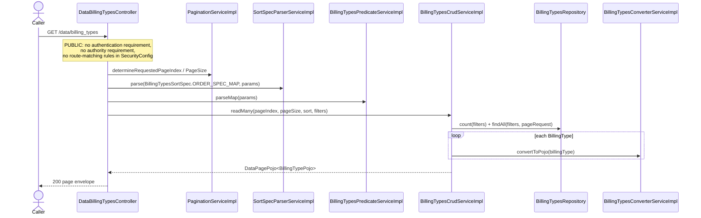
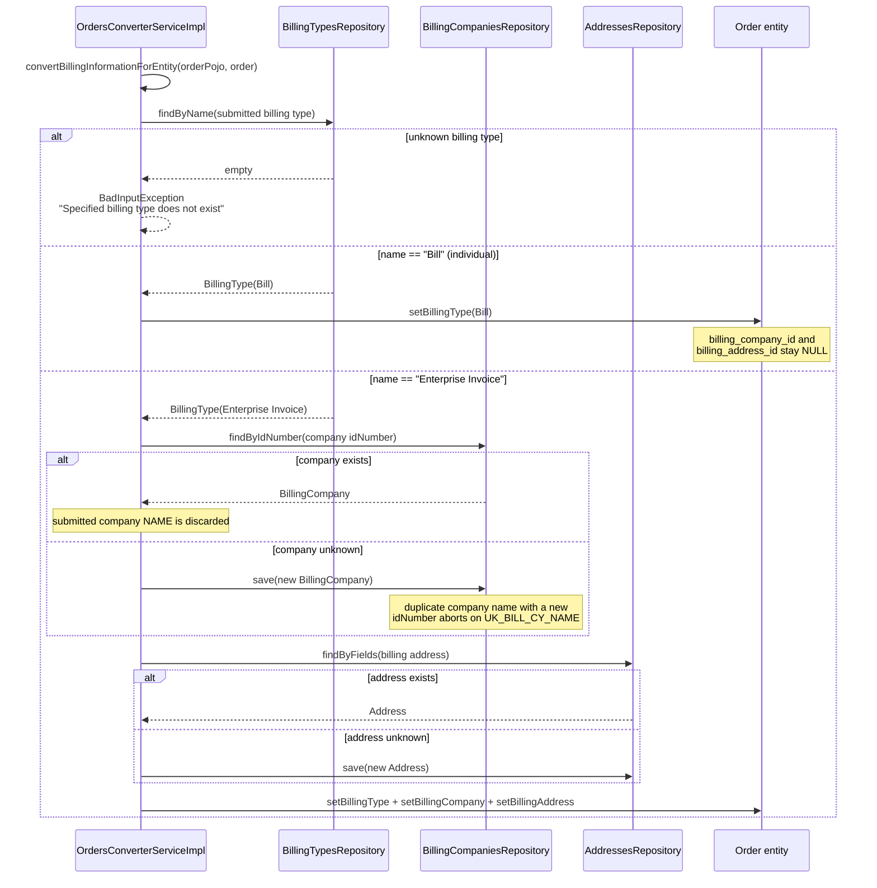
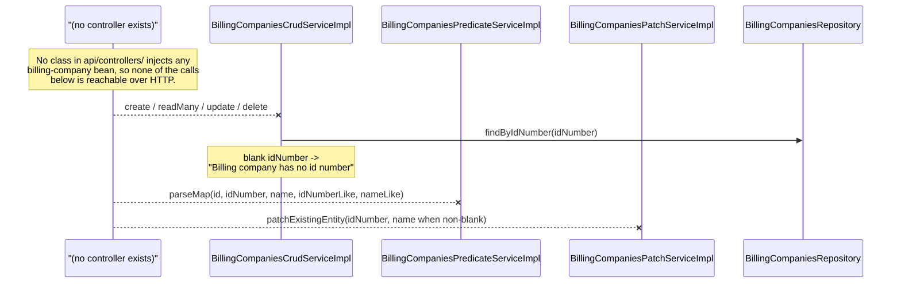

# Sequence diagrams — Billing (`billing`)

## Billing-type listing (`GET /data/billing_types`)

## Enterprise-invoice billing resolution during checkout

## Billing-company service stack (wired but unreachable)

