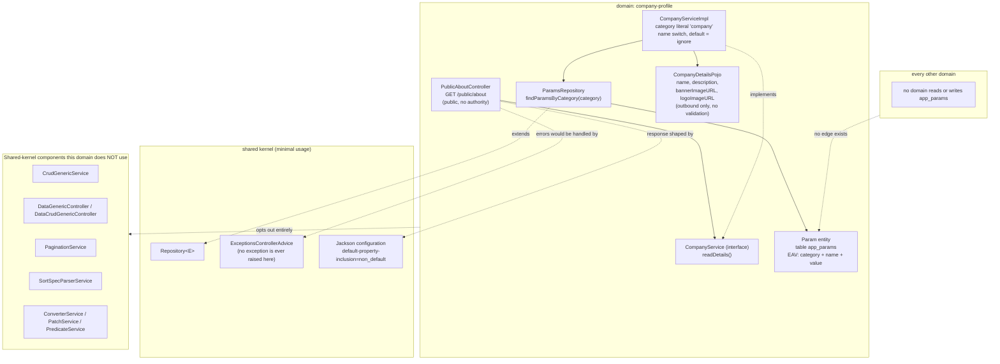

# Component diagram — Company Profile (`company-profile`)

## Edge summary

| Edge | Direction | Nature |
|---|---|---|
| `company-profile` → shared persistence | outbound | single category query |
| `company-profile` → Jackson configuration | outbound | response field omission behaviour |
| any domain → `company-profile` | — | **none** |
| `app_params` → any other table | — | **none**; no foreign key in either direction |

## Extraction notes

- This is the **lowest-risk extraction in the entire system**: one table, one
  entity, one repository method, one service, one controller, one outbound-only
  transport model, no shared entity, no foreign key, no consumer.
- It is also the only domain that does not inherit from the generic CRUD or
  generic controller base classes, so extracting it does not require untangling
  any framework inheritance.
- The absent write surface is the main design decision a rewrite must make. Two
  reasonable targets: keep the EAV table and add a guarded write route with a new
  authority code, or promote the four branding values to typed configuration and
  retire the table. The existing code supports neither; both are new work.
- Because nothing is cached and the endpoint is public and high-traffic, this is
  the first place a rewrite should introduce caching — but note that no caching
  pattern exists in the current system to follow.
