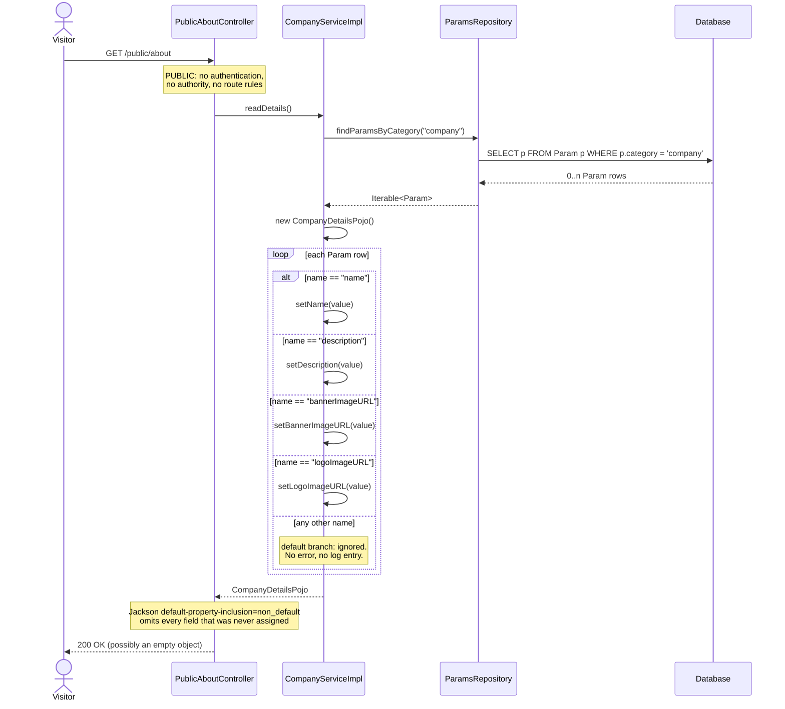
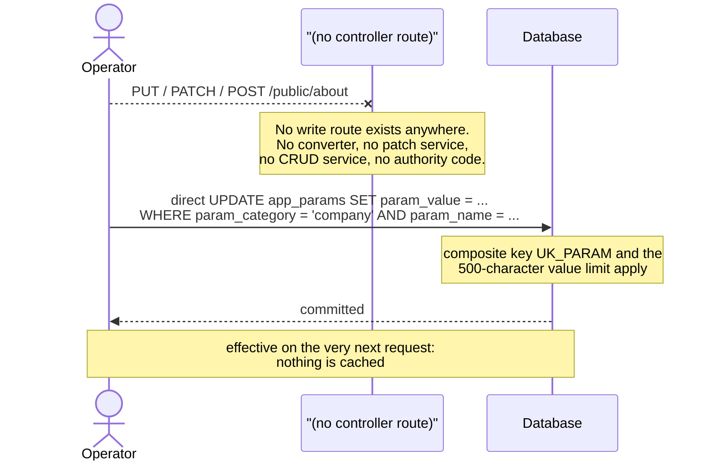

# Sequence diagrams — Company Profile (`company-profile`)

## Public company profile retrieval (`GET /public/about`)



## Degenerate cases

```mermaid
sequenceDiagram
    actor Visitor
    participant PublicAboutController
    participant CompanyServiceImpl
    participant ParamsRepository

    rect rgb(243,243,243)
    Note over Visitor,ParamsRepository: empty app_params table
    Visitor->>PublicAboutController: GET /public/about
    PublicAboutController->>CompanyServiceImpl: readDetails()
    CompanyServiceImpl->>ParamsRepository: findParamsByCategory("company")
    ParamsRepository-->>CompanyServiceImpl: empty iterable
    CompanyServiceImpl-->>PublicAboutController: untouched CompanyDetailsPojo
    PublicAboutController-->>Visitor: 200 OK {}
    end

    rect rgb(248,248,248)
    Note over Visitor,ParamsRepository: mis-keyed row (name = "logoImageUrl")
    Visitor->>PublicAboutController: GET /public/about
    PublicAboutController->>CompanyServiceImpl: readDetails()
    CompanyServiceImpl->>ParamsRepository: findParamsByCategory("company")
    ParamsRepository-->>CompanyServiceImpl: row with unrecognised name
    Note over CompanyServiceImpl: default branch swallows it;<br/>logoImageURL stays unset
    PublicAboutController-->>Visitor: 200 OK, logoImageURL key ABSENT
    end

    rect rgb(243,243,243)
    Note over Visitor,ParamsRepository: rows exist in another category
    Visitor->>PublicAboutController: GET /public/about
    PublicAboutController->>CompanyServiceImpl: readDetails()
    CompanyServiceImpl->>ParamsRepository: findParamsByCategory("company")
    Note over ParamsRepository: rows with category != 'company'<br/>are never selected and are inert
    ParamsRepository-->>CompanyServiceImpl: only 'company' rows
    PublicAboutController-->>Visitor: 200 OK
    end
```

## The absent write path


