# Component diagram — Customer (`customer`)

```mermaid
flowchart TB
    subgraph customer["domain: customer"]
        DataCustomersController["DataCustomersController<br/>GET POST PUT DELETE<br/>/data/customers, customers:*<br/>NO PATCH ROUTE"]
        CustomersCrudServiceImpl["CustomersCrudServiceImpl<br/>getExisting by person idNumber"]
        CustomersConverterServiceImpl["CustomersConverterServiceImpl<br/>PersonPojo &lt;-&gt; Customer"]
        CustomersPatchServiceImpl["CustomersPatchServiceImpl<br/>delegates 'person.' sub-map<br/>WIRED BUT UNREACHABLE"]
        CustomersPredicateServiceImpl["CustomersPredicateServiceImpl<br/>all keys traverse basePath.person"]
        CustomersSortSpec["CustomersSortSpec<br/>7 person-backed keys"]
        CustomersRepository["CustomersRepository<br/>findByPersonIdNumber (JOIN FETCH)"]
        Customer["Customer entity<br/>table customers<br/>one field: person"]

        DataCustomersController --> CustomersCrudServiceImpl
        DataCustomersController --> CustomersPredicateServiceImpl
        DataCustomersController --> CustomersSortSpec
        CustomersCrudServiceImpl --> CustomersConverterServiceImpl
        CustomersCrudServiceImpl --> CustomersPatchServiceImpl
        CustomersCrudServiceImpl --> CustomersRepository
        CustomersRepository --> Customer
    end

    subgraph kernel["shared kernel"]
        CrudGenericService["CrudGenericService"]
        DataCrudGenericController["DataCrudGenericController"]
        PaginationServiceImpl["PaginationServiceImpl"]
        SortSpecParserServiceImpl["SortSpecParserServiceImpl"]
        Utils["Utils.copyMapWithUnprefixedEntries<br/>(over-replaces the prefix)"]
        Constants["Constants<br/>PERSON_DATA_MAP_KEYS_PREFIX = 'person.'"]
        RepositoryBase["Repository&lt;E&gt;"]
    end

    CustomersCrudServiceImpl -.extends.-> CrudGenericService
    DataCustomersController -.extends.-> DataCrudGenericController
    DataCustomersController --> PaginationServiceImpl
    DataCustomersController --> SortSpecParserServiceImpl
    CustomersPatchServiceImpl --> Utils
    CustomersPatchServiceImpl --> Constants
    CustomersRepository -.extends.-> RepositoryBase

    subgraph person["domain: person"]
        PersonPojo["PersonPojo<br/>SHARED as the customer<br/>transport model"]
        PeoplePatchServiceImpl["PeoplePatchServiceImpl"]
        Person["Person entity<br/>table people"]
    end

    CustomersConverterServiceImpl --> PersonPojo
    DataCustomersController --> PersonPojo
    CustomersPatchServiceImpl --> PeoplePatchServiceImpl
    Customer -. "FK person_id<br/>NOT NULL + UNIQUE,<br/>one-to-one, cascade ALL, eager" .-> Person

    subgraph order["domain: order"]
        OrdersConverterServiceImpl["OrdersConverterServiceImpl"]
        Order["Order entity<br/>table orders"]
    end
    subgraph userdomain["domain: user"]
        RegistrationServiceImpl["RegistrationServiceImpl"]
        JwtGuestAuthenticationFilter["JwtGuestAuthenticationFilter"]
    end

    OrdersConverterServiceImpl -->|"clean service-level edge"| CustomersCrudServiceImpl
    RegistrationServiceImpl -->|"clean service-level edge"| CustomersCrudServiceImpl
    JwtGuestAuthenticationFilter -->|"clean service-level edge"| CustomersCrudServiceImpl
    Order -. "FK customer_id<br/>NOT NULL, no cascade" .-> Customer
```

## Edge summary

| Edge | Direction | Nature |
|---|---|---|
| `customer` → `person` | outbound | cascading one-to-one; shared transport model; nested patch delegation |
| `order` → `customer` | inbound | **service-level** call during checkout |
| `user` → `customer` | inbound | **service-level** calls from registration and guest authentication |
| `orders` → `customers` | inbound (data) | mandatory foreign key, no cascade; blocks customer deletion |
| `customer` → shared kernel | outbound | generic CRUD, pagination, sorting, prefix utility and its constant |

## Extraction notes

- **All three inbound edges are service-level.** This domain is unusually clean
  for extraction: no consumer touches its repository or its entity directly.
- **The outbound dependency on `person` is the hard part.** The cascading
  one-to-one means a customer and its person are written atomically today. If
  `person` becomes a separate service, customer creation becomes a two-step
  distributed operation and the atomicity guarantee in BR-CUSTOMER-003 is lost.
- **The shared transport model is a contract liability.** The customer API *is*
  the person API. Extracting `customer` without introducing a customer model
  means publishing the person schema as part of the customer service's contract,
  and any later change to person fields is a breaking change for customer
  clients.
- **The mandatory foreign key from `orders`** must become a reference by
  identifier or identification number if the databases are split, and the
  deletion rule (BR-CUSTOMER-015) must move from a database constraint into an
  explicit cross-service check.
