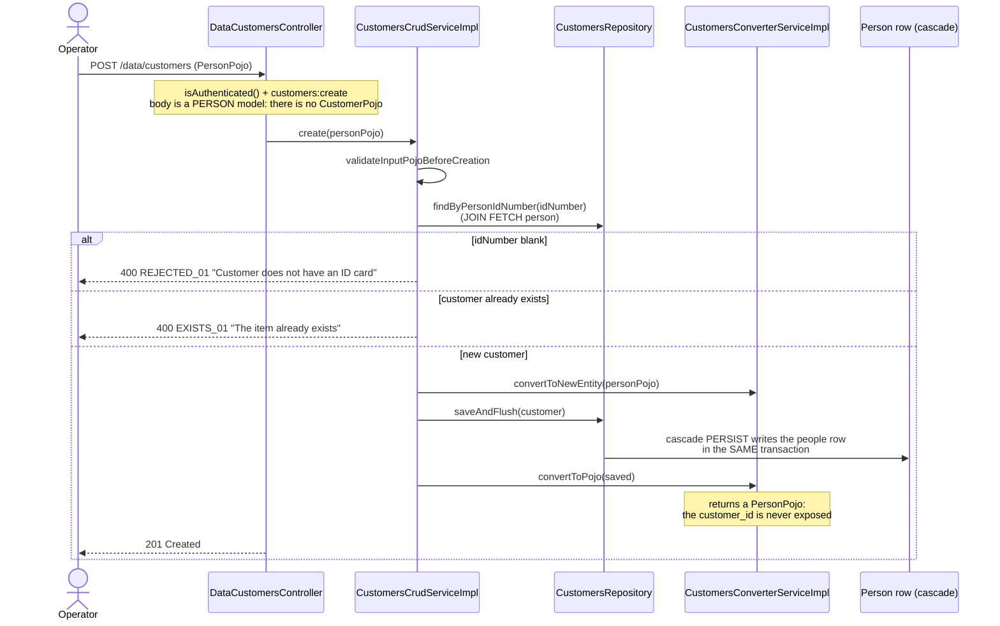
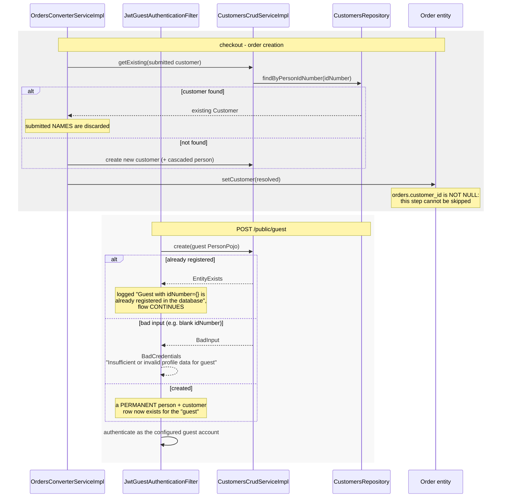

# Sequence diagrams — Customer (`customer`)

## Register a customer directly (`POST /data/customers`)



## Correct a customer's person data (`PUT /data/customers`) and the unreachable patch path

```mermaid
sequenceDiagram
    actor Operator
    participant DataCustomersController
    participant CustomersPredicateServiceImpl
    participant CustomersCrudServiceImpl
    participant CustomersPatchServiceImpl
    participant Utils
    participant PeoplePatchServiceImpl
    participant CustomersRepository

    Operator->>DataCustomersController: PUT /data/customers?idNumber=111111111<br/>(full PersonPojo)
    Note over DataCustomersController: authority customers:update.<br/>There is NO PATCH route: the patch service<br/>below is wired but unreachable, so every<br/>mandatory person field must be re-sent.
    alt request params empty
        DataCustomersController-->>Operator: 400 REJECTED_01 "Missing request params"
    end
    DataCustomersController->>CustomersPredicateServiceImpl: parseMap(requestParams)
    Note over CustomersPredicateServiceImpl: every condition traverses<br/>basePath.person
    DataCustomersController->>CustomersCrudServiceImpl: update(personPojo, filters)
    CustomersCrudServiceImpl->>CustomersRepository: count(filters)
    alt more than one match
        CustomersCrudServiceImpl-->>Operator: 500 "Cannot update more than one item at a time"
    end
    CustomersCrudServiceImpl->>CustomersRepository: findOne(filters)
    alt no match
        DataCustomersController-->>Operator: 404 NOTFOUND_01 "No element was found to update"
    else matched
        Note over CustomersCrudServiceImpl: FULL OVERWRITE: body becomes a new entity,<br/>existing id assigned, saveAndFlush
        rect rgb(255,245,245)
        Note over CustomersPatchServiceImpl,PeoplePatchServiceImpl: UNREACHABLE today - shown because the<br/>logic is implemented and wired as a bean
        CustomersCrudServiceImpl--xCustomersPatchServiceImpl: patchExistingEntity(changes, customer)
        CustomersPatchServiceImpl->>Utils: copyMapWithUnprefixedEntries(changes, "person.")
        Note over Utils: replaces EVERY occurrence of the prefix,<br/>not just the leading one (defect)
        alt sub-map empty
            Note over CustomersPatchServiceImpl: nested person untouched;<br/>the customer has no patchable field,<br/>so the whole patch is a no-op
        else sub-map non-empty
            CustomersPatchServiceImpl->>PeoplePatchServiceImpl: patchExistingEntity(subMap, person)
            Note over PeoplePatchServiceImpl: names / idNumber / email only when non-blank;<br/>phone1 / phone2 unconditionally
        end
        end
        CustomersCrudServiceImpl->>CustomersRepository: saveAndFlush(replacement)
        DataCustomersController-->>Operator: 204 No Content
    end
```

## Customer resolution at checkout and during guest authentication (cross-domain)


