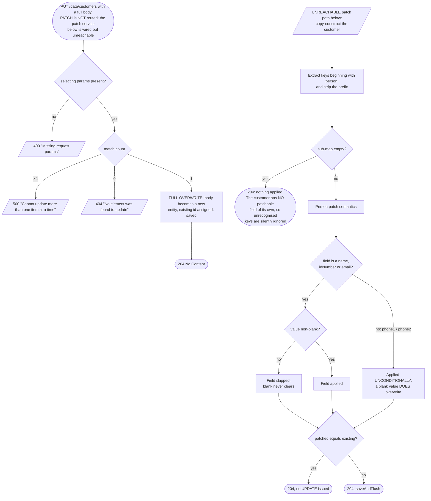
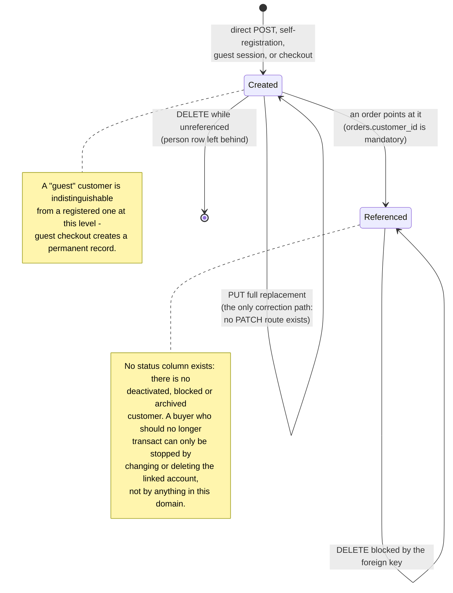

# Workflow diagram — Customer (`customer`)

## The three creation paths that converge on one service

```mermaid
flowchart TD
    A1[["Operator:<br/>POST /data/customers<br/>authority customers:create"]] --> Svc
    A2[["Visitor:<br/>POST /public/register<br/>PUBLIC - third write of<br/>a NON-transactional flow"]] --> Svc
    A3[["Visitor:<br/>POST /public/guest<br/>before a token is issued"]] --> Svc
    A4[["Checkout:<br/>POST /public/checkout<br/>via the order converter"]] --> Resolve

    Svc[CustomersCrudServiceImpl.create] --> Blank{idNumber blank?}
    Blank -- yes --> R1[/Bad input:<br/>"Customer does not have an ID card"<br/>guest path maps this to<br/>"Insufficient or invalid profile data for guest"/]
    Blank -- no --> Lookup[findByPersonIdNumber<br/>JOIN FETCH person]
    Lookup --> Exists{customer exists?}
    Exists -- yes --> R2[/Already exists:<br/>"The item already exists"/]
    Exists -- no --> Create[Convert + saveAndFlush;<br/>cascade writes the people row<br/>in the SAME transaction]
    Create --> Done([customer + person persisted])

    R2 --> Who{which caller?}
    Who -- "direct POST" --> Fail400[/400 EXISTS_01 returned/]
    Who -- "guest filter" --> Tolerate[Logged "Guest with idNumber={} is<br/>already registered", flow CONTINUES]
    Tolerate --> Done

    Resolve[OrdersConverterServiceImpl<br/>.convertCustomerInformationForEntity] --> RFound{getExisting hits?}
    RFound -- yes --> Reuse[Reuse the stored customer;<br/>SUBMITTED NAMES DISCARDED]
    RFound -- no --> Create
    Reuse --> Done
```

## Correction resolution: replacement is the only route, patching is unreachable



## Deletion reachability

```mermaid
flowchart LR
    Del([DELETE /data/customers]) --> Params{params empty?}
    Params -- yes --> Nothing([204, nothing deleted])
    Params -- no --> Count{match count}
    Count -- "0" --> NF[/404 "Requested item(s) not found"/]
    Count -- "&gt;= 1" --> Ref{any order references<br/>this customer?}
    Ref -- yes --> Blocked[/500 FK_ORDER_CUSTOM_ID violation.<br/>Because orders.customer_id is NOT NULL,<br/>ANY buyer with history is<br/>permanently undeletable./]
    Ref -- no --> Gone([204 customer removed;<br/>the people row SURVIVES as an orphan])
```

## Lifecycle


