# Component diagram — Image Registry (`image`)

```mermaid
flowchart TB
    subgraph image["domain: image"]
        DataImagesController["DataImagesController<br/>GET POST PUT PATCH DELETE /data/images"]
        ImagesCrudServiceImpl["ImagesCrudServiceImpl<br/>getExisting by filename"]
        ImagesConverterServiceImpl["ImagesConverterServiceImpl"]
        ImagesPatchServiceImpl["ImagesPatchServiceImpl"]
        ImagesPredicateServiceImpl["ImagesPredicateServiceImpl"]
        ImagesSortSpec["ImagesSortSpec"]
        ImagesRepository["ImagesRepository<br/>findByFilename"]
        Image["Image entity<br/>table images"]
        ImagePojo["ImagePojo"]

        DataImagesController --> ImagesCrudServiceImpl
        DataImagesController --> ImagesPredicateServiceImpl
        DataImagesController --> ImagesSortSpec
        ImagesCrudServiceImpl --> ImagesConverterServiceImpl
        ImagesCrudServiceImpl --> ImagesPatchServiceImpl
        ImagesCrudServiceImpl --> ImagesRepository
        ImagesRepository --> Image
        ImagesConverterServiceImpl --> ImagePojo
    end

    subgraph kernel["shared kernel"]
        CrudGenericService["CrudGenericService"]
        DataCrudGenericController["DataCrudGenericController"]
        PaginationServiceImpl["PaginationServiceImpl"]
        SortSpecParserServiceImpl["SortSpecParserServiceImpl"]
        RepositoryBase["Repository&lt;E&gt;"]
        ExceptionsControllerAdvice["ExceptionsControllerAdvice"]
    end

    ImagesCrudServiceImpl -.extends.-> CrudGenericService
    DataImagesController -.extends.-> DataCrudGenericController
    DataImagesController --> PaginationServiceImpl
    DataImagesController --> SortSpecParserServiceImpl
    ImagesRepository -.extends.-> RepositoryBase
    DataImagesController -.errors handled by.-> ExceptionsControllerAdvice

    subgraph product["domain: product"]
        ProductsCrudServiceImpl["ProductsCrudServiceImpl"]
        ProductImagesRepository["ProductImagesRepository"]
        ProductImage["ProductImage entity<br/>table product_images"]
    end

    ProductsCrudServiceImpl --> ImagesCrudServiceImpl
    ProductImagesRepository --> ProductImage
    ProductImage -. FK image_id .-> Image
```

## Edge summary

| Edge | Direction | Nature |
|---|---|---|
| `image` → shared kernel | outbound | generic CRUD, pagination, sorting, error envelope |
| `product` → `image` | inbound | service-level call to `getExisting` during image linking |
| `product_images` → `images` | inbound (data) | foreign key with no cascade; blocks image deletion |
| `image` → any other domain | — | none |

The `product_images` join entity deliberately lives in the `product` domain, not
here: its lifecycle is governed by the product aggregate (rows are deleted and
rebuilt wholesale when a product is updated), while `images` rows outlive any
individual product.
