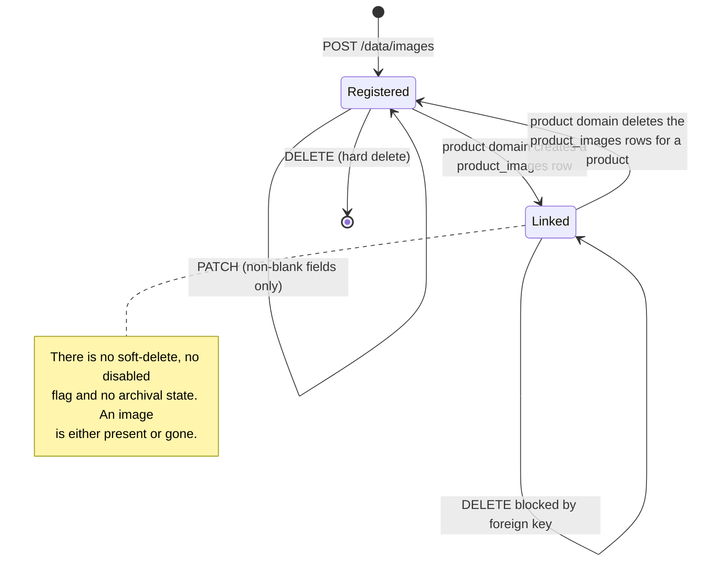

# Workflow diagram — Image Registry (`image`)

## Generic CRUD decision flow as applied to images

```mermaid
flowchart TD
    Start([Request on /data/images]) --> Verb{HTTP verb}

    Verb -- GET --> Page[Resolve pageIndex / pageSize]
    Page --> HasParams{params non-empty?}
    HasParams -- yes --> SortFilter[Resolve sortBy+order against<br/>code / filename / url<br/>and build filters]
    HasParams -- no --> Unfiltered[Unsorted, unfiltered page]
    SortFilter --> ShortCircuit{id, code or<br/>filename present?}
    ShortCircuit -- yes --> Single[Discard all other filters,<br/>match on that key alone]
    ShortCircuit -- no --> Multi[Combine remaining<br/>code / filename partial filters]
    Single --> Fetch
    Multi --> Fetch
    Unfiltered --> Fetch[count + findAll, convert each row]
    Fetch --> Envelope([200 page envelope])

    Verb -- POST --> NotBlank{code, filename, url<br/>all non-blank?}
    NotBlank -- no --> V1[/400 REJECTED_02 validation envelope/]
    NotBlank -- yes --> BlankFn{filename blank<br/>at service level?}
    BlankFn -- yes --> V2[/400 REJECTED_01 "Invalid filename"/]
    BlankFn -- no --> Exists{findByFilename<br/>returns a row?}
    Exists -- yes --> V3[/400 EXISTS_01 "The item already exists"/]
    Exists -- no --> Save[convertToNewEntity + saveAndFlush]
    Save --> DbUnique{code or url<br/>violates UNIQUE?}
    DbUnique -- yes --> V4[/500 infrastructure constraint error/]
    DbUnique -- no --> Created([201 created image])

    Verb -- "PUT / PATCH" --> ParamsEmpty{request params empty?}
    ParamsEmpty -- yes --> V5[/400 REJECTED_01 "Missing request params"/]
    ParamsEmpty -- no --> Count{match count}
    Count -- "> 1" --> V6[/500 "Cannot update more than one item at a time"/]
    Count -- "0" --> V7[/404 NOTFOUND_01 "No element was found to update"/]
    Count -- "1" --> Mode{verb}
    Mode -- PUT --> Overwrite[Convert body to new entity,<br/>assign existing id, save<br/>FULL overwrite]
    Mode -- PATCH --> Patch[Copy existing, apply only<br/>non-blank code / filename / url]
    Patch --> Equal{patched equals existing?}
    Equal -- yes --> NoWrite([204, no UPDATE issued])
    Equal -- no --> Overwrite
    Overwrite --> Updated([204 No Content])

    Verb -- DELETE --> DelEmpty{request params empty?}
    DelEmpty -- yes --> NoOp([204, nothing deleted<br/>no mass-delete path exists])
    DelEmpty -- no --> DelCount{match count}
    DelCount -- "0" --> V8[/404 NOTFOUND_01 "Requested item(s) not found"/]
    DelCount -- "&gt;= 1" --> DelAll[Delete every matching row]
    DelAll --> FkCheck{row referenced by<br/>product_images?}
    FkCheck -- yes --> V9[/500 foreign-key constraint error/]
    FkCheck -- no --> Deleted([204 No Content])
```

## Lifecycle


