# Component diagram — Order, Checkout & Fulfilment (`order`)

```mermaid
flowchart TB
    subgraph orderdomain["domain: order"]
        subgraph rest["REST surface"]
            DataOrdersController["DataOrdersController<br/>GET POST PUT PATCH DELETE /data/orders<br/>+ POST /confirmation /rejection /completion<br/>isAuthenticated + orders:*"]
            DataOrderStatusesController["DataOrderStatusesController<br/>GET /data/order_statuses<br/>order_statuses:read (READ ONLY)"]
            PublicCheckoutController["PublicCheckoutController<br/>POST /public/checkout (authority 'checkout')<br/>GET+POST /public/checkout/validate (PUBLIC)"]
            PublicReceiptController["PublicReceiptController<br/>GET /public/receipt/{token} (PUBLIC)"]
        end
        subgraph services["services"]
            CheckoutServiceImpl["CheckoutServiceImpl<br/>start + confirm + result URL"]
            OrdersProcessServiceImpl["OrdersProcessServiceImpl<br/>THE STATE MACHINE<br/>7 guarded transitions"]
            ReceiptServiceImpl["ReceiptServiceImpl"]
            OrdersCrudServiceImpl["OrdersCrudServiceImpl<br/>EDIT LOCK in flushPartialChanges<br/>readOne hydrates addresses + lines"]
            OrderStatusesCrudServiceImpl["OrderStatusesCrudServiceImpl"]
            OrdersConverterServiceImpl["OrdersConverterServiceImpl<br/>TAX_PERCENT = 0.19<br/>all monetary arithmetic<br/>server-side price authority"]
            AddressesConverterServiceImpl["AddressesConverterServiceImpl"]
            OrdersPatchServiceImpl["OrdersPatchServiceImpl<br/>date status paymentType shipper<br/>BYPASSES the state machine"]
            OrdersPredicateServiceImpl["OrdersPredicateServiceImpl<br/>id/buyOrder date statusName token"]
            OrdersSortSpec["OrdersSortSpec (9 keys)"]
        end
        subgraph data["owned data"]
            OrdersRepository["OrdersRepository<br/>findByTransactionToken<br/>findByIdWithDetails<br/>setStatus setTransactionToken"]
            OrderDetailsRepository["OrderDetailsRepository<br/>findBySellId"]
            OrderStatusesRepository["OrderStatusesRepository<br/>findByName"]
            AddressesRepository["AddressesRepository<br/>findByFields (all SIX columns)"]
            PaymentTypesRepository["PaymentTypesRepository<br/>findByName"]
            Order["Order - orders"]
            OrderDetail["OrderDetail - order_details"]
            OrderStatus["OrderStatus - order_statuses"]
            Address["Address - addresses<br/>NO controller, NO crud service"]
            PaymentType["PaymentType - payment_types<br/>NO controller, NO crud service"]
        end

        DataOrdersController --> OrdersCrudServiceImpl
        DataOrdersController --> OrdersProcessServiceImpl
        DataOrdersController --> OrdersPredicateServiceImpl
        DataOrdersController --> OrdersSortSpec
        DataOrderStatusesController --> OrderStatusesCrudServiceImpl
        PublicCheckoutController --> OrdersCrudServiceImpl
        PublicCheckoutController --> CheckoutServiceImpl
        PublicReceiptController --> ReceiptServiceImpl

        CheckoutServiceImpl --> OrdersProcessServiceImpl
        CheckoutServiceImpl --> OrdersCrudServiceImpl
        CheckoutServiceImpl --> OrdersPredicateServiceImpl
        OrdersProcessServiceImpl --> OrdersRepository
        OrdersProcessServiceImpl --> OrderDetailsRepository
        OrdersProcessServiceImpl --> OrderStatusesRepository
        OrdersProcessServiceImpl --> OrdersConverterServiceImpl
        OrdersCrudServiceImpl --> OrdersConverterServiceImpl
        OrdersCrudServiceImpl --> OrdersPatchServiceImpl
        OrdersCrudServiceImpl --> AddressesConverterServiceImpl
        OrdersCrudServiceImpl --> OrdersRepository
        OrdersConverterServiceImpl --> AddressesRepository
        OrdersConverterServiceImpl --> PaymentTypesRepository
        OrdersPatchServiceImpl --> OrderStatusesRepository
        OrdersPatchServiceImpl --> PaymentTypesRepository
        ReceiptServiceImpl --> OrdersRepository
        OrdersRepository --> Order
        OrderDetailsRepository --> OrderDetail
        OrderStatusesRepository --> OrderStatus
        AddressesRepository --> Address
        PaymentTypesRepository --> PaymentType
        Order -. "FK order_status_id<br/>NOT NULL, updatable=false" .-> OrderStatus
        Order -. "FK billing_address_id +<br/>shipping_address_id<br/>nullable, updatable=false" .-> Address
        Order -. "FK payment_type_id<br/>NOT NULL, updatable=false" .-> PaymentType
        OrderDetail -. "FK order_id<br/>insertable=false updatable=false" .-> Order
    end

    subgraph integrations["EXTERNAL INTEGRATIONS (only domain with any)"]
        WebpayplusPaymentServiceImpl["WebpayplusPaymentServiceImpl<br/>Transbank SDK, synchronous<br/>sandbox unless production=true<br/>NO retry, NO idempotency"]
        MailgunMailingServiceImpl["MailgunMailingServiceImpl<br/>Mailgun HTTP via Unirest<br/>profile-gated, OPTIONAL bean<br/>NO retry, NOT transactional"]
        Transbank[("Transbank Webpay Plus")]
        Mailgun[("Mailgun API")]
    end

    CheckoutServiceImpl --> WebpayplusPaymentServiceImpl
    WebpayplusPaymentServiceImpl --> Transbank
    Transbank -. "unauthenticated callbacks:<br/>GET token_ws / POST TBK_TOKEN" .-> PublicCheckoutController
    DataOrdersController --> MailgunMailingServiceImpl
    PublicCheckoutController --> MailgunMailingServiceImpl
    MailgunMailingServiceImpl --> Mailgun

    subgraph kernel["shared kernel"]
        CrudGenericService["CrudGenericService"]
        DataCrudGenericController["DataCrudGenericController"]
        PaginationServiceImpl["PaginationServiceImpl"]
        SortSpecParserServiceImpl["SortSpecParserServiceImpl"]
        ApiProperties["ApiProperties<br/>ableToEditOrdersAfterBeingProcessed"]
        Constants["Constants<br/>8 status names, 2 billing types,<br/>2 token header names,<br/>AUTHORITY_CHECKOUT"]
        ReceiptConverters["OrderEntity2ReceiptPojo +<br/>OrderDetailEntity2ReceiptDetailPojo"]
        ExceptionsControllerAdvice["ExceptionsControllerAdvice<br/>maps only 4 conditions"]
    end

    OrdersCrudServiceImpl -.extends.-> CrudGenericService
    DataOrdersController -.extends.-> DataCrudGenericController
    OrdersCrudServiceImpl --> ApiProperties
    OrdersProcessServiceImpl --> Constants
    OrdersConverterServiceImpl --> Constants
    ReceiptServiceImpl --> ReceiptConverters
    DataOrdersController --> PaginationServiceImpl
    DataOrdersController --> SortSpecParserServiceImpl

    subgraph consumed["consumed domains"]
        CustomersCrudServiceImpl["customer:<br/>CustomersCrudServiceImpl"]
        ProductsRepository["product:<br/>ProductsRepository"]
        BillingRepos["billing:<br/>BillingTypesRepository +<br/>BillingCompaniesRepository"]
        ShippersRepository["shipper:<br/>ShippersRepository"]
        Salesperson["salesperson:<br/>Salesperson entity"]
    end

    OrdersConverterServiceImpl -->|"service-level (clean)"| CustomersCrudServiceImpl
    OrdersConverterServiceImpl -->|"repository-level (LEAK)"| ProductsRepository
    OrdersConverterServiceImpl -->|"repository-level (LEAK)"| BillingRepos
    OrdersConverterServiceImpl -->|"repository-level (LEAK)"| ShippersRepository
    OrdersPatchServiceImpl -->|"repository-level (LEAK)"| ShippersRepository
    Order -. "FK salesperson_id, nullable,<br/>NEVER populated by any route" .-> Salesperson
```

## Edge summary

| Edge | Direction | Nature |
|---|---|---|
| `order` → Transbank | outbound external | synchronous SDK, no retry, no idempotency |
| Transbank → `order` | inbound external | **unauthenticated public callbacks** |
| `order` → Mailgun | outbound external | synchronous HTTP, optional, not transactional |
| `order` → `customer` | outbound | **service-level** (clean) |
| `order` → `product` | outbound | **repository-level** (leak) |
| `order` → `billing` | outbound | **repository-level** (leak) |
| `order` → `shipper` | outbound | **repository-level** (leak) |
| `order` → `salesperson` | outbound | modelled, never populated |
| any domain → `order` | — | **none** |

## Extraction notes

- **This domain is a pure consumer.** Nothing reads its data, so it can be
  extracted last with no risk to other domains — which is exactly why it sits at
  the end of the execution order.
- **Four of its five domain dependencies are repository-level.** Each needs a
  lookup contract before extraction: product by barcode (returning name and
  current price), billing type by name, billing company by identification number
  with create, and shipper by name.
- **The customer dependency is already clean** and needs no reshaping.
- **Addresses and payment types travel with this domain**, because nothing else
  reads them. They need no new contract, but note they have no API surface at all
  today, so a rewrite inherits two tables with no management capability.
- **The state machine, the tax arithmetic and the edit lock are the three pieces
  of real business logic** in the whole system. They must be ported
  behaviour-for-behaviour, including the integer truncation order and the
  name-based status comparison (or a deliberate switch to code-based comparison,
  which the source itself recommends).
- **The patch bypass (BR-ORDER-028) and the replacement gap (BR-ORDER-031) are
  integrity defects**, not features. Decide explicitly whether to reproduce them.
- **Callback security is the largest non-functional risk**: both validation
  routes are public with no signature or origin check, and replay protection is
  incidental.
