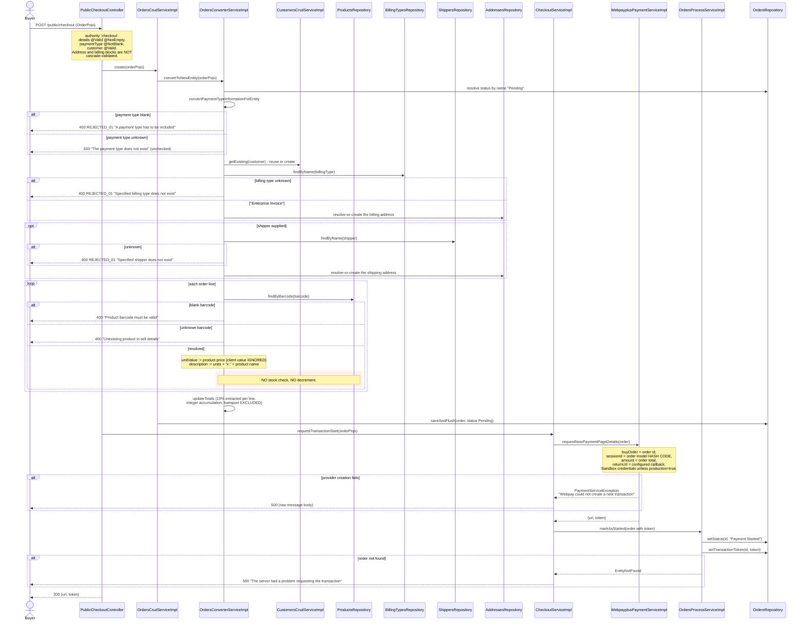
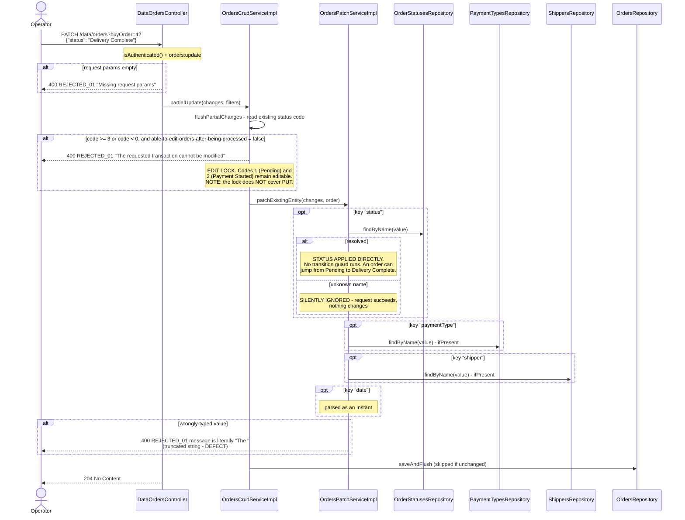
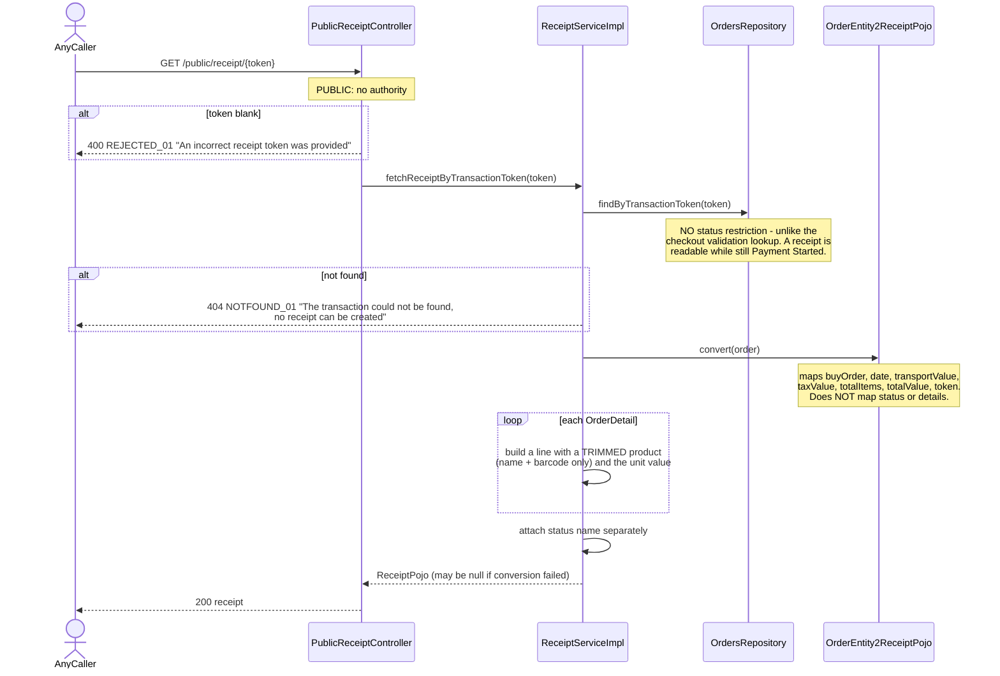

# Sequence diagrams — Order, Checkout & Fulfilment (`order`)

## Checkout: submit a cart and start a payment (`POST /public/checkout`)



## Payment confirmation callback (`GET /public/checkout/validate`)

```mermaid
sequenceDiagram
    participant Provider as Transbank (buyer's browser)
    participant PublicCheckoutController
    participant CheckoutServiceImpl
    participant OrdersPredicateServiceImpl
    participant OrdersCrudServiceImpl
    participant WebpayplusPaymentServiceImpl
    participant OrdersProcessServiceImpl
    participant MailgunMailingServiceImpl

    Provider->>PublicCheckoutController: GET /public/checkout/validate?token_ws=...
    Note over PublicCheckoutController: PUBLIC: no authority, no signature check,<br/>no provider-origin check, no idempotency key
    alt token_ws missing
        PublicCheckoutController-->>Provider: 400 REJECTED_01 "No transaction token was provided"
    end
    PublicCheckoutController->>CheckoutServiceImpl: confirmTransaction(token, wasAborted=false)
    CheckoutServiceImpl->>OrdersPredicateServiceImpl: parseMap{statusCode: "Payment Started", token: token}
    CheckoutServiceImpl->>OrdersCrudServiceImpl: readOne(predicate)
    alt no match (already confirmed, or unknown token)
        OrdersCrudServiceImpl-->>Provider: 404 NOTFOUND_01 "No sell matches the filtering conditions"
        Note over OrdersCrudServiceImpl: this status condition is the ONLY<br/>replay protection in the flow
    end
    CheckoutServiceImpl->>WebpayplusPaymentServiceImpl: requestPaymentResult(token)
    alt commit fails inside the adapter
        Note over WebpayplusPaymentServiceImpl: failure SWALLOWED - returns a non-zero code,<br/>so infrastructure trouble looks like a decline
    else transport failure
        WebpayplusPaymentServiceImpl-->>PublicCheckoutController: PaymentServiceException<br/>"Webpay failed to confirm the transaction"
        PublicCheckoutController-->>Provider: 500 (raw message); order STAYS Payment Started
    end
    WebpayplusPaymentServiceImpl-->>CheckoutServiceImpl: responseCode
    alt responseCode == 0
        CheckoutServiceImpl->>OrdersProcessServiceImpl: markAsPaid -> "Paid, Unconfirmed"<br/>(+ re-reads and attaches order lines)
    else responseCode != 0
        CheckoutServiceImpl->>OrdersProcessServiceImpl: markAsFailed -> "Payment Failed"
    end
    alt wrong current status
        OrdersProcessServiceImpl-->>CheckoutServiceImpl: BadInput "The transaction is not in<br/>a valid state for this api"
        CheckoutServiceImpl-->>Provider: 500 "Transaction could not be confirmed"<br/>(real state only logged)
    end
    opt mailing bean present
        PublicCheckoutController->>MailgunMailingServiceImpl: notifyOrderStatusToClient(order)
        Note over MailgunMailingServiceImpl: "Paid, Unconfirmed" -> customer payment template.<br/>Sent AFTER the transition is committed:<br/>a failure loses the mail, cannot roll back.
    end
    PublicCheckoutController-->>Provider: 303 See Other<br/>Location: browserRedirectionUrl + "?token=" + token
```

## Operator confirmation (`POST /data/orders/confirmation`)

```mermaid
sequenceDiagram
    actor Operator
    participant DataOrdersController
    participant OrdersProcessServiceImpl
    participant OrdersCrudServiceImpl
    participant OrderStatusesRepository
    participant OrdersRepository
    participant OrderDetailsRepository
    participant MailgunMailingServiceImpl

    Operator->>DataOrdersController: POST /data/orders/confirmation (OrderPojo)
    Note over DataOrdersController: isAuthenticated() + orders:update
    DataOrdersController->>OrdersProcessServiceImpl: markAsConfirmed(order)
    OrdersProcessServiceImpl->>OrdersCrudServiceImpl: getExisting(order) by buyOrder id
    alt no match (or buyOrder null)
        OrdersProcessServiceImpl-->>Operator: 404 NOTFOUND_01 "No transaction matches given input"
    end
    OrdersProcessServiceImpl->>OrdersProcessServiceImpl: current status must be "Paid, Unconfirmed"
    alt wrong state
        OrdersProcessServiceImpl-->>Operator: 400 REJECTED_01 "The transaction is not in<br/>a valid state for this api"
    end
    OrdersProcessServiceImpl->>OrderStatusesRepository: findByName("Paid, Confirmed")
    alt status row missing
        OrdersProcessServiceImpl-->>Operator: 500 "No status matches the 'Paid, Confirmed' name -<br/>Is the database empty or corrupt?"
    end
    OrdersProcessServiceImpl->>OrdersRepository: setStatus(id, status)
    Note over OrdersRepository: modifying update that CLEARS the<br/>persistence context - the status<br/>association is mapped updatable=false,<br/>so it cannot simply be assigned
    OrdersProcessServiceImpl->>OrdersRepository: getById(id) + convert
    alt conversion yields null
        OrdersProcessServiceImpl-->>Operator: 500 "Converter could not turn Sell<br/>into its Pojo equivalent"
    end
    OrdersProcessServiceImpl->>OrderDetailsRepository: findBySellId(id)
    Note over OrdersProcessServiceImpl: lines re-attached so notification<br/>templates have full detail
    opt mailing bean present
        DataOrdersController->>MailgunMailingServiceImpl: notifyOrderStatusToClient(order)
        DataOrdersController->>MailgunMailingServiceImpl: notifyOrderStatusToOwners(order)
        Note over MailgunMailingServiceImpl: confirmation is the ONLY route that<br/>notifies the owner; rejection and<br/>completion notify the customer only
    end
    DataOrdersController-->>Operator: 204 No Content
```

## The patch bypass of the status machine (`PATCH /data/orders`)



## Public receipt lookup (`GET /public/receipt/{token}`)


