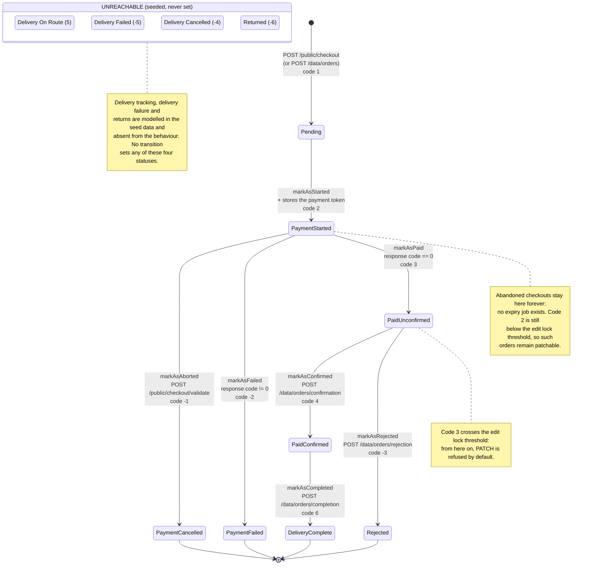
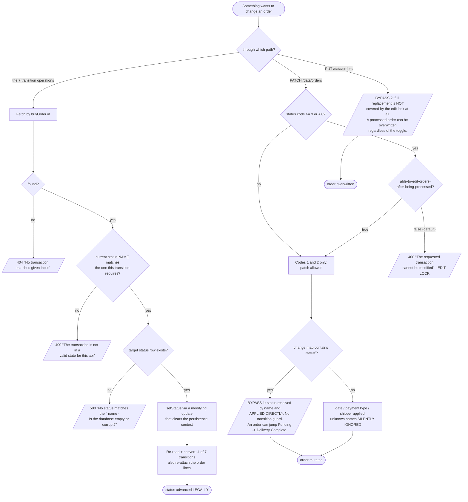
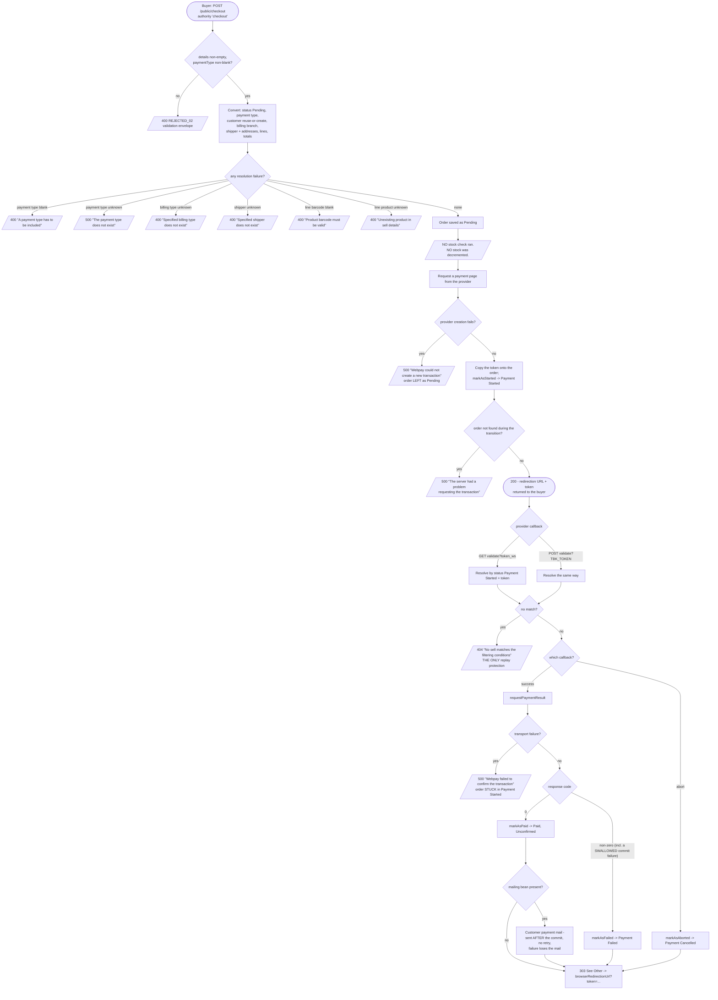
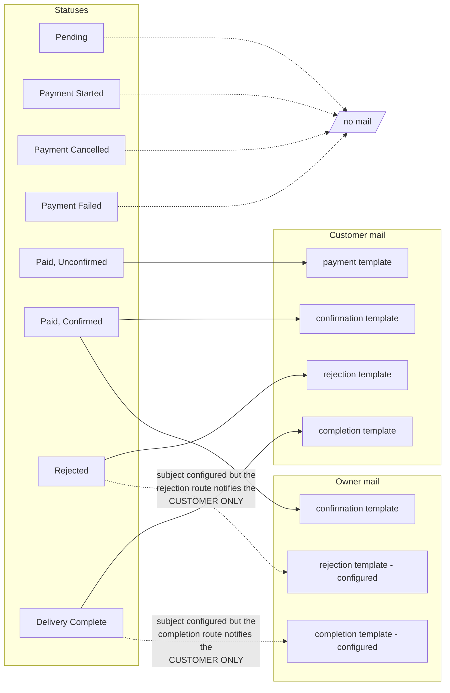

# Workflow diagram — Order, Checkout & Fulfilment (`order`)

## The order status machine



## Guards, the edit lock and the two bypasses



## Monetary calculation

```mermaid
flowchart TD
    Lines([Submitted order lines]) --> Per{for each line}
    Per --> Price[unitValue := product.price<br/>CLIENT VALUE DISCARDED]
    Price --> Desc[description := units + 'x ' + product.name]
    Desc --> Tax["unitTax = unitValue * 0.19<br/>(TAX IS EXTRACTED from a<br/>tax-INCLUSIVE unit value)"]
    Tax --> Net[unitNet = unitValue - unitTax]
    Net --> Acc["accumulate as int:<br/>taxesValue += unitTax * units<br/>netValue += unitNet * units<br/>totalItems += units"]
    Acc --> More{more lines?}
    More -- yes --> Per
    More -- no --> Total[totalValue = taxesValue + netValue]
    Total --> Transport[/transportValue is NOT added.<br/>It is NOT NULL, sortable, and set<br/>by NO code: always zero./]
    Transport --> Done([order totals stored as int(11):<br/>no decimal places anywhere])

    Done --> Warn[/Truncation order is LOAD-BEARING:<br/>a rewrite that accumulates in decimal<br/>and rounds at the end will produce<br/>DIFFERENT totals./]
```

## Checkout end to end, including the failure branches



## Notification matrix


