# Component diagram — Person Registry (`person`)

```mermaid
flowchart TB
    subgraph person["domain: person"]
        DataPeopleController["DataPeopleController<br/>GET /data/people"]
        PeopleCrudServiceImpl["PeopleCrudServiceImpl<br/>getExisting by idNumber"]
        PeopleConverterServiceImpl["PeopleConverterServiceImpl"]
        PeoplePatchServiceImpl["PeoplePatchServiceImpl"]
        PeoplePredicateServiceImpl["PeoplePredicateServiceImpl"]
        PeopleSortSpec["PeopleSortSpec"]
        PeopleRepository["PeopleRepository<br/>findByIdNumber"]
        Person["Person entity<br/>table people"]
        PersonPojo["PersonPojo"]

        DataPeopleController --> PeopleCrudServiceImpl
        DataPeopleController --> PeoplePredicateServiceImpl
        DataPeopleController --> PeopleSortSpec
        PeopleCrudServiceImpl --> PeopleConverterServiceImpl
        PeopleCrudServiceImpl --> PeoplePatchServiceImpl
        PeopleCrudServiceImpl --> PeopleRepository
        PeopleRepository --> Person
        PeopleConverterServiceImpl --> PersonPojo
    end

    subgraph kernel["shared kernel"]
        CrudGenericService["CrudGenericService"]
        DataGenericController["DataGenericController"]
        PaginationServiceImpl["PaginationServiceImpl"]
        SortSpecParserServiceImpl["SortSpecParserServiceImpl"]
        Utils["Utils.copyMapWithUnprefixedEntries"]
        RepositoryBase["Repository&lt;E&gt;"]
    end

    PeopleCrudServiceImpl -.extends.-> CrudGenericService
    DataPeopleController -.extends.-> DataGenericController
    DataPeopleController --> PaginationServiceImpl
    DataPeopleController --> SortSpecParserServiceImpl
    PeopleRepository -.extends.-> RepositoryBase

    subgraph user["domain: user"]
        RegistrationServiceImpl["RegistrationServiceImpl"]
        ProfileServiceImpl["ProfileServiceImpl"]
    end
    subgraph customer["domain: customer"]
        CustomersCrudServiceImpl["CustomersCrudServiceImpl"]
        CustomersPatchServiceImpl["CustomersPatchServiceImpl"]
    end
    subgraph salesperson["domain: salesperson"]
        SalespeopleCrudServiceImpl["SalespeopleCrudServiceImpl"]
        SalespeoplePatchServiceImpl["SalespeoplePatchServiceImpl"]
    end

    RegistrationServiceImpl --> PeopleRepository
    RegistrationServiceImpl --> PeopleConverterServiceImpl
    ProfileServiceImpl --> PeopleCrudServiceImpl
    ProfileServiceImpl --> PeoplePatchServiceImpl
    CustomersCrudServiceImpl --> Person
    CustomersPatchServiceImpl --> PeoplePatchServiceImpl
    CustomersPatchServiceImpl --> Utils
    SalespeopleCrudServiceImpl --> Person
    SalespeoplePatchServiceImpl --> PeoplePatchServiceImpl
```

## Edge summary

| Edge | Direction | Nature |
|---|---|---|
| `person` → shared kernel | outbound | inherits generic CRUD, pagination, sorting, persistence |
| `user` → `person` | inbound | registration and profile flows create/attach/patch persons |
| `customer` → `person` | inbound | cascaded person persistence, nested `person.` patching |
| `salesperson` → `person` | inbound | cascaded person persistence, nested `person.` patching |
| `person` → any other domain | — | none; this domain has no outbound domain dependency |
