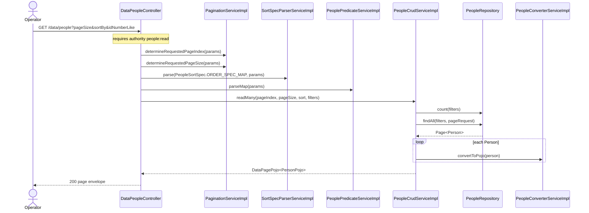
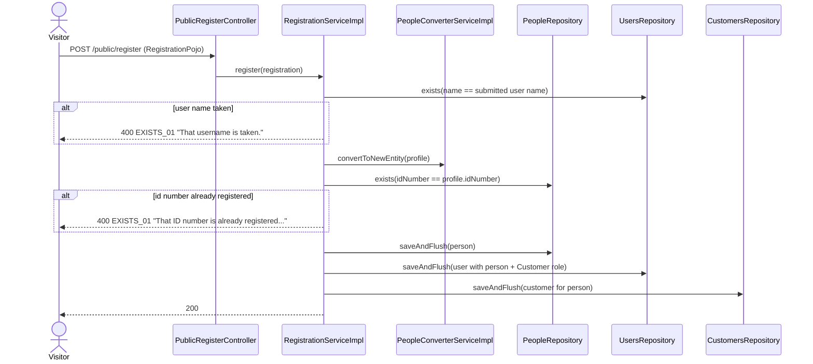
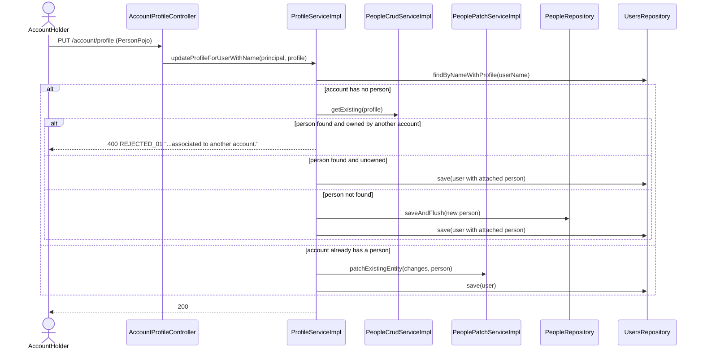

# Sequence diagrams — Person Registry (`person`)

## Paged person search (`GET /data/people`)

## Person de-duplication during account registration (cross-domain)

## Attaching or patching the person behind an account profile (cross-domain)

