# Component diagram — Product Category Tree (`product-category`)

```mermaid
flowchart TB
    subgraph prodcat["domain: product-category"]
        DataProductCategoriesController["DataProductCategoriesController<br/>GET POST PUT PATCH DELETE<br/>/data/product_categories"]
        ProductCategoriesCrudServiceImpl["ProductCategoriesCrudServiceImpl<br/>getExisting by code<br/>overrides flushPartialChanges<br/>to re-attach parent"]
        ProductCategoryTreeResolverServiceImpl["ProductCategoryTreeResolverServiceImpl<br/>getBranchesFromRoot<br/>getBranchIdsFromRootId<br/>getBranchIdsFromRootCode"]
        ProductCategoriesConverterServiceImpl["ProductCategoriesConverterServiceImpl"]
        ProductCategoriesPatchServiceImpl["ProductCategoriesPatchServiceImpl<br/>code + name only"]
        ProductCategoriesPredicateServiceImpl["ProductCategoriesPredicateServiceImpl<br/>id code name nameLike<br/>parentId parentCode rootId rootCode"]
        ProductCategoriesSortSpec["ProductCategoriesSortSpec<br/>(name, code)"]
        ProductsCategoriesRepository["ProductsCategoriesRepository<br/>findByCode findByName<br/>findByParent findIdsByParentId"]
        ProductCategory["ProductCategory entity<br/>table product_categories<br/>self-referencing parent"]
        ProductCategoryPojo["ProductCategoryPojo<br/>(self-referencing parent,<br/>not nested-validated)"]

        DataProductCategoriesController --> ProductCategoriesCrudServiceImpl
        DataProductCategoriesController --> ProductCategoriesPredicateServiceImpl
        DataProductCategoriesController --> ProductCategoriesSortSpec
        ProductCategoriesPredicateServiceImpl --> ProductCategoryTreeResolverServiceImpl
        ProductCategoryTreeResolverServiceImpl --> ProductsCategoriesRepository
        ProductCategoriesCrudServiceImpl --> ProductCategoriesConverterServiceImpl
        ProductCategoriesCrudServiceImpl --> ProductCategoriesPatchServiceImpl
        ProductCategoriesCrudServiceImpl --> ProductsCategoriesRepository
        ProductsCategoriesRepository --> ProductCategory
        ProductCategory -. "FK parent_product_category_id<br/>(self)" .-> ProductCategory
        ProductCategoriesConverterServiceImpl --> ProductCategoryPojo
    end

    subgraph kernel["shared kernel"]
        CrudGenericService["CrudGenericService"]
        DataCrudGenericController["DataCrudGenericController"]
        PaginationServiceImpl["PaginationServiceImpl"]
        SortSpecParserServiceImpl["SortSpecParserServiceImpl"]
        ApiProperties["ApiProperties<br/>maxCategoryFetchingRecursionDepth"]
        RepositoryBase["Repository&lt;E&gt;"]
    end

    ProductCategoriesCrudServiceImpl -.extends.-> CrudGenericService
    DataProductCategoriesController -.extends.-> DataCrudGenericController
    DataProductCategoriesController --> PaginationServiceImpl
    DataProductCategoriesController --> SortSpecParserServiceImpl
    ProductCategoryTreeResolverServiceImpl --> ApiProperties
    ProductsCategoriesRepository -.extends.-> RepositoryBase

    subgraph product["domain: product"]
        ProductsPredicateServiceImpl["ProductsPredicateServiceImpl"]
        ProductsRepository["ProductsRepository<br/>setProductCategoryById<br/>orphanizeByCategories (never called)"]
        ProductsPatchServiceImpl["ProductsPatchServiceImpl<br/>re-attaches existing category"]
        Product["Product entity<br/>table products"]
    end

    ProductsPredicateServiceImpl -->|"clean service-level edge"| ProductCategoryTreeResolverServiceImpl
    ProductsRepository -->|"data-level edge"| ProductCategory
    ProductsPatchServiceImpl --> Product
    Product -. "FK product_category_id<br/>(nullable, no cascade)" .-> ProductCategory
```

## Edge summary

| Edge | Direction | Nature |
|---|---|---|
| `product-category` → shared kernel | outbound | generic CRUD, pagination, sorting, recursion-depth configuration |
| `product` → `product-category` | inbound | **service-level** call to the tree resolver (the cleanest boundary in the system) |
| `products` → `product_categories` | inbound (data) | nullable foreign key, no cascade; blocks category deletion |
| internal: predicate service → tree resolver | internal | the `rootId` / `rootCode` keys reuse the same resolver that `product` consumes |
| `product-category` → any other domain | — | none |

## Extraction notes

- The tree resolver is already an interface-backed capability with no dependency
  on anything but its own repository and a configuration value, so it lifts out
  cleanly as a standalone classification service.
- The blocker is the physical foreign key from `products`. Splitting the
  databases means products must hold a category **code or identifier reference**
  rather than a constrained foreign key, and the orphaning operation (currently
  dead code) must become the real mechanism for category deletion.
- Both the parent-preservation override in the crud service and the absence of a
  `parent` key in the patch service must be preserved as explicit behaviour in a
  rewrite; they are the only things keeping the hierarchy intact under patching.
