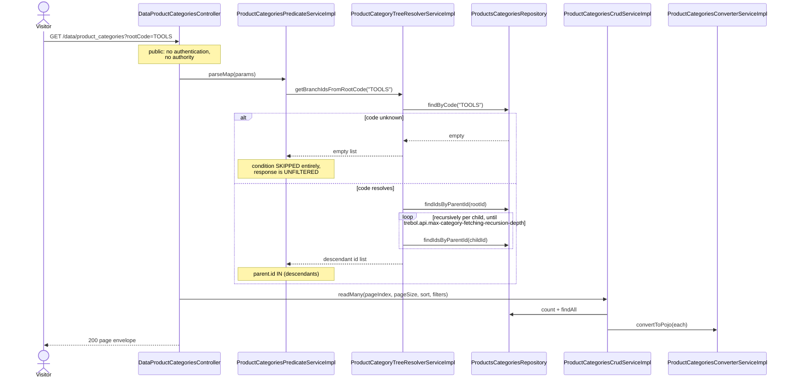
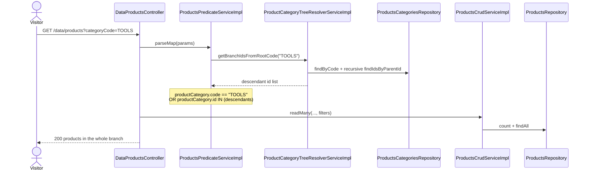

# Sequence diagrams — Product Category Tree (`product-category`)

## Whole-branch category browsing (`GET /data/product_categories?rootCode=...`)



## Patch a category with parent preservation (`PATCH /data/product_categories`)

```mermaid
sequenceDiagram
    actor Operator
    participant DataProductCategoriesController
    participant ProductCategoriesPredicateServiceImpl
    participant ProductCategoriesCrudServiceImpl
    participant ProductCategoriesPatchServiceImpl
    participant ProductsCategoriesRepository

    Operator->>DataProductCategoriesController: PATCH /data/product_categories?code=TOOLS (change map)
    Note over DataProductCategoriesController: authority product_categories:update
    alt request params empty
        DataProductCategoriesController-->>Operator: 400 REJECTED_01 "Missing request params"
    end
    DataProductCategoriesController->>ProductCategoriesPredicateServiceImpl: parseMap(requestParams)
    DataProductCategoriesController->>ProductCategoriesCrudServiceImpl: partialUpdate(changes, filters)
    ProductCategoriesCrudServiceImpl->>ProductsCategoriesRepository: count(filters)
    alt more than one match
        ProductCategoriesCrudServiceImpl-->>Operator: 500 "Cannot update more than one item at a time"
    end
    ProductCategoriesCrudServiceImpl->>ProductsCategoriesRepository: findOne(filters)
    alt no match
        DataProductCategoriesController-->>Operator: 404 NOTFOUND_01 "No element was found to update"
    else matched
        ProductCategoriesCrudServiceImpl->>ProductCategoriesPatchServiceImpl: patchExistingEntity(changes, category)
        Note over ProductCategoriesPatchServiceImpl: applies code and name only when<br/>non-blank; NO parent key exists
        ProductCategoriesPatchServiceImpl-->>ProductCategoriesCrudServiceImpl: patched copy
        ProductCategoriesCrudServiceImpl->>ProductCategoriesCrudServiceImpl: re-attach existingEntity.getParent()
        alt patched equals existing
            ProductCategoriesCrudServiceImpl-->>DataProductCategoriesController: existing, no write
        else changed
            ProductCategoriesCrudServiceImpl->>ProductsCategoriesRepository: saveAndFlush(patched)
        end
        DataProductCategoriesController-->>Operator: 204 No Content
    end
```

## Branch-aware product search (cross-domain, consumed by `product`)


