# Component diagram — Product List (`product-list`)

```mermaid
flowchart TB
    subgraph prodlist["domain: product-list"]
        subgraph lists["list management (generic framework)"]
            DataProductListsController["DataProductListsController<br/>GET POST PUT PATCH DELETE<br/>/data/product_lists<br/>GET is PUBLIC"]
            ProductListsCrudServiceImpl["ProductListsCrudServiceImpl<br/>getExisting by NAME<br/>overrides delete to clean up<br/>membership first"]
            ProductListConverterServiceImpl["ProductListConverterServiceImpl<br/>(singular impl, plural interface)"]
            ProductListPatchServiceImpl["ProductListPatchServiceImpl<br/>name + code only;<br/>disabled flag NOT patchable"]
            ProductListsPredicateServiceImpl["ProductListsPredicateServiceImpl<br/>name/listName code/listCode<br/>nameLike codeLike<br/>NO id key"]
            ProductListsSortSpec["ProductListsSortSpec<br/>name code totalCount<br/>(only aggregate sort key)"]
            ProductListsRepository["ProductListsRepository<br/>findByName"]
            ProductList["ProductList entity<br/>table product_lists<br/>code/name min length 2<br/>disabled flag (inert)"]
            ProductListPojo["ProductListPojo<br/>code @NotEmpty, name unvalidated,<br/>NO disabled field"]
        end
        subgraph contents["contents management (hand-written)"]
            DataProductListContentsController["DataProductListContentsController<br/>GET POST PUT DELETE<br/>/data/product_list_contents<br/>extends NO base class<br/>listCode REQUIRED on all four"]
            ProductListItemsConverterServiceImpl["ProductListItemsConverterServiceImpl<br/>item -> ProductPojo"]
            ProductListItemsPredicateServiceImpl["ProductListItemsPredicateServiceImpl<br/>listName listCode productName<br/>productCode *Like; null-map safe"]
            ProductListItemsSortSpec["ProductListItemsSortSpec<br/>name barcode (via product)"]
            ProductListItemsRepository["ProductListItemsRepository<br/>deleteByListId<br/>deleteByProductId (never called)"]
            ProductListItem["ProductListItem entity<br/>table product_list_items<br/>NO unique pair constraint<br/>both associations EAGER"]
        end

        DataProductListsController --> ProductListsCrudServiceImpl
        DataProductListsController --> ProductListsPredicateServiceImpl
        DataProductListsController --> ProductListsSortSpec
        ProductListsCrudServiceImpl --> ProductListConverterServiceImpl
        ProductListsCrudServiceImpl --> ProductListPatchServiceImpl
        ProductListsCrudServiceImpl --> ProductListsRepository
        ProductListsCrudServiceImpl -->|"pre-delete cleanup"| ProductListItemsRepository
        ProductListsRepository --> ProductList
        ProductListConverterServiceImpl --> ProductListPojo

        DataProductListContentsController --> ProductListsRepository
        DataProductListContentsController --> ProductListItemsRepository
        DataProductListContentsController --> ProductListItemsPredicateServiceImpl
        DataProductListContentsController --> ProductListItemsSortSpec
        DataProductListContentsController --> ProductListItemsConverterServiceImpl
        ProductListItemsRepository --> ProductListItem
        ProductListItem -. "FK product_list_id" .-> ProductList
    end

    subgraph kernel["shared kernel"]
        CrudGenericService["CrudGenericService"]
        DataCrudGenericController["DataCrudGenericController"]
        PaginationServiceImpl["PaginationServiceImpl"]
        SortSpecParserServiceImpl["SortSpecParserServiceImpl"]
        RepositoryBase["Repository&lt;E&gt;"]
        ExceptionsControllerAdvice["ExceptionsControllerAdvice"]
    end

    ProductListsCrudServiceImpl -.extends.-> CrudGenericService
    DataProductListsController -.extends.-> DataCrudGenericController
    DataProductListsController --> PaginationServiceImpl
    DataProductListsController --> SortSpecParserServiceImpl
    DataProductListContentsController --> PaginationServiceImpl
    DataProductListContentsController --> SortSpecParserServiceImpl
    ProductListsRepository -.extends.-> RepositoryBase
    ProductListItemsRepository -.extends.-> RepositoryBase
    DataProductListContentsController -.errors handled by.-> ExceptionsControllerAdvice

    subgraph product["domain: product"]
        ProductsCrudServiceImpl["ProductsCrudServiceImpl"]
        ProductPojo["ProductPojo<br/>REUSED as the contents<br/>request and response model"]
        Product["Product entity<br/>table products"]
    end

    DataProductListContentsController -->|"service-level edge made<br/>directly FROM a controller"| ProductsCrudServiceImpl
    DataProductListContentsController --> ProductPojo
    ProductListItemsConverterServiceImpl --> ProductPojo
    ProductListItem -. "FK product_id<br/>ON DELETE CASCADE:<br/>the ONLY cascade in the schema" .-> Product
```

## Edge summary

| Edge | Direction | Nature |
|---|---|---|
| `product-list` → `product` | outbound | **service-level** call to resolve a product, made from a controller |
| `product_list_items` → `products` | outbound (data) | `ON DELETE CASCADE` — product deletion silently shrinks lists |
| any domain → `product-list` | — | **none**; nothing consumes lists or membership |
| `product-list` → shared kernel | outbound | generic CRUD for lists only; the contents controller uses pagination and sorting but no base class |
| internal: list crud → item repository | internal | pre-delete membership cleanup |

## Two surfaces, two conventions

| Aspect | list management | contents management |
|---|---|---|
| base class | generic CRUD controller | **none** |
| selection | request parameter map → predicate | mandatory `listCode` + predicate |
| empty filter on delete | deletes **nothing** | empties the **whole list** |
| body validation | on create and replace | on add only, not on replace |
| transport model | own model | reuses the `product` model |
| authorities | three conventional codes | one code for all three writes |

Reproducing this domain faithfully means reproducing **both** conventions,
including the inverted delete semantics.

## Extraction notes

- **Zero inbound coupling** makes this a low-risk extraction: no other domain
  reads lists.
- **The outbound edge is already a service call**, so it survives a boundary
  unchanged in shape — but it is issued from a controller, so a rewrite should
  move it behind a service first.
- **The cascade must become explicit.** `ON DELETE CASCADE` on the membership
  table cannot survive a database split. The unused
  `deleteByProductId` repository method is the intended replacement and would
  have to be driven by a product-deleted notification — which does not exist,
  since the system publishes no events.
- **Decide the disabled flag's fate.** Three layers currently prevent it from
  working; either implement it (hide disabled lists from the public reads) or
  drop the column.
- **Fix or deliberately preserve the contents total count**, which today reports
  the list size rather than the filtered match count.
