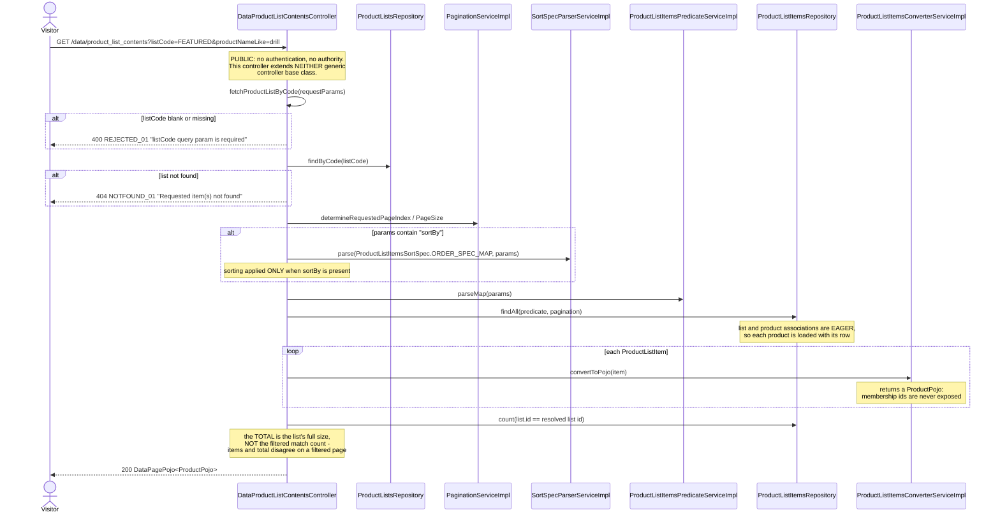
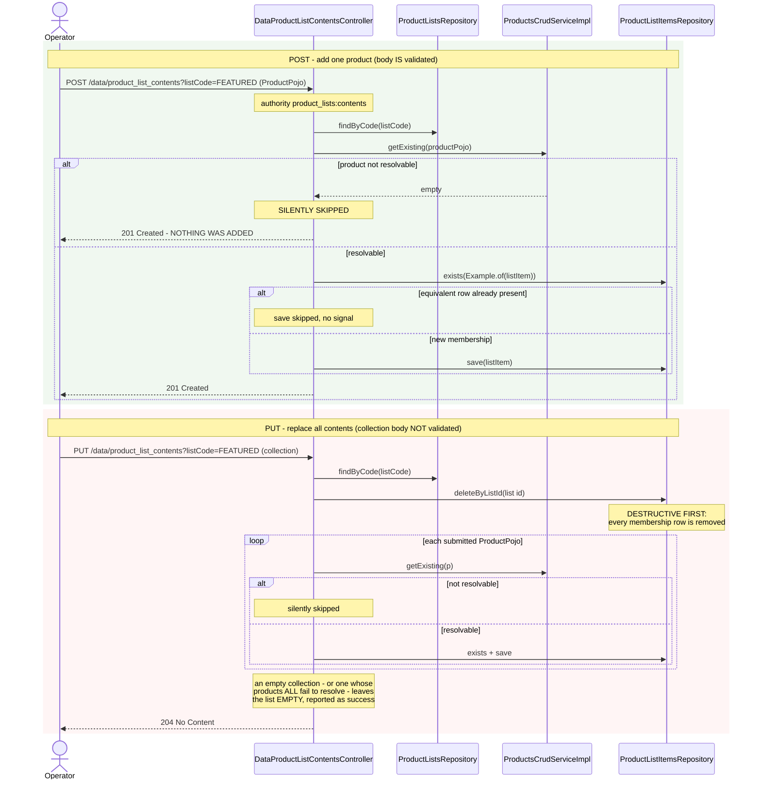
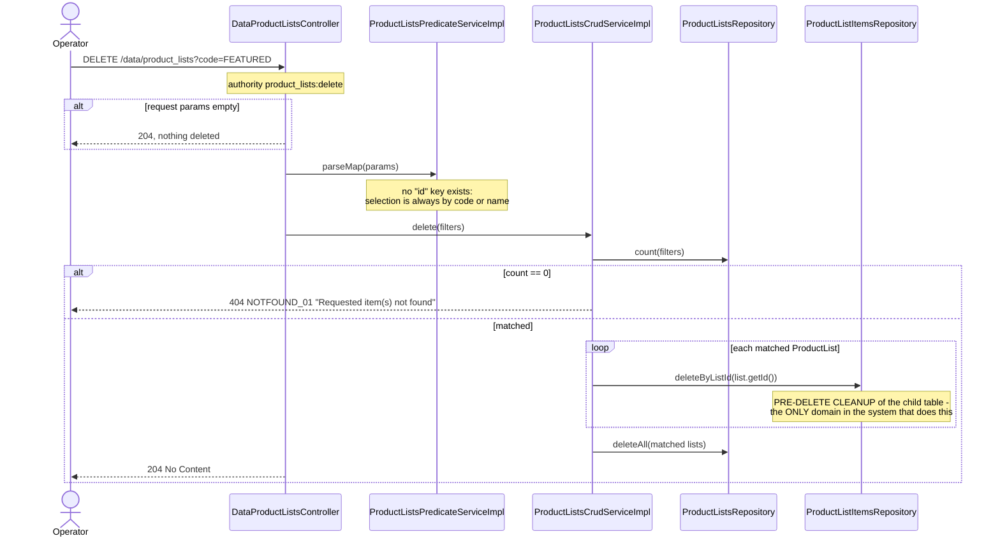
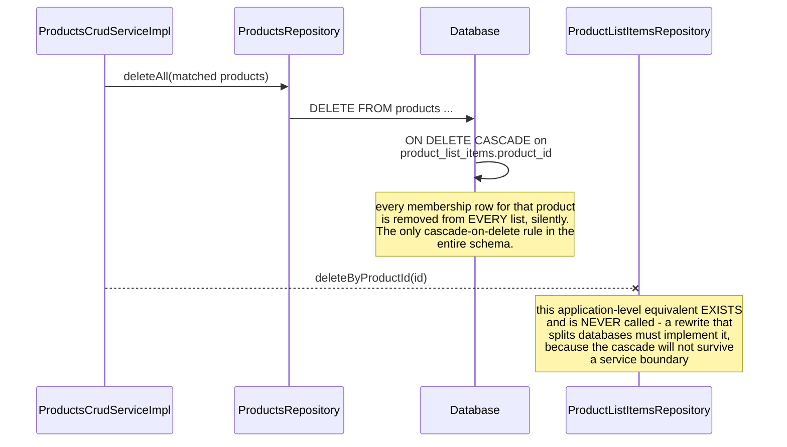

# Sequence diagrams — Product List (`product-list`)

## Browse a list's contents (`GET /data/product_list_contents?listCode=...`)

## Add one product versus replace all contents

## Delete a list with membership cleanup (`DELETE /data/product_lists`)

## Product deletion shrinking lists (cross-domain, database-driven)

