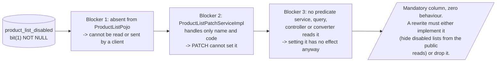

# Workflow diagram — Product List (`product-list`)

## Contents operations: one resolver, four very different outcomes

```mermaid
flowchart TD
    Start([Request on /data/product_list_contents]) --> Resolve[fetchProductListByCode]
    Resolve --> Blank{listCode blank or missing?}
    Blank -- yes --> E1[/400 REJECTED_01<br/>"listCode query param is required"/]
    Blank -- no --> Found{findByCode resolves?}
    Found -- no --> E2[/404 NOTFOUND_01<br/>"Requested item(s) not found"/]
    Found -- yes --> Verb{verb}

    Verb -- GET --> G1[Resolve pageIndex / pageSize]
    G1 --> G2{params contain 'sortBy'?}
    G2 -- yes --> G3[Apply sorting on<br/>product name / barcode]
    G2 -- no --> G4[Unsorted page]
    G3 --> G5
    G4 --> G5[Build the membership filter and fetch rows<br/>products loaded EAGERLY]
    G5 --> G6[Convert each row to a ProductPojo]
    G6 --> G7[/Total count = rows in the LIST,<br/>not rows matching the FILTER:<br/>items and total disagree/]
    G7 --> GOut([200 page of products])

    Verb -- POST --> P1[Validate the single product body:<br/>name, barcode non-blank; price non-null]
    P1 --> P2[Resolve the product by barcode<br/>via the product domain]
    P2 --> P3{resolvable?}
    P3 -- no --> P4[/201 Created - NOTHING ADDED.<br/>Silently skipped, no signal./]
    P3 -- yes --> P5{equivalent membership<br/>row already exists?}
    P5 -- yes --> P6([201, save skipped])
    P5 -- no --> P7[save the membership row]
    P7 --> P8([201 Created])

    Verb -- PUT --> U1[/Collection body is NOT validated/]
    U1 --> U2[deleteByListId:<br/>EVERY membership row removed FIRST]
    U2 --> U3{for each submitted product}
    U3 -- "not resolvable" --> U4[silently skipped]
    U3 -- "resolvable" --> U5[exists-check, then save]
    U4 --> U6{more?}
    U5 --> U6
    U6 -- yes --> U3
    U6 -- no --> U7{anything re-added?}
    U7 -- no --> U8[/204 - THE LIST IS NOW EMPTY.<br/>Happens for an empty collection OR<br/>when every product fails to resolve./]
    U7 -- yes --> U9([204 contents replaced])

    Verb -- DELETE --> D1[Build the membership filter<br/>from the same keys as GET]
    D1 --> D2{any product filter supplied?}
    D2 -- no --> D3[/Filter matches the WHOLE list:<br/>204, list emptied.<br/>INVERTED vs the generic CRUD delete,<br/>where an empty filter deletes nothing./]
    D2 -- yes --> D4([204, matching rows removed])
```

## List lifecycle and the inert disabled flag

```mermaid
stateDiagram-v2
    [*] --> Empty: POST /data/product_lists<br/>(code @NotEmpty, name guarded only<br/>by the service; both min length 2)
    Empty --> Populated: POST or PUT on<br/>/data/product_list_contents
    Populated --> Populated: PATCH renames / re-codes the list<br/>(membership and flag untouched)
    Populated --> Empty: PUT contents with an empty or<br/>wholly unresolvable collection
    Populated --> Empty: DELETE contents with only listCode
    Populated --> Shrinking: a product is deleted in the<br/>product domain (ON DELETE CASCADE)
    Shrinking --> Populated
    Populated --> [*]: DELETE /data/product_lists<br/>(membership cleaned up FIRST)
    Empty --> [*]: DELETE /data/product_lists

    note right of Populated
        disabled = true changes NOTHING:
        - no filter or query reads the flag
        - the flag is absent from ProductListPojo
        - the patch service cannot set it
        A disabled list stays fully readable
        through both PUBLIC endpoints.
    end note
```



## Why the disabled flag cannot work: three independent blockers



## Deletion responsibilities compared

```mermaid
flowchart TD
    subgraph ThisDomain["Deleting a LIST - application-level cleanup"]
        L1[DELETE /data/product_lists] --> L2{match count}
        L2 -- "0" --> L3[/404 "Requested item(s) not found"/]
        L2 -- "&gt;= 1" --> L4[For each matched list:<br/>deleteByListId on the membership table]
        L4 --> L5[Then delete the list rows]
        L5 --> L6([204 - the ONLY pre-delete child<br/>cleanup in the whole system])
    end
    subgraph OtherDomain["Deleting a PRODUCT - database-level cascade"]
        P1[DELETE /data/products] --> P2[products row removed]
        P2 --> P3[ON DELETE CASCADE fires on<br/>product_list_items.product_id]
        P3 --> P4([membership rows vanish from every list,<br/>silently, with no application code involved])
        P2 -. "deleteByProductId exists<br/>and is NEVER called" .-> P5[/dead code duplicating<br/>the cascade/]
    end
```
