# Component diagram — Product Catalog (`product`)

```mermaid
flowchart TB
    subgraph product["domain: product"]
        DataProductsController["DataProductsController<br/>GET POST PUT PATCH DELETE<br/>/data/products<br/>GET is PUBLIC"]
        ProductsCrudServiceImpl["ProductsCrudServiceImpl<br/>overrides create, update(id),<br/>readOne and getExisting<br/>(largest crud impl)"]
        ProductsConverterServiceImpl["ProductsConverterServiceImpl"]
        ProductsPatchServiceImpl["ProductsPatchServiceImpl<br/>re-attaches the existing category;<br/>images NOT patchable"]
        ProductsPredicateServiceImpl["ProductsPredicateServiceImpl<br/>id barcode name *Like<br/>categoryCode categoryCodeLike"]
        ProductsSortSpec["ProductsSortSpec<br/>name barcode price category"]
        ProductsRepository["ProductsRepository<br/>findByBarcode<br/>setProductCategoryById (dead)<br/>orphanizeByCategories (dead)<br/>deepReadAll (predicate ignored)"]
        ProductImagesRepository["ProductImagesRepository<br/>findByProductId<br/>deepFindProductImagesByProductId<br/>deleteByProductId"]
        Product["Product entity<br/>table products<br/>field 'barcode' -> column 'product_code'"]
        ProductImage["ProductImage entity<br/>table product_images<br/>NO unique pair constraint"]
        ProductPojo["ProductPojo<br/>stock fields unconstrained;<br/>category and images not<br/>nested-validated"]

        DataProductsController --> ProductsCrudServiceImpl
        DataProductsController --> ProductsPredicateServiceImpl
        DataProductsController --> ProductsSortSpec
        ProductsCrudServiceImpl --> ProductsConverterServiceImpl
        ProductsCrudServiceImpl --> ProductsPatchServiceImpl
        ProductsCrudServiceImpl --> ProductsRepository
        ProductsCrudServiceImpl --> ProductImagesRepository
        ProductsRepository --> Product
        ProductImagesRepository --> ProductImage
        ProductImage -. "FK product_id<br/>no cascade: BLOCKS product delete" .-> Product
        ProductsConverterServiceImpl --> ProductPojo
    end

    subgraph kernel["shared kernel"]
        CrudGenericService["CrudGenericService"]
        DataCrudGenericController["DataCrudGenericController"]
        PaginationServiceImpl["PaginationServiceImpl"]
        SortSpecParserServiceImpl["SortSpecParserServiceImpl"]
        RepositoryBase["Repository&lt;E&gt;"]
        ExceptionsControllerAdvice["ExceptionsControllerAdvice"]
    end

    ProductsCrudServiceImpl -.extends.-> CrudGenericService
    DataProductsController -.extends.-> DataCrudGenericController
    DataProductsController --> PaginationServiceImpl
    DataProductsController --> SortSpecParserServiceImpl
    ProductsRepository -.extends.-> RepositoryBase
    ProductImagesRepository -.extends.-> RepositoryBase
    DataProductsController -.errors handled by.-> ExceptionsControllerAdvice

    subgraph image["domain: image"]
        ImagesCrudServiceImpl["ImagesCrudServiceImpl"]
        Image["Image entity<br/>table images"]
    end
    subgraph prodcat["domain: product-category"]
        ProductCategoryTreeResolverServiceImpl["ProductCategoryTreeResolverServiceImpl"]
        ProductCategory["ProductCategory entity<br/>table product_categories"]
    end

    ProductsCrudServiceImpl -->|"clean service-level edge"| ImagesCrudServiceImpl
    ProductsPredicateServiceImpl -->|"clean service-level edge"| ProductCategoryTreeResolverServiceImpl
    ProductsRepository -. "dead-code helpers reach<br/>the category entity directly" .-> ProductCategory
    ProductImage -. "FK image_id<br/>no cascade: BLOCKS image delete" .-> Image
    Product -. "FK product_category_id<br/>nullable, no cascade:<br/>BLOCKS category delete" .-> ProductCategory

    subgraph order["domain: order"]
        OrdersConverterServiceImpl["OrdersConverterServiceImpl"]
        OrderDetail["OrderDetail entity<br/>table order_details"]
    end
    subgraph prodlist["domain: product-list"]
        DataProductListContentsController["DataProductListContentsController"]
        ProductListItem["ProductListItem entity<br/>table product_list_items"]
    end

    OrdersConverterServiceImpl -->|"boundary leak:<br/>direct repository call;<br/>copies price onto the line"| ProductsRepository
    DataProductListContentsController -->|"clean service-level edge"| ProductsCrudServiceImpl
    OrderDetail -. "FK product_id<br/>ON DELETE SET NULL:<br/>history survives" .-> Product
    ProductListItem -. "FK product_id<br/>ON DELETE CASCADE:<br/>silently de-listed" .-> Product
```

## Edge summary

| Edge | Direction | Nature |
|---|---|---|
| `product` → `image` | outbound | **service-level** call during image linking |
| `product` → `product-category` | outbound | **service-level** call to the tree resolver; plus two dead repository helpers |
| `order` → `product` | inbound | **direct repository access**; copies the current price onto the order line |
| `product-list` → `product` | inbound | **service-level** call to resolve a product |
| `product` → shared kernel | outbound | generic CRUD with four overridden extension points, pagination, sorting |

## Referential behaviour on delete — three different rules

| Referencing table | Rule | Effect of deleting a product |
|---|---|---|
| `product_images` | no cascade | **delete is blocked** by the constraint |
| `order_details` | `ON DELETE SET NULL` | the line's product reference is nulled; description and unit value survive |
| `product_list_items` | `ON DELETE CASCADE` | the product is silently removed from every list |

The inconsistency is deliberate in the DDL and must be reproduced consciously: a
rewrite that applies one uniform rule changes behaviour in two of the three
cases.

## Extraction notes

- **Outbound coupling is already clean**, so `product` can keep calling `image`
  and `product-category` across a service boundary with no change in shape.
- **The inbound order edge is the work item.** The order converter needs a
  product-lookup contract returning barcode, name and current price; the
  price-copy-at-creation behaviour (which gives order history price stability)
  must be preserved.
- **Three foreign keys cross the proposed boundary** (`order_details`,
  `product_list_items`, `product_images` — the last one internal). Splitting the
  databases means re-expressing the set-null and cascade rules as explicit
  application behaviour.
- **Decide the stock question first.** If a rewrite introduces availability
  checking or stock decrement, that logic belongs here and the order domain needs
  a reservation or decrement call — a new contract, not a port.
- **Clean up or keep the dead code deliberately**: `orphanizeByCategories` is the
  missing half of safe category deletion, and the filtered deep query is broken
  (BR-PRODUCT-032).
