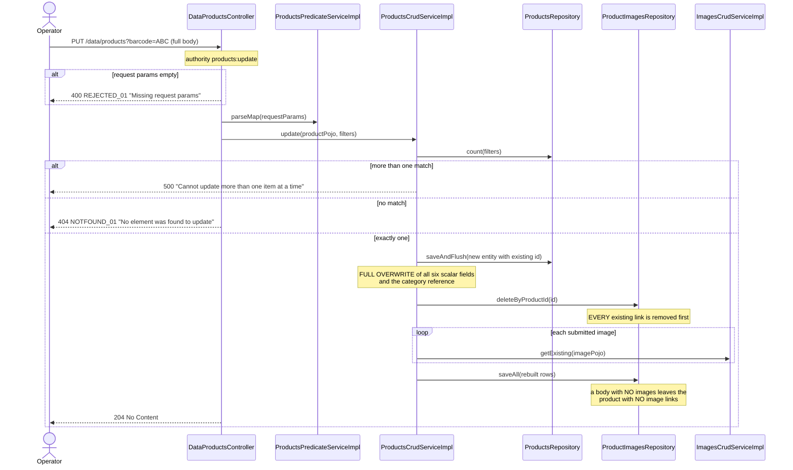
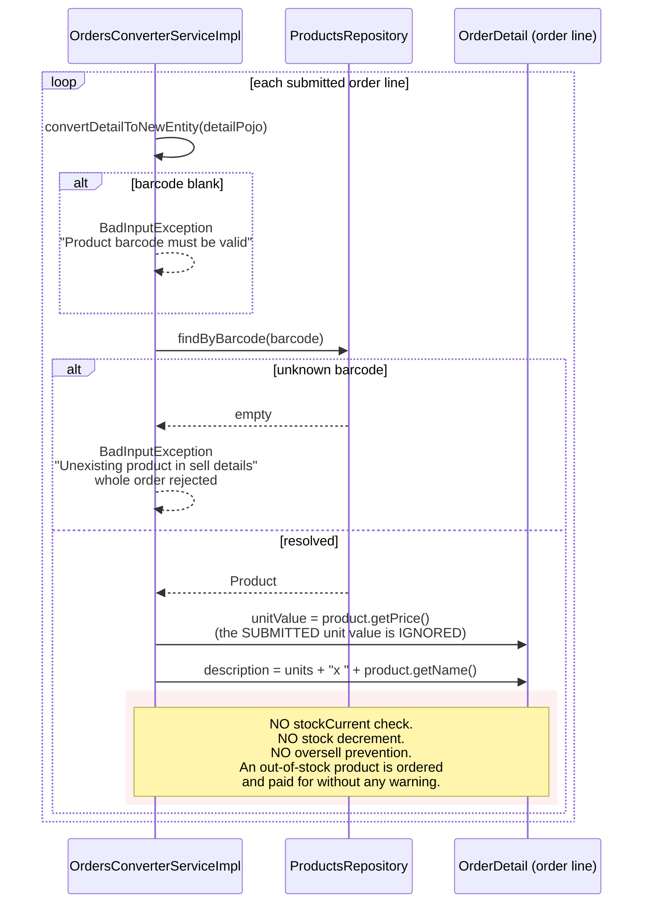

# Sequence diagrams — Product Catalog (`product`)

## Create a product with tolerant image linking (`POST /data/products`)

```mermaid
sequenceDiagram
    actor Operator
    participant DataProductsController
    participant ProductsCrudServiceImpl
    participant ProductsRepository
    participant ProductsConverterServiceImpl
    participant ImagesCrudServiceImpl
    participant ProductImagesRepository

    Operator->>DataProductsController: POST /data/products (ProductPojo + images)
    Note over DataProductsController: authority products:create.<br/>name, barcode @NotBlank; price @NotNull;<br/>stock fields UNCONSTRAINED
    DataProductsController->>ProductsCrudServiceImpl: create(productPojo)
    ProductsCrudServiceImpl->>ProductsCrudServiceImpl: validateInputPojoBeforeCreation
    ProductsCrudServiceImpl->>ProductsRepository: findByBarcode(barcode)
    alt barcode blank
        ProductsCrudServiceImpl-->>Operator: 400 REJECTED_01 "Invalid product barcode"
    else product exists
        ProductsCrudServiceImpl-->>Operator: 400 EXISTS_01 "The item already exists"
    end
    ProductsCrudServiceImpl->>ProductsConverterServiceImpl: convertToNewEntity(pojo)
    ProductsCrudServiceImpl->>ProductsRepository: saveAndFlush(product)
    Note over ProductsRepository: a duplicate NAME with a new barcode<br/>fails HERE on UK_PRODUCT_NAME

    ProductsCrudServiceImpl->>ProductsCrudServiceImpl: makeProductImageRelationships(product, images)
    loop each submitted ImagePojo
        ProductsCrudServiceImpl->>ImagesCrudServiceImpl: getExisting(imagePojo)
        alt filename blank
            ImagesCrudServiceImpl-->>ProductsCrudServiceImpl: BadInputException "Invalid filename"
            Note over ProductsCrudServiceImpl: CAUGHT, logged at debug:<br/>"An image was not linked to product<br/>with barcode '{}'" - loop continues.<br/>Client is never told.
        else found
            ImagesCrudServiceImpl-->>ProductsCrudServiceImpl: stored Image
        else valid but unknown
            ImagesCrudServiceImpl-->>ProductsCrudServiceImpl: empty
            Note over ProductsCrudServiceImpl: builds an UNSAVED placeholder Image<br/>from the submitted fields, bypassing<br/>the image domain's own validation
        end
    end
    ProductsCrudServiceImpl->>ProductImagesRepository: saveAll(ProductImage rows)
    Note over ProductImagesRepository: no unique constraint on<br/>(image_id, product_id): duplicates allowed
    ProductsCrudServiceImpl->>ProductsConverterServiceImpl: convertToPojo(saved)
    DataProductsController-->>Operator: 201 Created
```

## Replace a product and rebuild its image links (`PUT /data/products`)



## Branch-aware public search and single-item read

```mermaid
sequenceDiagram
    actor Visitor
    participant DataProductsController
    participant ProductsPredicateServiceImpl
    participant ProductCategoryTreeResolverServiceImpl
    participant ProductsCrudServiceImpl
    participant ProductsRepository
    participant ProductImagesRepository

    Visitor->>DataProductsController: GET /data/products?categoryCode=TOOLS
    Note over DataProductsController: PUBLIC: no authentication, no authority.<br/>products:read exists and is granted<br/>but is NEVER checked.
    DataProductsController->>ProductsPredicateServiceImpl: parseMap(params)
    ProductsPredicateServiceImpl->>ProductCategoryTreeResolverServiceImpl: getBranchIdsFromRootCode("TOOLS")
    ProductCategoryTreeResolverServiceImpl-->>ProductsPredicateServiceImpl: descendant category ids<br/>(bounded by max-category-fetching-recursion-depth)
    Note over ProductsPredicateServiceImpl: productCategory.code == "TOOLS"<br/>OR productCategory.id IN (descendants)
    DataProductsController->>ProductsCrudServiceImpl: readMany(pageIndex, pageSize, sort, filters)
    ProductsCrudServiceImpl->>ProductsRepository: count + findAll
    Note over ProductsCrudServiceImpl: the PAGED path does NOT join-fetch<br/>image links; stock and price ARE<br/>returned to anonymous callers
    DataProductsController-->>Visitor: 200 page envelope

    rect rgb(243,243,243)
    Note over ProductsCrudServiceImpl,ProductImagesRepository: single-item read (overridden)
    ProductsCrudServiceImpl->>ProductsRepository: findOne(filters)
    ProductsCrudServiceImpl->>ProductImagesRepository: deepFindProductImagesByProductId(id)
    Note over ProductImagesRepository: JOIN FETCH image: only THIS path<br/>populates the product's image list
    end
```

## Product resolution at checkout — with no stock check (cross-domain)


