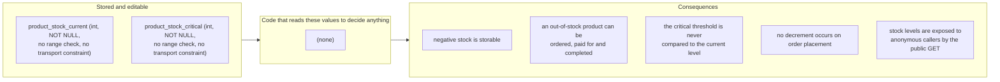
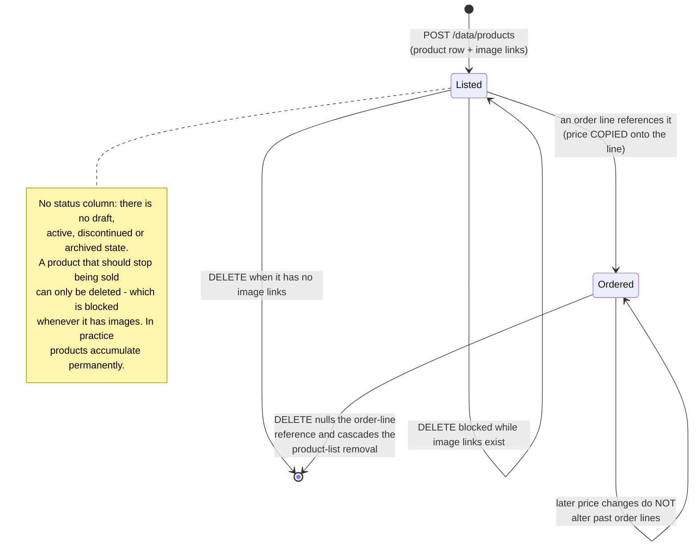

# Workflow diagram — Product Catalog (`product`)

## Image-link management across the three write verbs

```mermaid
flowchart TD
    Start([Write request on /data/products]) --> Verb{verb}

    Verb -- POST --> C1[Persist the product row]
    C1 --> C2[Build image links from the<br/>submitted image list]
    C2 --> Loop{for each submitted image}
    Loop -- "filename blank" --> Swallow[/Bad-input CAUGHT, logged at debug:<br/>"An image was not linked to product<br/>with barcode '{}'" - continue/]
    Loop -- "filename known" --> UseStored[Use the stored images row]
    Loop -- "filename valid but unknown" --> Placeholder[/Build an UNSAVED placeholder image<br/>from the submitted fields, bypassing<br/>the image domain's validation/]
    Swallow --> More{more images?}
    UseStored --> More
    Placeholder --> More
    More -- yes --> Loop
    More -- no --> SaveLinks[saveAll the product_images rows]
    SaveLinks --> CDone([201: product created,<br/>silently-dropped images NOT reported])

    Verb -- PUT --> U1[Overwrite the product row<br/>including the category reference]
    U1 --> U2[deleteByProductId:<br/>EVERY existing link removed]
    U2 --> U3{body carries images?}
    U3 -- no --> NoImages[/Product now has NO image links.<br/>Omission is destructive./]
    U3 -- yes --> U4[Rebuild links with the same<br/>tolerant resolution as POST]
    NoImages --> UDone([204 No Content])
    U4 --> UDone

    Verb -- PATCH --> P1[Copy the product and<br/>RE-ATTACH the existing category]
    P1 --> P2{field type}
    P2 -- "barcode / name / description" --> NB{value non-blank?}
    NB -- no --> SkipF[Skipped: blank never clears]
    NB -- yes --> SetF[Applied]
    P2 -- "price / currentStock / criticalStock" --> Uncond{value explicitly null?}
    Uncond -- yes --> NPE[/Null-dereference: no guard exists.<br/>Not a clean validation error./]
    Uncond -- no --> SetN[Cast and applied unconditionally]
    SkipF --> PEq
    SetF --> PEq
    SetN --> PEq{patched equals existing?}
    PEq -- yes --> PNo([204, no UPDATE issued])
    PEq -- no --> PDone([204: scalars changed.<br/>Category UNCHANGED - a patch can<br/>never declassify or reclassify.<br/>Images UNTOUCHED.])
```

## Deletion: three different downstream rules

```mermaid
flowchart TD
    D([DELETE /data/products]) --> Empty{params empty?}
    Empty -- yes --> Nothing([204, nothing deleted])
    Empty -- no --> Cnt{match count}
    Cnt -- "0" --> NF[/404 "Requested item(s) not found"/]
    Cnt -- "&gt;= 1" --> Refs[Evaluate referencing rows]

    Refs --> R1{any product_images row?}
    R1 -- yes --> Block[/500 FK constraint violation:<br/>DELETE IS BLOCKED.<br/>No pre-delete cleanup exists,<br/>even though this domain owns<br/>product_images./]
    R1 -- no --> R2[order_details rows:<br/>ON DELETE SET NULL]
    R2 --> R2a[/Product reference nulled.<br/>Line description and unit value<br/>SURVIVE: history stays readable./]
    R2a --> R3[product_list_items rows:<br/>ON DELETE CASCADE]
    R3 --> R3a[/Product SILENTLY removed from<br/>every product list./]
    R3a --> Gone([204 product removed])
```

## The inert stock model



## Lifecycle


