# Component diagram — Salesperson (`salesperson`)

```mermaid
flowchart TB
    subgraph salesperson["domain: salesperson"]
        DataSalespeopleController["DataSalespeopleController<br/>GET POST PUT DELETE<br/>/data/salespeople<br/>NO PATCH ROUTE"]
        SalespeopleCrudServiceImpl["SalespeopleCrudServiceImpl<br/>getExisting by person idNumber"]
        SalespeopleConverterServiceImpl["SalespeopleConverterServiceImpl<br/>PersonPojo &lt;-&gt; Salesperson"]
        SalespeoplePatchServiceImpl["SalespeoplePatchServiceImpl<br/>WIRED BUT UNREACHABLE<br/>hardcodes the 'person.' literal"]
        SalespeoplePredicateServiceImpl["SalespeoplePredicateServiceImpl<br/>all keys traverse basePath.person"]
        SalespeopleSortSpec["SalespeopleSortSpec<br/>7 person-backed keys"]
        SalespeopleRepository["SalespeopleRepository<br/>findByPersonIdNumber (JOIN FETCH)"]
        Salesperson["Salesperson entity<br/>table salespeople<br/>one field: person"]

        DataSalespeopleController --> SalespeopleCrudServiceImpl
        DataSalespeopleController --> SalespeoplePredicateServiceImpl
        DataSalespeopleController --> SalespeopleSortSpec
        SalespeopleCrudServiceImpl --> SalespeopleConverterServiceImpl
        SalespeopleCrudServiceImpl --> SalespeoplePatchServiceImpl
        SalespeopleCrudServiceImpl --> SalespeopleRepository
        SalespeopleRepository --> Salesperson
    end

    subgraph kernel["shared kernel"]
        CrudGenericService["CrudGenericService"]
        DataCrudGenericController["DataCrudGenericController"]
        PaginationServiceImpl["PaginationServiceImpl"]
        SortSpecParserServiceImpl["SortSpecParserServiceImpl"]
        Utils["Utils.copyMapWithUnprefixedEntries"]
        RepositoryBase["Repository&lt;E&gt;"]
    end

    SalespeopleCrudServiceImpl -.extends.-> CrudGenericService
    DataSalespeopleController -.extends.-> DataCrudGenericController
    DataSalespeopleController --> PaginationServiceImpl
    DataSalespeopleController --> SortSpecParserServiceImpl
    SalespeoplePatchServiceImpl --> Utils
    SalespeopleRepository -.extends.-> RepositoryBase

    subgraph person["domain: person"]
        PersonPojo["PersonPojo<br/>SHARED as the salesperson<br/>transport model"]
        PeoplePatchServiceImpl["PeoplePatchServiceImpl"]
        Person["Person entity<br/>table people"]
    end

    SalespeopleConverterServiceImpl --> PersonPojo
    DataSalespeopleController --> PersonPojo
    SalespeoplePatchServiceImpl --> PeoplePatchServiceImpl
    Salesperson -. "FK person_id<br/>NOT NULL, NOT UNIQUE,<br/>many-to-one, cascade ALL, eager" .-> Person

    subgraph order["domain: order"]
        OrdersConverterServiceImpl["OrdersConverterServiceImpl<br/>never sets salesperson"]
        OrdersPatchServiceImpl["OrdersPatchServiceImpl<br/>no salesperson key"]
        OrdersSortSpec["OrdersSortSpec<br/>no salesperson sort key"]
        Order["Order entity<br/>table orders"]
    end

    OrdersConverterServiceImpl --x Order
    OrdersPatchServiceImpl --x Order
    Order -. "FK salesperson_id (nullable)<br/>cascade PERSIST + MERGE<br/>ALWAYS NULL: no route sets it" .-> Salesperson
```

## Edge summary

| Edge | Direction | Nature |
|---|---|---|
| `salesperson` → `person` | outbound | cascading many-to-one; shared transport model; nested patch delegation |
| `order` → `salesperson` | inbound | **modelled but dead** — nullable foreign key that no route ever populates |
| `salesperson` → shared kernel | outbound | generic CRUD, pagination, sorting, prefix utility |
| any other domain → `salesperson` | — | none |

## Contrast with `customer`

The two domains are structurally parallel but differ in four ways that a rewrite
must treat as deliberate decisions rather than accidents of copying:

| Aspect | `customer` | `salesperson` |
|---|---|---|
| person uniqueness | database-enforced | **not enforced at all** |
| association type | one-to-one | many-to-one |
| `PATCH` route | absent (patch service wired, unreachable) | absent (patch service wired, unreachable) |
| prefix constant | shared constant referenced | **literal hardcoded** |
| reference from `orders` | mandatory, always populated | optional, **never** populated |
| live inbound callers | three, all service-level | **none** |

## Extraction notes

- **Zero coupling risk.** Nothing in a shipped deployment calls into this domain,
  so it can be lifted out without touching any caller.
- **The outbound dependency on `person` is the only real constraint**, and it is
  the same cascading-atomicity problem as `customer`: splitting `person` turns a
  single transactional write into a distributed one.
- **Decide the uniqueness invariant before extracting.** Adding the missing
  unique constraint is a data-migration question (duplicates may already exist in
  a live database), not just a schema change.
- **Attribution is new functionality**, not a port. The data model supports it;
  the API does not. If it is implemented, the persist/merge cascade from the order
  entity should be removed so that salesperson rows are only ever written through
  this domain's own service.
