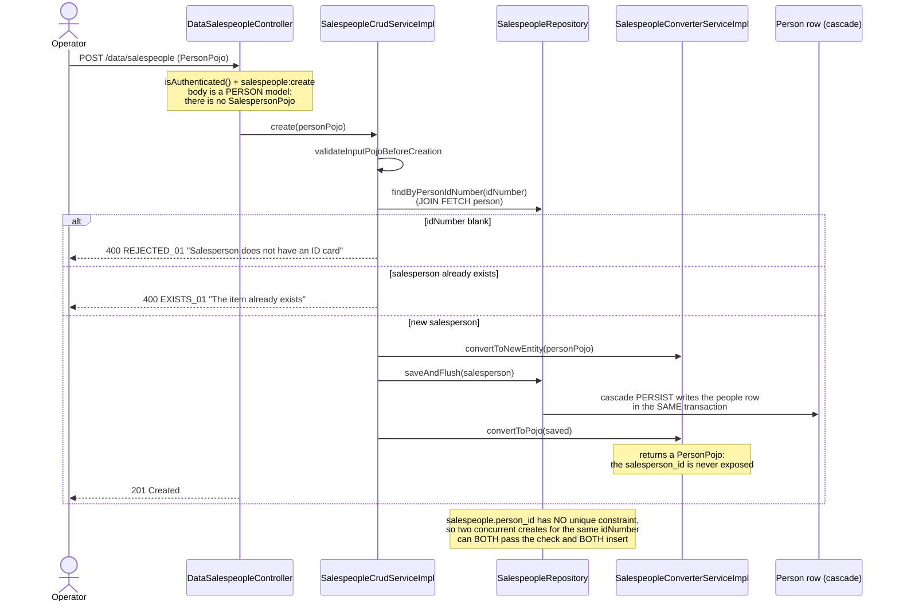
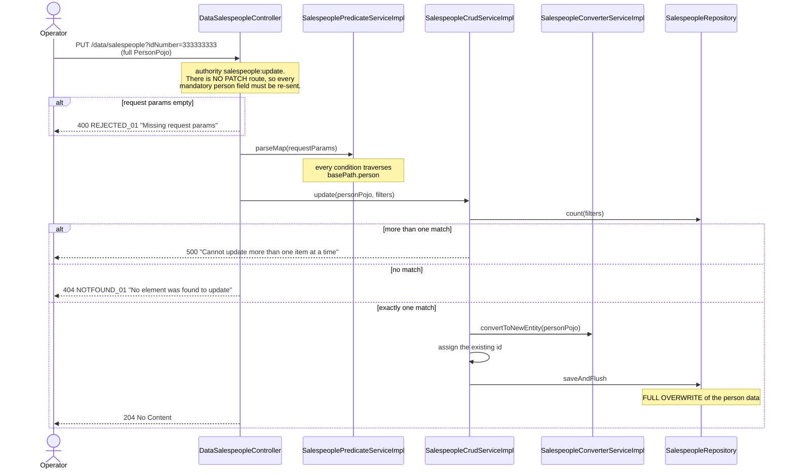

# Sequence diagrams — Salesperson (`salesperson`)

## Register a salesperson (`POST /data/salespeople`)



## Replace a salesperson (`PUT /data/salespeople`) — the only correction path



## The two unreachable paths

```mermaid
sequenceDiagram
    participant NoRoute as "(no PATCH route)"
    participant SalespeoplePatchServiceImpl
    participant Utils
    participant PeoplePatchServiceImpl
    participant OrdersConverterServiceImpl
    participant OrdersPatchServiceImpl
    participant Order as Order entity
    participant Salesperson as Salesperson row

    rect rgb(255,245,245)
    Note over NoRoute,PeoplePatchServiceImpl: unreachable path 1: partial update
    NoRoute--xSalespeoplePatchServiceImpl: patchExistingEntity(changes, salesperson)
    SalespeoplePatchServiceImpl->>Utils: copyMapWithUnprefixedEntries(changes, "person.")
    Note over SalespeoplePatchServiceImpl: prefix is a HARDCODED LITERAL here,<br/>unlike the customer patch service which<br/>uses the shared constant
    SalespeoplePatchServiceImpl->>PeoplePatchServiceImpl: patchExistingEntity(subMap, person)
    Note over PeoplePatchServiceImpl: fully implemented and wired as a bean -<br/>exposing it is a ROUTING change,<br/>not a logic change
    end

    rect rgb(245,245,255)
    Note over OrdersConverterServiceImpl,Salesperson: unreachable path 2: order attribution
    OrdersConverterServiceImpl--xOrder: no code sets order.salesperson at checkout
    OrdersPatchServiceImpl--xOrder: the patch service exposes no "salesperson" key
    Note over Order: orders.salesperson_id is therefore<br/>ALWAYS NULL in a shipped deployment
    Order -. "cascade PERSIST + MERGE exists" .-> Salesperson
    Note over Salesperson: if a route ever populated the field,<br/>order persistence would write this table<br/>WITHOUT passing the salesperson<br/>service's validation
    end
```
