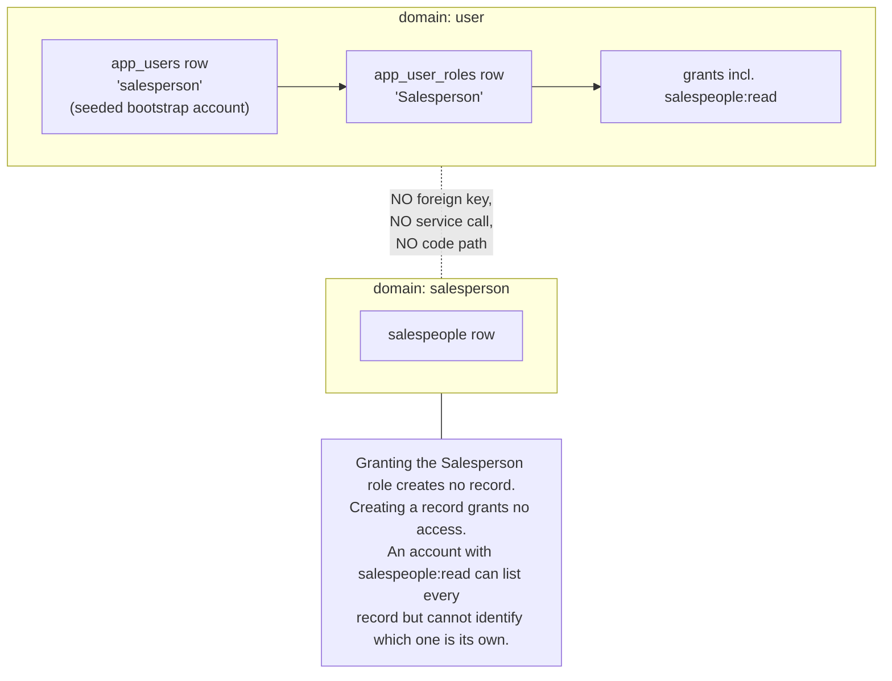

# Workflow diagram — Salesperson (`salesperson`)

## Available operations and their outcomes

```mermaid
flowchart TD
    Start([Request on /data/salespeople]) --> Auth[class-level: isAuthenticated]
    Auth --> Verb{HTTP verb}

    Verb -- GET --> AR{authority salespeople:read?}
    AR -- no --> Denied[/403 access denied/]
    AR -- yes --> Page[Resolve pageIndex / pageSize]
    Page --> Short{id or idNumber present?}
    Short -- yes --> One[Short-circuit:<br/>discard all other filters]
    Short -- no --> Many[Combine name / firstName / lastName /<br/>email and their *Like variants,<br/>all via basePath.person]
    One --> Fetch
    Many --> Fetch[count + findAll, convert each row<br/>to a PersonPojo]
    Fetch --> Env([200 page envelope;<br/>salesperson_id NOT included])

    Verb -- POST --> AC{authority salespeople:create?}
    AC -- no --> Denied
    AC -- yes --> V1{firstName, lastName,<br/>idNumber, email all non-blank?}
    V1 -- no --> E1[/400 REJECTED_02 validation envelope/]
    V1 -- yes --> V2{idNumber blank at<br/>service level?}
    V2 -- yes --> E2[/400 REJECTED_01<br/>"Salesperson does not have an ID card"/]
    V2 -- no --> V3{findByPersonIdNumber hits?}
    V3 -- yes --> E3[/400 EXISTS_01 "The item already exists"/]
    V3 -- no --> Race{concurrent create for<br/>the same idNumber?}
    Race -- yes --> Dup[/BOTH inserts succeed:<br/>no unique constraint on<br/>salespeople.person_id/]
    Race -- no --> Created([201: salesperson + person<br/>written in ONE transaction])

    Verb -- PUT --> AU{authority salespeople:update?}
    AU -- no --> Denied
    AU -- yes --> P1{params empty?}
    P1 -- yes --> E4[/400 "Missing request params"/]
    P1 -- no --> P2{match count}
    P2 -- "&gt; 1" --> E5[/500 "Cannot update more<br/>than one item at a time"/]
    P2 -- "0" --> E6[/404 "No element was found to update"/]
    P2 -- "1" --> Over[FULL OVERWRITE:<br/>body becomes a new entity,<br/>existing id assigned]
    Over --> Done([204 No Content])

    Verb -- PATCH --> NoRoute[/404: NO PATCH ROUTE EXISTS.<br/>SalespeoplePatchServiceImpl is wired<br/>but unreachable - PUT is the only<br/>correction path./]

    Verb -- DELETE --> AD{authority salespeople:delete?}
    AD -- no --> Denied
    AD -- yes --> D1{params empty?}
    D1 -- yes --> Nothing([204, nothing deleted])
    D1 -- no --> D2{match count}
    D2 -- "0" --> E7[/404 "Requested item(s) not found"/]
    D2 -- "&gt;= 1" --> D3{any order references it?}
    D3 -- "yes (unreachable today)" --> E8[/500 FK_ORDER_SPERSON violation/]
    D3 -- no --> Gone([204 removed;<br/>the people row SURVIVES])
```

## Order attribution: modelled, never reached

```mermaid
flowchart LR
    subgraph Exists["Exists in the data model"]
        C1["orders.salesperson_id column (nullable)"]
        C2["FK_ORDER_SPERSON foreign key"]
        C3["Order.salesperson association<br/>cascade PERSIST + MERGE"]
    end
    subgraph Missing["Missing at the API boundary"]
        M1["public checkout never populates it"]
        M2["OrdersPatchServiceImpl has no<br/>'salesperson' key"]
        M3["OrdersPredicateServiceImpl has no<br/>salesperson filter"]
        M4["OrdersSortSpec has no<br/>salesperson sort key"]
    end
    subgraph Result
        R1["orders.salesperson_id is ALWAYS NULL<br/>in a shipped deployment"]
        R2["attribution is NEW WORK in a rewrite,<br/>not a port"]
        R3["the cascade is a latent bypass of<br/>this domain's validation"]
    end
    Exists --> Missing --> Result
```



## Disconnection from access control



## Lifecycle

```mermaid
stateDiagram-v2
    [*] --> Created: POST /data/salespeople<br/>(salesperson + person in one transaction)
    Created --> Created: PUT full replacement<br/>(the only correction path)
    Created --> Duplicated: concurrent create for the same<br/>person: no unique constraint stops it
    Duplicated --> Duplicated: both rows persist indefinitely
    Created --> [*]: DELETE (always possible today;<br/>the people row survives as an orphan)
    note right of Created
        No status column, no attributes, no
        departure or deactivation concept, and
        no link to a login account. The record
        exists only to be referenced by an
        order - which no route ever does.
    end note
```


