# Component diagram — Shipper (`shipper`)

```mermaid
flowchart TB
    subgraph shipper["domain: shipper"]
        DataShippersController["DataShippersController<br/>GET POST PUT PATCH DELETE /data/shippers"]
        ShippersCrudServiceImpl["ShippersCrudServiceImpl<br/>getExisting by name"]
        ShippersConverterServiceImpl["ShippersConverterServiceImpl"]
        ShippersPatchServiceImpl["ShippersPatchServiceImpl"]
        ShippersPredicateServiceImpl["ShippersPredicateServiceImpl"]
        ShippersSortSpec["ShippersSortSpec (name only)"]
        ShippersRepository["ShippersRepository<br/>findByName"]
        Shipper["Shipper entity<br/>table shippers"]
        ShipperPojo["ShipperPojo"]

        DataShippersController --> ShippersCrudServiceImpl
        DataShippersController --> ShippersPredicateServiceImpl
        DataShippersController --> ShippersSortSpec
        ShippersCrudServiceImpl --> ShippersConverterServiceImpl
        ShippersCrudServiceImpl --> ShippersPatchServiceImpl
        ShippersCrudServiceImpl --> ShippersRepository
        ShippersRepository --> Shipper
        ShippersConverterServiceImpl --> ShipperPojo
    end

    subgraph kernel["shared kernel"]
        CrudGenericService["CrudGenericService"]
        DataCrudGenericController["DataCrudGenericController"]
        PaginationServiceImpl["PaginationServiceImpl"]
        SortSpecParserServiceImpl["SortSpecParserServiceImpl"]
        RepositoryBase["Repository&lt;E&gt;"]
        ExceptionsControllerAdvice["ExceptionsControllerAdvice"]
    end

    ShippersCrudServiceImpl -.extends.-> CrudGenericService
    DataShippersController -.extends.-> DataCrudGenericController
    DataShippersController --> PaginationServiceImpl
    DataShippersController --> SortSpecParserServiceImpl
    ShippersRepository -.extends.-> RepositoryBase
    DataShippersController -.errors handled by.-> ExceptionsControllerAdvice

    subgraph order["domain: order"]
        OrdersConverterServiceImpl["OrdersConverterServiceImpl"]
        OrdersPatchServiceImpl["OrdersPatchServiceImpl"]
        Order["Order entity<br/>table orders"]
    end

    OrdersConverterServiceImpl -->|"boundary leak:<br/>direct repository call"| ShippersRepository
    OrdersPatchServiceImpl -->|"boundary leak:<br/>direct repository call"| ShippersRepository
    Order -. "FK shipper_id (nullable,<br/>updatable=false)" .-> Shipper
```

## Edge summary

| Edge | Direction | Nature |
|---|---|---|
| `shipper` → shared kernel | outbound | generic CRUD, pagination, sorting, error envelope |
| `order` → `shipper` | inbound | **direct repository access**, not service-mediated |
| `orders` → `shippers` | inbound (data) | nullable foreign key, no cascade; blocks carrier deletion |
| `shipper` → any other domain | — | none |

The two inbound edges are the extraction risk for this domain: both the order
converter and the order patch service hold a compile-time dependency on this
domain's repository interface. Splitting `shipper` out requires introducing a
carrier-lookup contract that the `order` domain calls instead.
