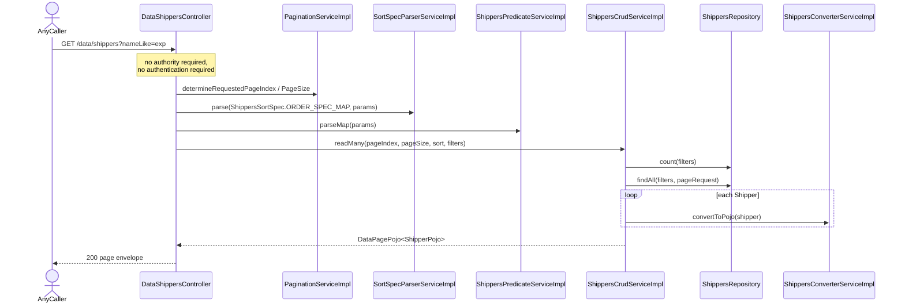
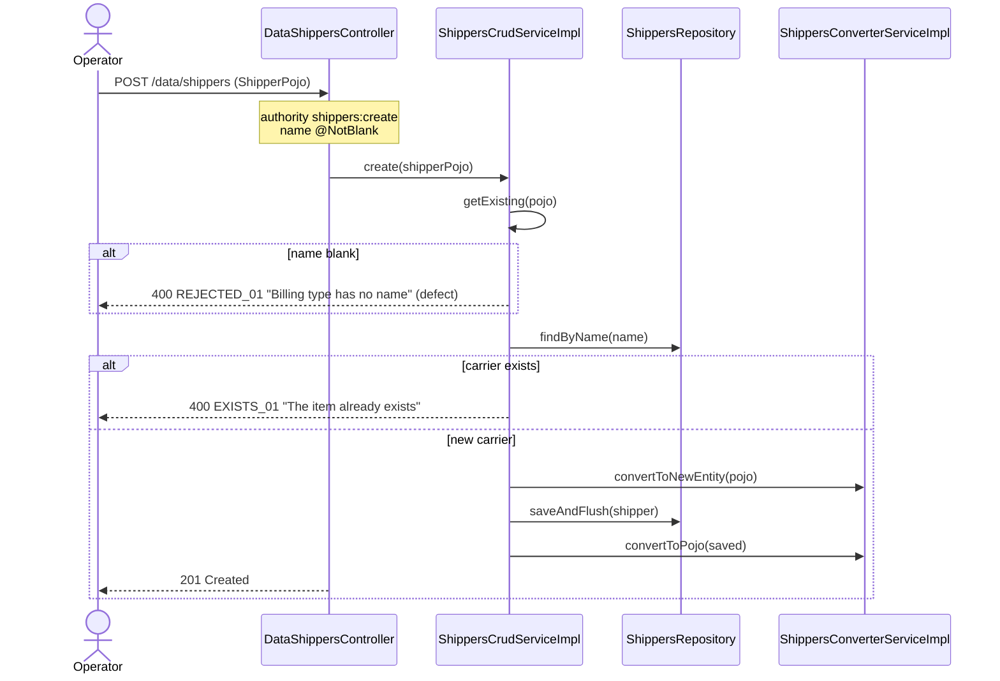
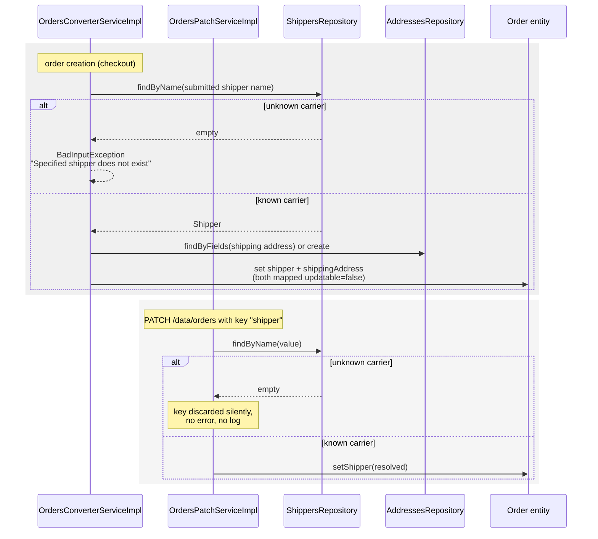

# Sequence diagrams — Shipper (`shipper`)

## Public carrier listing (`GET /data/shippers`)

## Register a carrier (`POST /data/shippers`)

## Carrier resolution and reassignment driven by the order domain

