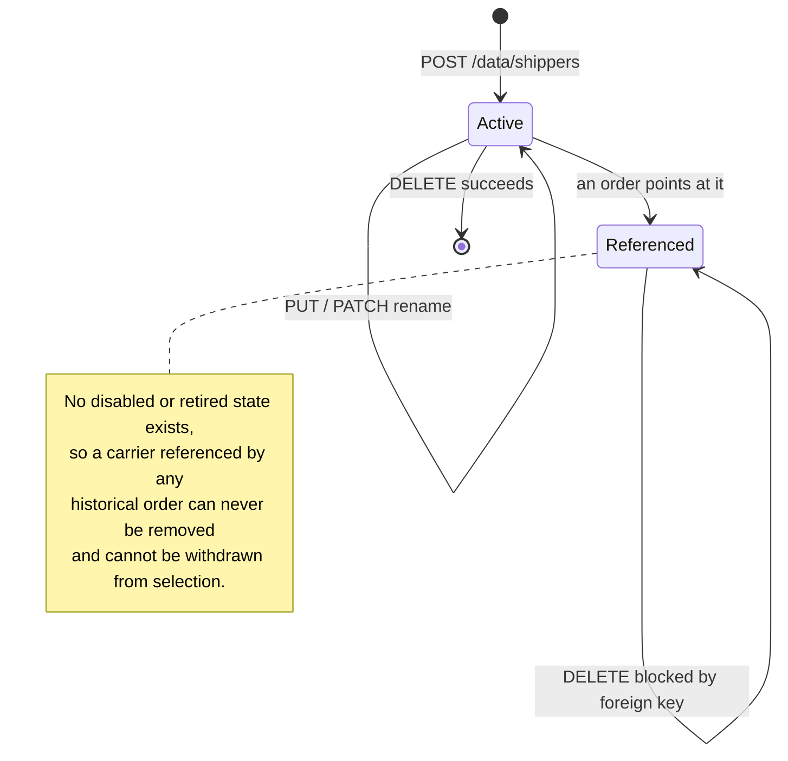

# Workflow diagram — Shipper (`shipper`)

## Carrier maintenance flow

```mermaid
flowchart TD
    Start([Request on /data/shippers]) --> Verb{HTTP verb}

    Verb -- GET --> Public[No authority check,<br/>no authentication check]
    Public --> Page[Resolve pageIndex / pageSize]
    Page --> Filter{id or name present?}
    Filter -- yes --> Single[Short-circuit:<br/>discard all other filters]
    Filter -- no --> Like[Apply nameLike if present]
    Single --> Fetch
    Like --> Fetch[count + findAll, convert rows]
    Fetch --> Env([200 page envelope])

    Verb -- POST --> AuthC{authority shippers:create?}
    AuthC -- no --> Denied[/403 access denied/]
    AuthC -- yes --> NB{name non-blank on body?}
    NB -- no --> V1[/400 REJECTED_02 validation envelope/]
    NB -- yes --> SvcBlank{blank at service level?}
    SvcBlank -- yes --> V2[/400 REJECTED_01<br/>"Billing type has no name" DEFECT/]
    SvcBlank -- no --> Dup{findByName hits?}
    Dup -- yes --> V3[/400 EXISTS_01 "The item already exists"/]
    Dup -- no --> Len{name longer than 255?}
    Len -- yes --> V4[/500 database length error/]
    Len -- no --> Created([201 carrier registered])

    Verb -- "PUT / PATCH" --> AuthU{authority shippers:update?}
    AuthU -- no --> Denied
    AuthU -- yes --> Empty{params empty?}
    Empty -- yes --> V5[/400 REJECTED_01 "Missing request params"/]
    Empty -- no --> Cnt{match count}
    Cnt -- "&gt; 1" --> V6[/500 "Cannot update more than one item at a time"/]
    Cnt -- "0" --> V7[/404 NOTFOUND_01 "No element was found to update"/]
    Cnt -- "1" --> Which{verb}
    Which -- PUT --> Overwrite[Convert body to new entity,<br/>assign existing id, save]
    Which -- PATCH --> Blank2{name value non-blank?}
    Blank2 -- no --> NoOp([204, nothing applied,<br/>no UPDATE issued])
    Blank2 -- yes --> Overwrite
    Overwrite --> Done([204 No Content])

    Verb -- DELETE --> AuthD{authority shippers:delete?}
    AuthD -- no --> Denied
    AuthD -- yes --> DEmpty{params empty?}
    DEmpty -- yes --> Nothing([204, nothing deleted])
    DEmpty -- no --> DCnt{match count}
    DCnt -- "0" --> V8[/404 NOTFOUND_01 "Requested item(s) not found"/]
    DCnt -- "&gt;= 1" --> Ref{any order references<br/>this carrier?}
    Ref -- yes --> V9[/500 FK_ORDER_SHIPPER_ID<br/>constraint violation/]
    Ref -- no --> Gone([204 carrier removed])
```

## Carrier assignment over an order's life

```mermaid
flowchart LR
    NoCarrier([Order created with<br/>no shipper: allowed,<br/>shipper_id is nullable])
    Assigned([Order created with<br/>a resolved carrier])
    Reassigned([Carrier replaced via<br/>PATCH key "shipper"])

    Checkout{{checkout payload<br/>includes shipper name?}}
    Checkout -- no --> NoCarrier
    Checkout -- "yes, unknown name" --> Reject[/400 "Specified shipper does not exist"<br/>whole order rejected/]
    Checkout -- "yes, known name" --> Assigned

    NoCarrier -- "PATCH shipper = known name" --> Reassigned
    Assigned -- "PATCH shipper = known name" --> Reassigned
    Assigned -- "PATCH shipper = unknown name" --> Assigned
    NoCarrier -- "PATCH shipper = unknown name" --> NoCarrier

    Reassigned -- "order status code &gt;= 3 or &lt; 0<br/>and editing disabled" --> Locked[/400 "The requested transaction<br/>cannot be modified"/]
```

## Lifecycle


