# Component diagram — Identity & Access (`user`)

```mermaid
flowchart TB
    subgraph userdomain["domain: user (Identity & Access)"]
        subgraph rest["REST surface"]
            DataUsersController["DataUsersController<br/>/data/users, users:*<br/>GET POST PUT DELETE, NO PATCH"]
            DataUserRolesController["DataUserRolesController<br/>/data/user_roles, user_roles:*<br/>GET POST PUT DELETE, NO PATCH"]
            AccountProfileController["AccountProfileController<br/>/account/profile<br/>isAuthenticated only"]
            AccessController["AccessController<br/>/access, /access/{apiRoute}"]
            PublicRegisterController["PublicRegisterController<br/>/public/register, PUBLIC"]
        end
        subgraph filters["authentication filters"]
            JwtLoginAuthenticationFilter["JwtLoginAuthenticationFilter<br/>/public/login"]
            JwtGuestAuthenticationFilter["JwtGuestAuthenticationFilter<br/>/public/guest"]
            GenericJwtAuthenticationFilter["GenericJwtAuthenticationFilter<br/>(abstract issuer)"]
            JwtTokenVerifierFilter["JwtTokenVerifierFilter"]
        end
        subgraph services["services"]
            UsersCrudServiceImpl["UsersCrudServiceImpl<br/>protected-account guard"]
            UserRolesCrudServiceImpl["UserRolesCrudServiceImpl"]
            RegistrationServiceImpl["RegistrationServiceImpl<br/>NOT transactional"]
            ProfileServiceImpl["ProfileServiceImpl"]
            UserDetailsServiceImpl["UserDetailsServiceImpl<br/>guest branch + regular branch"]
            UserPermissionsServiceImpl["UserPermissionsServiceImpl<br/>role -> authority set"]
            AuthorizedApiServiceImpl["AuthorizedApiServiceImpl<br/>resource:action splitting"]
            ClaimsParser["ClaimsAuthorizationHeaderParserServiceImpl"]
        end
        subgraph support["converters / patch / predicates / sortspecs"]
            UsersConverterServiceImpl["UsersConverterServiceImpl"]
            UsersPatchServiceImpl["UsersPatchServiceImpl<br/>name + role only, NO password<br/>WIRED BUT UNREACHABLE"]
            UsersPredicateServiceImpl["UsersPredicateServiceImpl<br/>id name email *Like"]
            UsersSortSpec["UsersSortSpec (name, role)"]
            UserRolesConverterServiceImpl["UserRolesConverterServiceImpl"]
            UserRolesPatchServiceImpl["UserRolesPatchServiceImpl"]
            UserRolesPredicateServiceImpl["UserRolesPredicateServiceImpl"]
            UserRolesSortSpec["UserRolesSortSpec (lower-case field name)"]
        end
        subgraph data["owned data"]
            UsersRepository["UsersRepository<br/>findByName, findByNameWithRole,<br/>findByNameWithProfile,<br/>findByIdWithProfile,<br/>findByPersonIdNumber"]
            UserRolesRepository["UserRolesRepository<br/>findByName"]
            PermissionsRepository["PermissionsRepository<br/>(no custom method)"]
            UserRolePermissionsRepository["UserRolePermissionsRepository<br/>deepFindPermissionsByUserRoleId"]
            User["User - app_users"]
            UserRole["UserRole - app_user_roles"]
            Permission["Permission - app_permissions"]
            UserRolePermission["UserRolePermission -<br/>app_user_role_permissions<br/>NO unique pair constraint"]
        end

        DataUsersController --> UsersCrudServiceImpl
        DataUsersController --> UsersPredicateServiceImpl
        DataUsersController --> UsersSortSpec
        DataUserRolesController --> UserRolesCrudServiceImpl
        DataUserRolesController --> UserRolesPredicateServiceImpl
        DataUserRolesController --> UserRolesSortSpec
        AccountProfileController --> ProfileServiceImpl
        AccessController --> ClaimsParser
        AccessController --> UserDetailsServiceImpl
        AccessController --> AuthorizedApiServiceImpl
        PublicRegisterController --> RegistrationServiceImpl

        JwtLoginAuthenticationFilter -.extends.-> GenericJwtAuthenticationFilter
        JwtGuestAuthenticationFilter -.extends.-> GenericJwtAuthenticationFilter
        JwtTokenVerifierFilter --> ClaimsParser

        UsersCrudServiceImpl --> UsersConverterServiceImpl
        UsersCrudServiceImpl --> UsersPatchServiceImpl
        UsersCrudServiceImpl --> UsersRepository
        UserRolesCrudServiceImpl --> UserRolesConverterServiceImpl
        UserRolesCrudServiceImpl --> UserRolesPatchServiceImpl
        UserRolesCrudServiceImpl --> UserRolesRepository
        UsersPatchServiceImpl --> UserRolesRepository
        UserDetailsServiceImpl --> UsersRepository
        UserDetailsServiceImpl --> UserPermissionsServiceImpl
        UserDetailsServiceImpl --> UserRolePermissionsRepository
        UserPermissionsServiceImpl --> UserRolePermissionsRepository
        RegistrationServiceImpl --> UsersRepository
        RegistrationServiceImpl --> UserRolesRepository
        ProfileServiceImpl --> UsersRepository

        UsersRepository --> User
        UserRolesRepository --> UserRole
        PermissionsRepository --> Permission
        UserRolePermissionsRepository --> UserRolePermission
        User -. FK user_role_id .-> UserRole
        UserRolePermission -. FK user_role_id .-> UserRole
        UserRolePermission -. FK permission_id .-> Permission
    end

    subgraph kernel["shared kernel"]
        SecurityConfig["SecurityConfig<br/>stateless, CSRF disabled,<br/>NO route-matching rules"]
        JwtKeyConfig["JwtKeyConfig<br/>HMAC key from the secret property"]
        SecurityProperties["SecurityProperties (10 keys)"]
        Constants["Constants<br/>AUTHORITY_CHECKOUT, JWT_PREFIX,<br/>JWT_CLAIM_AUTHORITIES"]
        CrudGenericService["CrudGenericService"]
        DataCrudGenericController["DataCrudGenericController"]
        PaginationServiceImpl["PaginationServiceImpl"]
        SortSpecParserServiceImpl["SortSpecParserServiceImpl"]
        RegexMatcherAdapterServiceImpl["RegexMatcherAdapterServiceImpl<br/>isAValidAuthorizationHeader (UNUSED)"]
        ExceptionsControllerAdvice["ExceptionsControllerAdvice<br/>maps only 4 conditions"]
    end

    SecurityConfig --> JwtLoginAuthenticationFilter
    SecurityConfig --> JwtGuestAuthenticationFilter
    SecurityConfig --> JwtTokenVerifierFilter
    SecurityConfig --> UserDetailsServiceImpl
    JwtKeyConfig --> SecurityProperties
    GenericJwtAuthenticationFilter --> JwtKeyConfig
    GenericJwtAuthenticationFilter --> Constants
    JwtTokenVerifierFilter --> Constants
    JwtTokenVerifierFilter -. "does not call" .-> RegexMatcherAdapterServiceImpl
    UsersCrudServiceImpl -.extends.-> CrudGenericService
    UserRolesCrudServiceImpl -.extends.-> CrudGenericService
    DataUsersController -.extends.-> DataCrudGenericController
    DataUserRolesController -.extends.-> DataCrudGenericController
    DataUsersController --> PaginationServiceImpl
    DataUsersController --> SortSpecParserServiceImpl
    UsersCrudServiceImpl --> SecurityProperties

    subgraph person["domain: person"]
        PeopleRepository["PeopleRepository"]
        PeoplePatchServiceImpl["PeoplePatchServiceImpl"]
        PeopleConverterServiceImpl["PeopleConverterServiceImpl"]
        Person["Person - people"]
    end
    subgraph customer["domain: customer"]
        CustomersCrudServiceImpl["CustomersCrudServiceImpl"]
    end

    RegistrationServiceImpl --> PeopleRepository
    RegistrationServiceImpl --> PeopleConverterServiceImpl
    ProfileServiceImpl --> PeoplePatchServiceImpl
    ProfileServiceImpl --> PeopleRepository
    JwtGuestAuthenticationFilter --> CustomersCrudServiceImpl
    RegistrationServiceImpl --> CustomersCrudServiceImpl
    User -. "FK person_id (nullable,<br/>NOT unique)" .-> Person

    subgraph consumers["every other domain"]
        AuthorityLiterals["authority string literals in<br/>@PreAuthorize annotations<br/>(compile-time unchecked)"]
    end
    Permission -. "values duplicated as literals" .-> AuthorityLiterals
```

## Edge summary

| Edge | Direction | Nature |
|---|---|---|
| `user` → `person` | **outbound** | registration and profile editing write person rows |
| `user` → `customer` | **outbound** | registration and guest authentication create customer rows |
| every domain → `user` | inbound (implicit) | authority string literals; no compile-time dependency |
| `user` → shared kernel | outbound | security configuration, generic CRUD, pagination, constants |
| `app_users` → `people` | outbound (data) | nullable, non-unique foreign key |

## Extraction notes

- This domain is the system's **security kernel**, yet it depends *outward* on two
  business domains. Extracting it as an identity service requires either moving
  the person and customer writes out of registration and guest access, or giving
  the identity service a client for those domains.
- The authority catalogue is duplicated as string literals across every
  controller in every other domain. A rewrite should generate or share those
  constants; today a renamed code silently disables an access check.
- The token carries the authority set, so any split that introduces per-service
  authorization must decide whether to keep trusting token claims (fast, stale by
  up to one token lifetime) or re-resolve grants per request (correct, chattier).
- The filter-based login and guest routes have no controller, so they are invisible
  to the API catalogue generated from controllers. Any rewrite must rediscover
  them from the security configuration.
