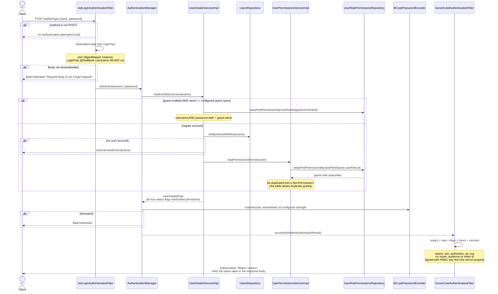
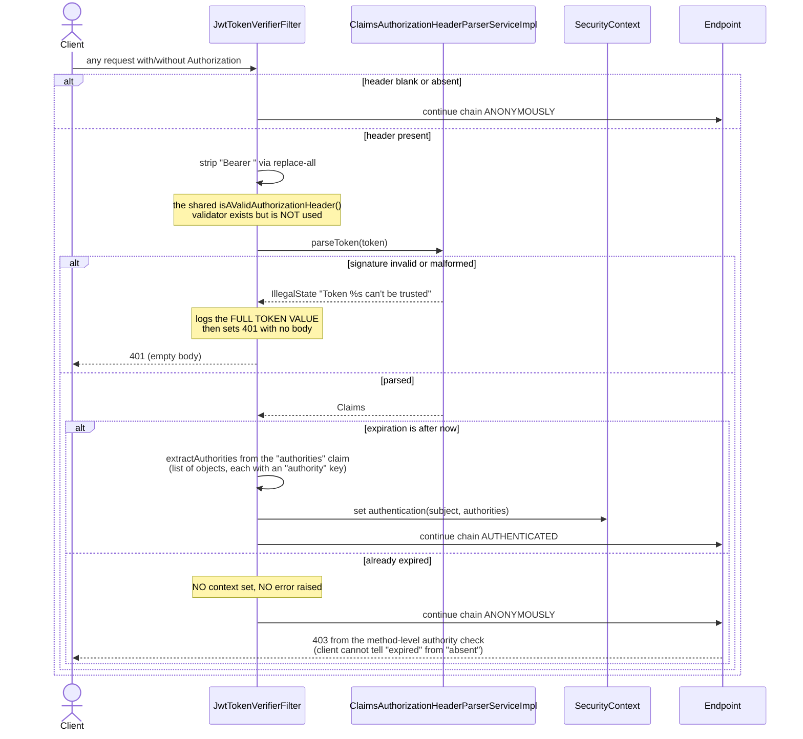
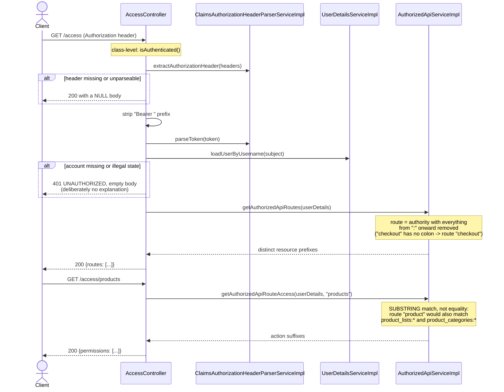
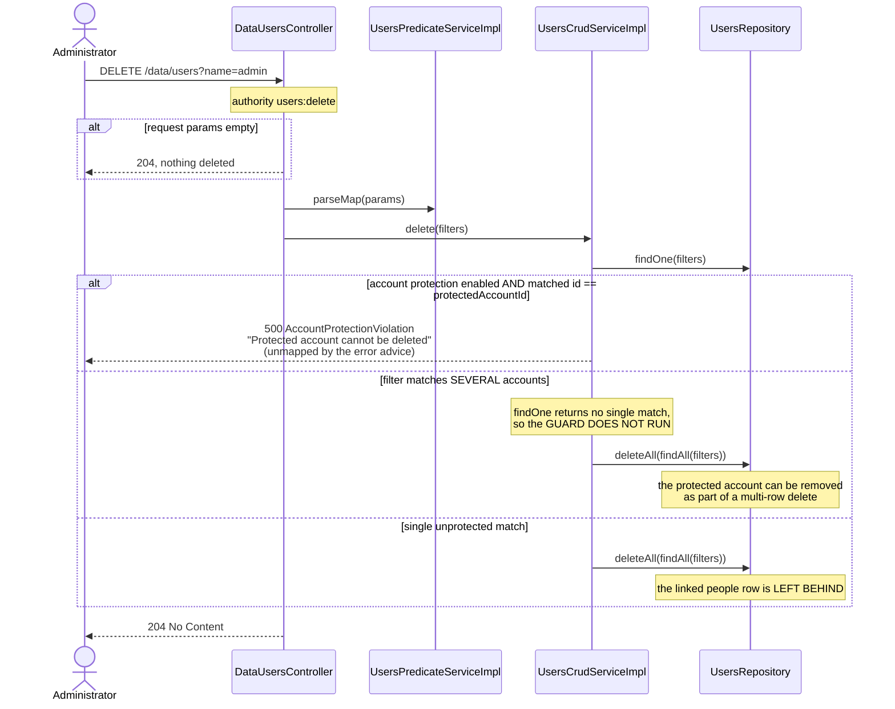

# Sequence diagrams — Identity & Access (`user`)

## Password login and token issuance (`POST /public/login`)



## Per-request token verification



## Self-registration (`POST /public/register`)

```mermaid
sequenceDiagram
    actor Visitor
    participant PublicRegisterController
    participant RegistrationServiceImpl
    participant UsersRepository
    participant PeopleConverterServiceImpl
    participant PeopleRepository
    participant UserRolesRepository
    participant BCryptPasswordEncoder
    participant CustomersRepository

    Visitor->>PublicRegisterController: POST /public/register {name, password, profile}
    Note over PublicRegisterController: PUBLIC route;<br/>body and nested profile are validated
    PublicRegisterController->>RegistrationServiceImpl: register(registration)
    RegistrationServiceImpl->>UsersRepository: exists(name == submitted name)
    alt taken
        RegistrationServiceImpl-->>Visitor: 400 EXISTS_01 "That username is taken."
    end
    RegistrationServiceImpl->>PeopleConverterServiceImpl: convertToNewEntity(profile)
    RegistrationServiceImpl->>PeopleRepository: exists(idNumber == profile.idNumber)
    alt already registered
        RegistrationServiceImpl-->>Visitor: 400 EXISTS_01 "That ID number is already registered..."
    end
    rect rgb(255,240,240)
    Note over RegistrationServiceImpl,CustomersRepository: NOT @Transactional - three independent writes
    RegistrationServiceImpl->>PeopleRepository: saveAndFlush(person)
    RegistrationServiceImpl->>UserRolesRepository: findByName("Customer")
    alt role missing
        RegistrationServiceImpl-->>Visitor: 500 IllegalState "No user role matches 'Customer',<br/>database might be compromised"<br/>(person row already persisted)
    end
    RegistrationServiceImpl->>BCryptPasswordEncoder: encode(password)
    RegistrationServiceImpl->>UsersRepository: saveAndFlush(user)
    RegistrationServiceImpl->>CustomersRepository: saveAndFlush(customer for person)
    Note over CustomersRepository: a failure here leaves a person<br/>and an account with NO customer row
    end
    RegistrationServiceImpl-->>Visitor: 200
```

## Authority and route discovery (`GET /access`, `GET /access/{apiRoute}`)



## Protected-account deletion guard (`DELETE /data/users`)


