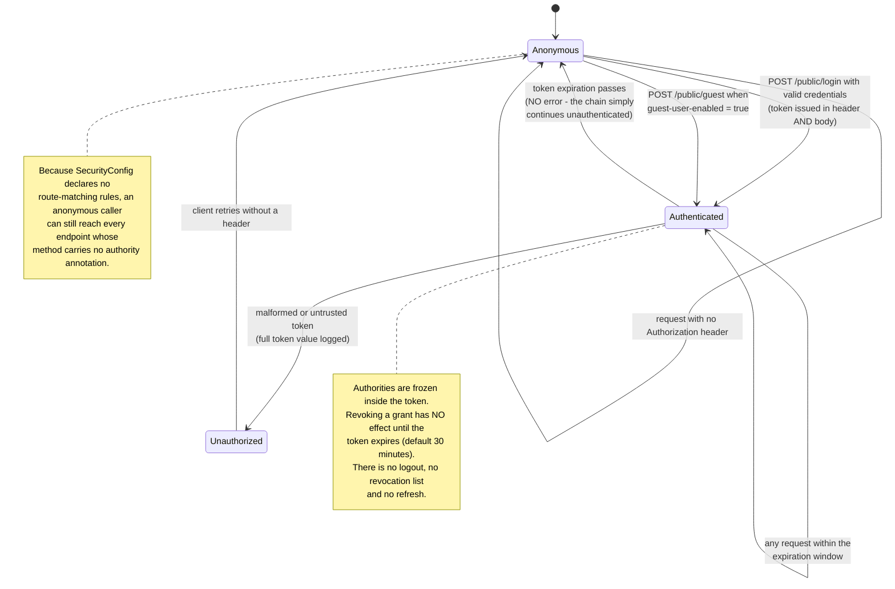
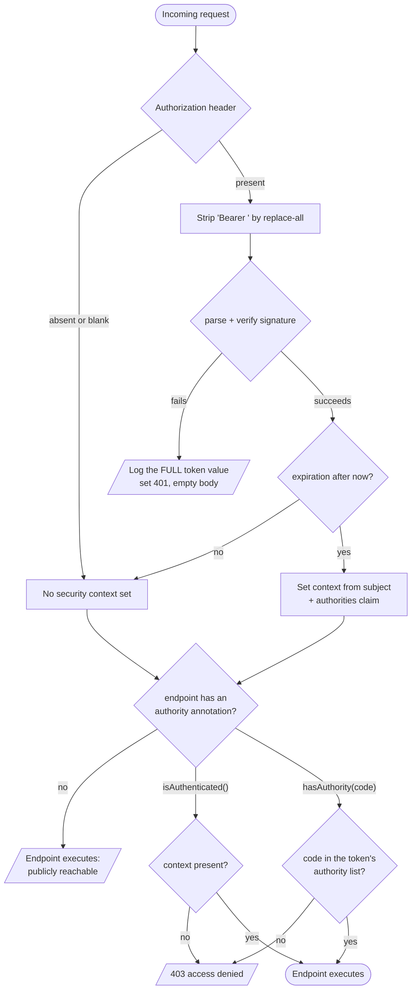
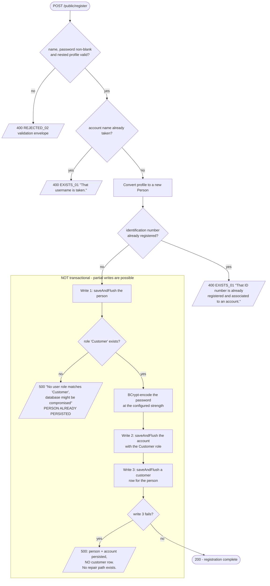
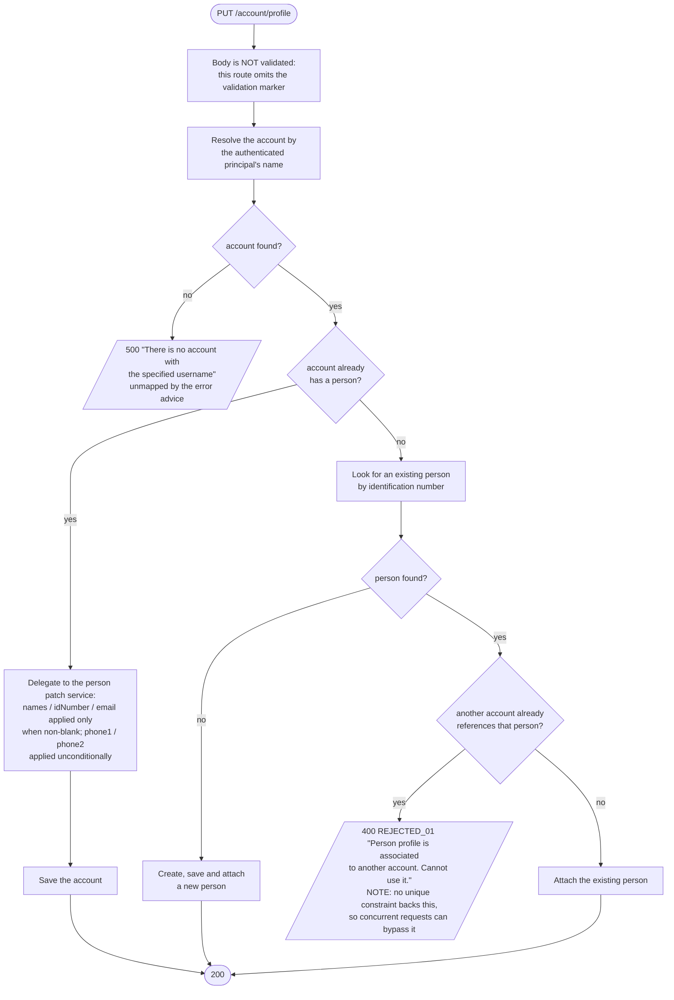
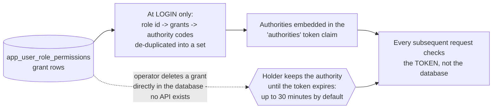

# Workflow diagram — Identity & Access (`user`)

## Session state progression (state lives in the token, not the database)

## Authentication decision flow

## Registration flow with its non-transactional window

## Profile replacement decision flow (`PUT /account/profile`)

## Authority resolution and the staleness window

