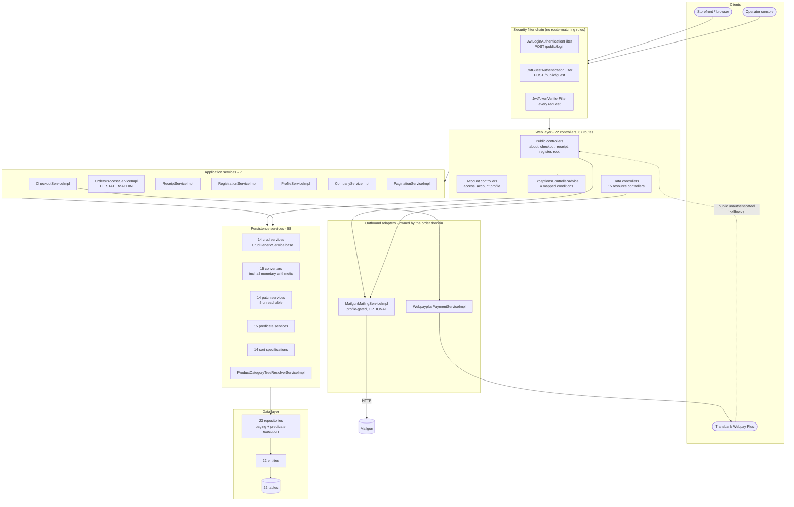
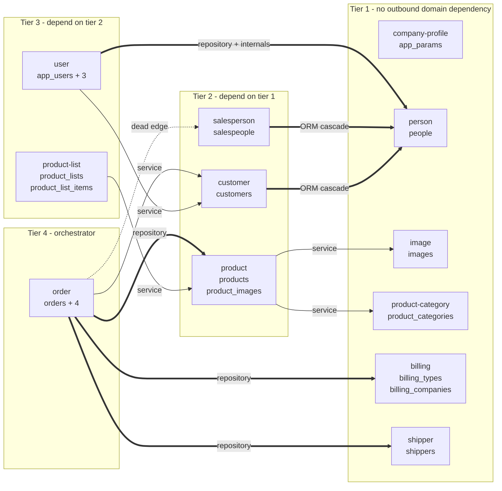
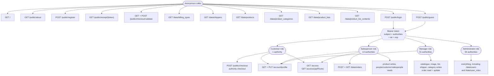
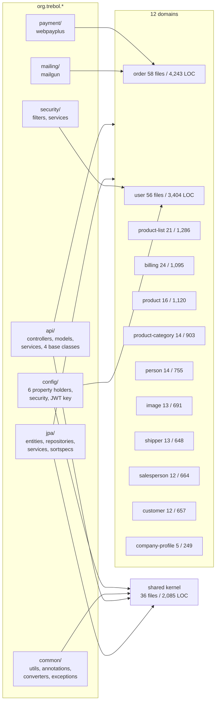
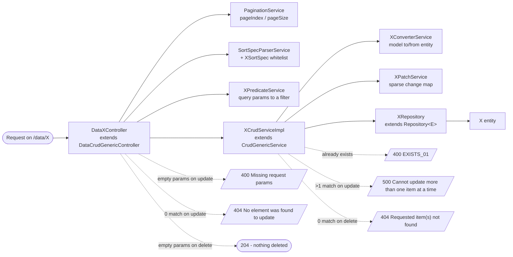

# Architecture Diagrams

System-wide structural views. Domain-scoped component diagrams live in each
`../detailed-domain-bre/domain-*/diagrams/component-diagram.md`.

## 1. Layered architecture

Note two structural facts visible here: authorization is applied **only** at the
controller-method level (the filter chain declares no route rules), and the two
outbound adapters are reached from both the application-service layer and the web
layer.

## 2. Domain map with coupling styles

Legend: thin arrow = service-level call (survives a split unchanged);
thick arrow = repository-level call or ORM cascade (needs a contract);
dotted = modelled but never executed.

`company-profile` has no edge in either direction.

## 3. Request paths by access level

## 4. Package structure to domain mapping

**The packages are organised by technical layer, not by domain.** Every domain's
code is spread across `api/controllers`, `api/models`, `jpa/entities`,
`jpa/repositories` and four `jpa/services/*` subpackages. A first step toward
extraction is repackaging by domain — a pure code-movement exercise with no
behavioural change, and the fastest way to make the boundaries visible in the
source tree.

## 5. The generic CRUD pattern (repeated 11 times)

Eleven domains follow this shape exactly. The deliberate exceptions are worth
knowing:

| Component | Deviation |
|---|---|
| `DataProductListContentsController` | extends **no** base class; inverts the empty-filter delete convention |
| `PublicAboutController` + `CompanyServiceImpl` | opts out of the pattern entirely — no converter, patch, predicate or crud service |
| `ProductsCrudServiceImpl` | overrides four hooks to manage the image-link table |
| `ProductListsCrudServiceImpl` | overrides delete to clean up membership first — the only pre-delete child cleanup in the system |
| `ProductCategoriesCrudServiceImpl` | overrides the patch flush to re-attach the parent |
| `OrdersCrudServiceImpl` | overrides the patch flush to enforce the edit lock, and `readOne` to hydrate addresses and lines |
| `UsersCrudServiceImpl` | overrides delete to enforce the protected-account guard |

## Related documentation

- per-domain component diagrams: `../detailed-domain-bre/domain-*/diagrams/component-diagram.md`
- boundary justification: `../domain-decomposition-overview/bounded-contexts.md`
- coupling detail: `../reference-documentation/coupling-hotspots.md`
