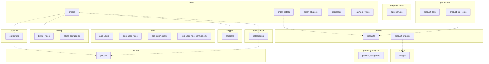
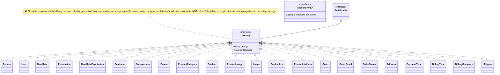
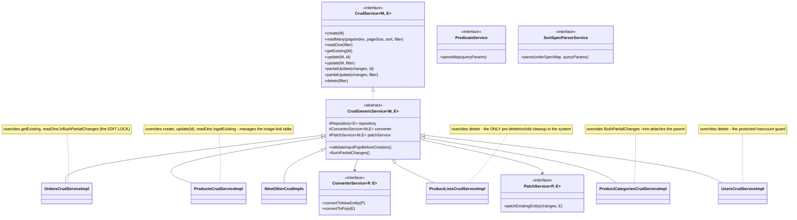
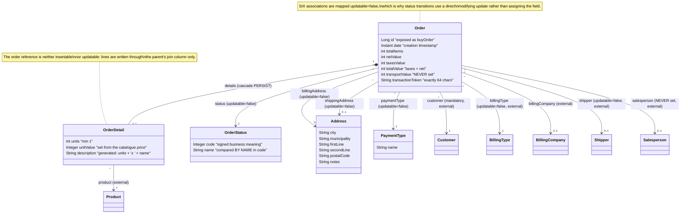
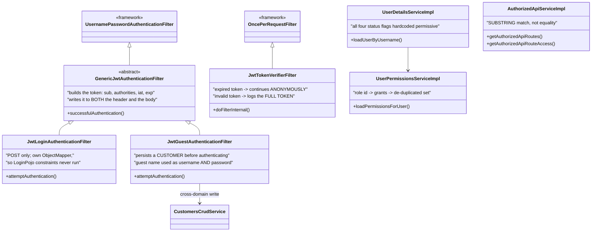

# Class and Entity-Relationship Diagrams

## 1. Entity-relationship diagram — all 22 tables

```mermaid
erDiagram
    people ||--o| app_users : "person_id (nullable, NOT unique)"
    people ||--|| customers : "person_id (unique)"
    people ||--o{ salespeople : "person_id (NOT unique)"
    app_user_roles ||--o{ app_users : "user_role_id"
    app_user_roles ||--o{ app_user_role_permissions : "user_role_id"
    app_permissions ||--o{ app_user_role_permissions : "permission_id"
    product_categories ||--o{ product_categories : "parent_product_category_id"
    product_categories ||--o{ products : "product_category_id (nullable)"
    products ||--o{ product_images : "product_id"
    images ||--o{ product_images : "image_id"
    products ||--o{ product_list_items : "product_id (ON DELETE CASCADE)"
    product_lists ||--o{ product_list_items : "product_list_id"
    customers ||--o{ orders : "customer_id (mandatory)"
    order_statuses ||--o{ orders : "order_status_id (mandatory)"
    payment_types ||--o{ orders : "payment_type_id (mandatory)"
    billing_types ||--o{ orders : "billing_type_id (mandatory)"
    billing_companies ||--o{ orders : "billing_company_id (nullable)"
    addresses ||--o{ orders : "billing_address_id (nullable)"
    addresses ||--o{ orders : "shipping_address_id (nullable)"
    shippers ||--o{ orders : "shipper_id (nullable)"
    salespeople ||--o{ orders : "salesperson_id (NEVER populated)"
    orders ||--o{ order_details : "order_id"
    products ||--o{ order_details : "product_id (ON DELETE SET NULL)"

    people {
        bigint person_id PK
        varchar person_id_number UK "20"
        varchar person_first_name "200"
        varchar person_last_name "200"
        varchar person_email "100, never format-validated"
        varchar person_phone1 "255, never validated"
        varchar person_phone2 "255, never validated"
    }
    app_users {
        bigint user_id PK
        varchar user_name UK "50"
        varchar user_password "100, BCrypt"
        bigint person_id FK "nullable"
        bigint user_role_id FK "mandatory"
    }
    app_user_roles {
        bigint user_role_id PK
        varchar user_role_name UK "50"
    }
    app_permissions {
        bigint permission_id PK
        varchar permission_code UK "25"
        varchar permission_description "100, always NULL"
    }
    app_user_role_permissions {
        bigint user_role_permission_id PK
        bigint permission_id FK "updatable=false"
        bigint user_role_id FK "updatable=false"
    }
    customers {
        bigint customer_id PK
        bigint person_id FK "UK - one customer per person"
    }
    salespeople {
        bigint salesperson_id PK
        bigint person_id FK "NO unique constraint"
    }
    app_params {
        bigint param_id PK
        varchar param_category "25"
        varchar param_name "50"
        varchar param_value "500"
    }
    product_categories {
        bigint product_category_id PK
        varchar product_category_code UK "50"
        varchar product_category_name "100, unique per parent"
        bigint parent_product_category_id FK "nullable, self"
    }
    products {
        bigint product_id PK
        varchar product_code UK "50, field is called barcode"
        varchar product_name UK "200"
        varchar product_description "4000, nullable"
        int product_price "whole units, no range check"
        int product_stock_current "NEVER read by any decision"
        int product_stock_critical "NEVER compared to anything"
        bigint product_category_id FK "nullable"
    }
    images {
        bigint image_id PK
        varchar image_code UK "50"
        varchar image_filename UK "100"
        varchar image_url UK "500, never validated"
    }
    product_images {
        bigint product_image_id PK
        bigint image_id FK "updatable=false"
        bigint product_id FK "updatable=false"
    }
    product_lists {
        bigint product_list_id PK
        varchar product_list_code UK "25, min length 2"
        varchar product_list_name UK "50, min length 2"
        bit product_list_disabled "INERT - read by no code"
    }
    product_list_items {
        bigint product_list_item_id PK
        bigint product_list_id FK
        bigint product_id FK "ON DELETE CASCADE"
    }
    orders {
        bigint order_id PK "exposed as buyOrder"
        datetime order_date "creation timestamp"
        int order_total_items "counts UNITS not lines"
        int order_net_value "computed"
        int order_taxes_value "computed, 19% extracted"
        int order_total_value "taxes + net, EXCLUDES transport"
        int order_transport_value "mandatory, NEVER set, always 0"
        varchar order_transaction_token "64, exactly 64 in the ORM"
    }
    order_details {
        bigint order_detail_id PK
        int order_detail_units "min 1"
        int order_detail_unit_value "server-set from the catalogue price"
        varchar order_detail_description "260, generated"
        bigint product_id FK "nullable in DDL, mandatory in the ORM"
        bigint order_id FK "insertable=false updatable=false"
    }
    order_statuses {
        bigint order_status_id PK
        int order_status_code UK "signed: negative = terminal failure"
        varchar order_status_name UK "100, compared BY NAME in code"
    }
    addresses {
        bigint address_id PK
        varchar address_city "50"
        varchar address_municipality "50"
        varchar address_first_line "100"
        varchar address_second_line "50, nullable"
        varchar address_postal_code "255, nullable"
        varchar address_notes "50, nullable"
    }
    payment_types {
        bigint payment_type_id PK
        varchar payment_type_name UK "100"
    }
    billing_types {
        bigint billing_type_id PK
        varchar billing_type_name UK "100, branch decided by LITERAL name"
    }
    billing_companies {
        bigint billing_company_id PK
        varchar billing_company_id_number UK "20, never format-validated"
        varchar billing_company_name UK "100"
    }
    shippers {
        bigint shipper_id PK
        varchar shipper_name UK "255, NO size annotation"
    }
```

`app_params` has no relationship to any table — it is the only fully isolated
table in the schema.

## 2. Table-to-domain ownership overlay

Dotted edges are foreign keys that **cross a domain boundary** — twelve in total.
Each is enumerated with its cascade rule and required replacement in
`../domain-decomposition-overview/data-ownership.md`.

## 3. Entity class hierarchy

## 4. Service layer class structure (the repeated pattern)

## 5. The order aggregate in detail

## 6. Security class structure

## Related documentation

- the verbatim schema with every constraint: `../database-documentation/00-global-schema.sql`
- seed data and the status-code semantics: `../database-documentation/00-seed-data.json`
- table ownership and the cross-boundary keys: `../domain-decomposition-overview/data-ownership.md`
- the shared entities in detail: `../cross-cutting-documentation/shared-entities.md`
