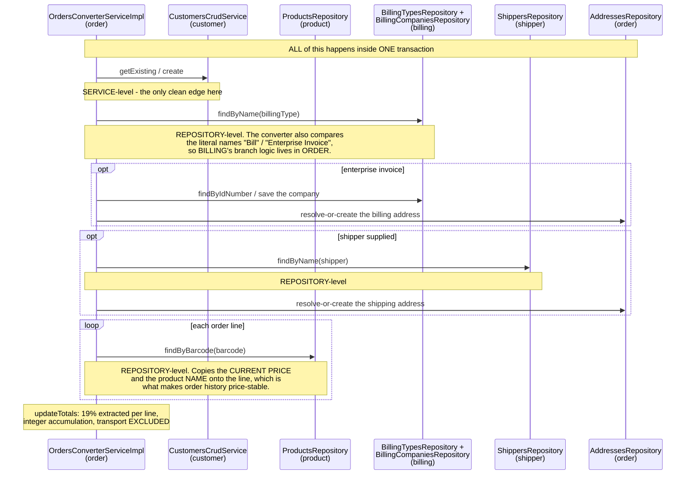
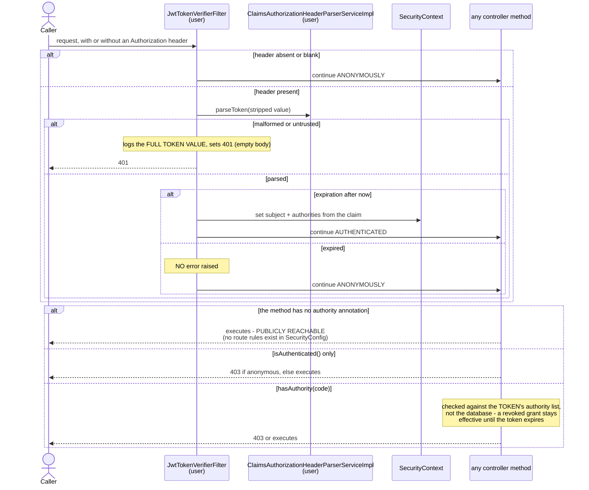

# Sequence Diagrams (system-wide)

The end-to-end flows that cross domain boundaries. Domain-scoped sequences live
in each `../detailed-domain-bre/domain-*/diagrams/sequence-diagram.md`.

## 1. Full purchase journey — registration through delivery completion

```mermaid
sequenceDiagram
    actor Buyer
    participant Register as PublicRegisterController<br/>(user)
    participant Login as JwtLoginAuthenticationFilter<br/>(user)
    participant Catalog as DataProductsController<br/>(product)
    participant Checkout as PublicCheckoutController<br/>(order)
    participant Transbank as Transbank Webpay Plus
    participant Orders as DataOrdersController<br/>(order)
    participant Mail as MailgunMailingServiceImpl<br/>(order)
    actor Operator

    Buyer->>Register: POST /public/register
    Note over Register: PUBLIC. Three UNWRAPPED writes:<br/>person, account (Customer role), customer.<br/>A failure at step 3 leaves a partial registration.
    Register-->>Buyer: 200

    Buyer->>Login: POST /public/login
    Login-->>Buyer: Bearer token in the header AND the body<br/>(authorities frozen for 30 minutes)

    Buyer->>Catalog: GET /data/products?categoryCode=TOOLS
    Note over Catalog: PUBLIC. Recursive category-branch expansion.<br/>Price AND stock levels returned anonymously.
    Catalog-->>Buyer: 200 page of products

    Buyer->>Checkout: POST /public/checkout (authority 'checkout')
    Note over Checkout: resolves payment type, customer, billing branch,<br/>shipper, addresses, and every line's product.<br/>Unit values OVERWRITTEN with catalogue prices.<br/>NO STOCK CHECK ANYWHERE.
    Checkout->>Transbank: create a payment page
    Transbank-->>Checkout: redirection URL + 64-char token
    Note over Checkout: order advances Pending -> Payment Started<br/>and the token is stored
    Checkout-->>Buyer: 200 {url, token}

    Buyer->>Transbank: pays on the hosted page
    Transbank->>Checkout: GET /public/checkout/validate?token_ws=...
    Note over Checkout: PUBLIC callback. No signature, no origin check,<br/>no idempotency key. Lookup filters on<br/>status=Payment Started: the only replay guard.
    Checkout->>Transbank: commit the payment
    Transbank-->>Checkout: responseCode (0 = paid)
    Note over Checkout: 0 -> Paid, Unconfirmed; otherwise -> Payment Failed.<br/>A commit FAILURE is swallowed as a decline.
    Checkout->>Mail: notify the customer (payment template)
    Note over Mail: sent AFTER the transition is committed.<br/>No retry; a failure loses the mail and returns 500.
    Checkout-->>Buyer: 303 -> storefront receipt page

    Operator->>Orders: POST /data/orders/confirmation (orders:update)
    Note over Orders: guard: current status must be Paid, Unconfirmed
    Orders->>Mail: notify customer AND owner
    Orders-->>Operator: 204

    Operator->>Orders: POST /data/orders/completion (orders:update)
    Note over Orders: guard: current status must be Paid, Confirmed
    Orders->>Mail: notify the customer
    Orders-->>Operator: 200

    Buyer->>Checkout: GET /public/receipt/{token}
    Note over Checkout: PUBLIC, token-addressed, NO status restriction
    Checkout-->>Buyer: 200 receipt
```

## 2. Guest checkout — the alternative entry path

```mermaid
sequenceDiagram
    actor Visitor
    participant GuestFilter as JwtGuestAuthenticationFilter<br/>(user)
    participant CustomerSvc as CustomersCrudServiceImpl<br/>(customer)
    participant PersonRow as people row<br/>(person)
    participant Checkout as PublicCheckoutController<br/>(order)

    Visitor->>GuestFilter: POST /public/guest (a person profile)
    Note over GuestFilter: only functional when<br/>trebol.security.guest-user-enabled = true
    GuestFilter->>CustomerSvc: create(profile)
    CustomerSvc->>PersonRow: cascade-create the person
    alt already registered
        CustomerSvc-->>GuestFilter: EntityExists
        Note over GuestFilter: logged and TOLERATED; the flow continues
    else blank identification number
        CustomerSvc-->>GuestFilter: BadInput
        GuestFilter-->>Visitor: BadCredentials<br/>"Insufficient or invalid profile data for guest"
    end
    Note over GuestFilter: authenticates with the configured guest name<br/>used as BOTH username and password
    GuestFilter-->>Visitor: Bearer token with the guest role's authorities
    Visitor->>Checkout: POST /public/checkout (authority 'checkout')
    Note over Checkout,PersonRow: the "guest" is now a PERMANENT person +<br/>customer record, indistinguishable from<br/>a registered buyer
```

## 3. Cross-domain read — branch-aware catalogue search

```mermaid
sequenceDiagram
    actor Visitor
    participant Products as DataProductsController<br/>(product)
    participant Pred as ProductsPredicateServiceImpl<br/>(product)
    participant Tree as ProductCategoryTreeResolverServiceImpl<br/>(product-category)
    participant CatRepo as ProductsCategoriesRepository<br/>(product-category)
    participant ProdRepo as ProductsRepository<br/>(product)

    Visitor->>Products: GET /data/products?categoryCode=TOOLS
    Products->>Pred: parseMap(params)
    Pred->>Tree: getBranchIdsFromRootCode("TOOLS")
    Note over Pred,Tree: the CLEANEST cross-domain edge in the system:<br/>a service interface, not a repository
    Tree->>CatRepo: findByCode("TOOLS")
    loop one query per tree level, up to depth 20
        Tree->>CatRepo: findIdsByParentId(childId)
    end
    Tree-->>Pred: descendant category identifiers
    Note over Tree: beyond the configured depth the set is<br/>SILENTLY TRUNCATED; an unknown code returns<br/>an empty list and the filter is DROPPED,<br/>so the response is UNFILTERED
    Products->>ProdRepo: count + findAll with the combined filter
    Products-->>Visitor: 200 products in the whole branch
```

## 4. Cross-domain write — the order converter touching four domains



This single diagram is the clearest statement of the system's main extraction
problem: four of five domain dependencies are repository-level, and they are all
exercised in the checkout critical path. See
`../reference-documentation/coupling-hotspots.md` hotspot HS-01.

## 5. Authentication and authorization on every request



## 6. Account profile — the four-way person resolution

```mermaid
sequenceDiagram
    actor Holder
    participant Profile as AccountProfileController<br/>(user)
    participant Svc as ProfileServiceImpl<br/>(user)
    participant Users as UsersRepository<br/>(user)
    participant People as PeopleRepository + PatchService<br/>(person)

    Holder->>Profile: PUT /account/profile (PersonPojo)
    Note over Profile: isAuthenticated() only.<br/>THE BODY IS NOT VALIDATED on this route.
    Profile->>Svc: updateProfileForUserWithName(principal, profile)
    Svc->>Users: findByNameWithProfile(userName)
    alt no such account
        Svc-->>Holder: 500 "There is no account with the specified username"<br/>(unmapped by the error advice)
    end
    alt the account already has a person
        Svc->>People: patchExistingEntity(changes, person)
        Note over People: names / idNumber / email applied only when<br/>non-blank; phone1 / phone2 UNCONDITIONALLY
    else the account has no person
        Svc->>People: find an existing person by identification number
        alt found and claimed by another account
            Svc-->>Holder: 400 "Person profile is associated to another account."<br/>NOTE: no unique constraint backs this check
        else found and unclaimed
            Svc->>Users: attach the existing person
        else not found
            Svc->>People: create and save a new person
            Svc->>Users: attach it
        end
    end
    Svc-->>Holder: 200
```

## Related documentation

- per-domain sequences: `../detailed-domain-bre/domain-*/diagrams/sequence-diagram.md`
- the cross-domain feature catalogue: `../detailed-domain-bre/cross-domain-features.md`
- the integrations in detail: `../reference-documentation/external-integrations-map.md`
