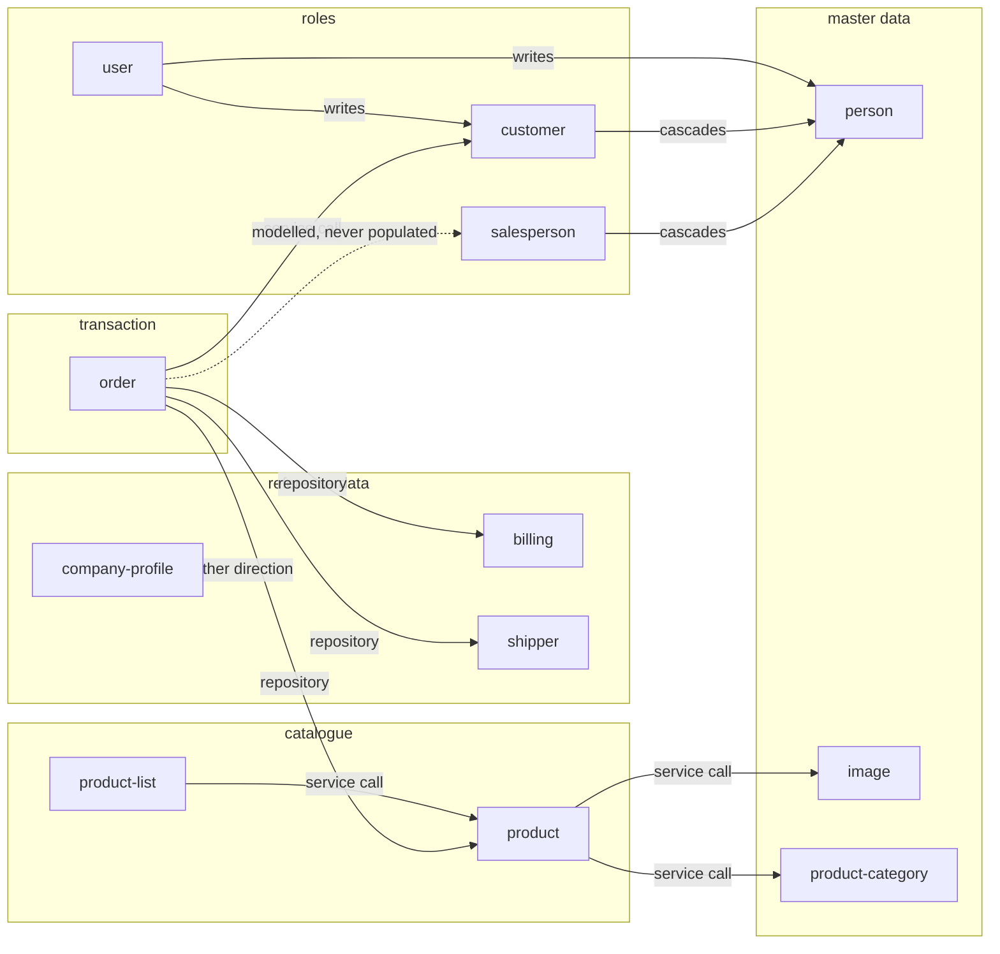

# Bounded Contexts

## The boundary rule applied (recorded for reproducibility)

> **Split into separate domains unless the concepts share a single aggregate
> root** — one entity whose lifecycle transactionally governs the others.
> Concepts that merely reference each other across a boundary stay separate;
> concepts mutated together within one aggregate's invariants merge.

Two supporting rules:

1. **Phantom-domain guard.** A candidate becomes a domain only if it has at least
   one service implementation **and** at least one owned table.
2. **Operational ownership.** When two contexts both touch a table, the owner is
   the primary reader and actor — the one whose code creates the rows and is the
   only one to read them.

Slugs are derived deterministically from the primary aggregate-root entity name,
kebab-cased, with no descriptive suffix: `Person` → `person`,
`ProductCategory` → `product-category`, `Order` → `order`.

---

## 1. `person` — Person Registry

**Aggregate root:** `Person`. **Invariant:** one person per national
identification number (database-enforced).

**Why separate from `customer`, `salesperson` and `user`:** all three reference a
person without governing its lifecycle — a person row survives the deletion of
any account, customer or salesperson that pointed at it
(`BR-USER-048`, `BR-CUSTOMER-014`, `BR-SALESPERSON-018`). The uniqueness
guarantee is the contract three other contexts depend on, which makes it a
master-data context rather than part of any of them.

**Evidence:** `jpa/entities/Person.java`; the three referencing entities declare
no removal cascade.

---

## 2. `image` — Image Registry

**Aggregate root:** `Image`. **Invariant:** code, filename and URL are each
globally unique.

**Why separate from `product`:** image rows outlive any individual product, while
the `product_images` link rows do not — they are deleted and rebuilt wholesale
whenever a product is replaced (`BR-PRODUCT-011`). The link table therefore
belongs to the product aggregate and the image rows do not.

**Evidence:** `jpa/services/crud/impl/ProductsCrudServiceImpl.java` rebuilds
links; `ImagesCrudServiceImpl` manages image rows independently.

---

## 3. `product-category` — Product Category Tree

**Aggregate root:** `ProductCategory` (self-referencing). **Invariants:** globally
unique code; name unique among siblings; recursion bounded by configuration; a
patch can never detach a category from its parent.

**Why separate from `product`:** products reference a category optionally and
with no cascade; the tree's own invariants (sibling-name uniqueness,
parent preservation, depth limit) are maintained entirely within this context.
`product` consumes only the descendant-resolution capability, through a service
interface.

**Evidence:** `jpa/services/impl/ProductCategoryTreeResolverServiceImpl.java`
consumed by `ProductsPredicateServiceImpl`; the parent re-attachment override in
`ProductCategoriesCrudServiceImpl`.

---

## 4. `billing` — Billing

**Aggregate root:** `BillingType` governing the billing branch, with
`BillingCompany` in the same context.

**Why the two entities merge:** the billing type chosen for an order **decides
whether a billing company is required at all** — the enterprise branch resolves
or creates a company and a billing address, the individual branch records
neither. The two are therefore mutated together inside one transactional decision
rather than merely referencing each other.

**Evidence:**
`jpa/services/conversion/impl/OrdersConverterServiceImpl.convertBillingInformationForEntity`;
`config/Constants.java` declares both billing-type names.

---

## 5. `shipper` — Shipper

**Aggregate root:** `Shipper`. **Invariant:** unique carrier name.

**Why separate from `order`:** carriers are created and maintained by operators
before any order references them, and their lifecycle is entirely independent of
any order. `order` only reads them by name.

**Evidence:** `DataShippersController` offers full carrier maintenance;
`orders.shipper_id` is nullable with no cascade.

---

## 6. `company-profile` — Company Profile

**Aggregate root:** `Param`, addressed by the composite key
`(category, name)`.

**Why separate from everything:** `app_params` is referenced by no table and read
by exactly one service. The context shares no entity, no repository and no
foreign key with any other, and it is the only context that opts out of the
generic CRUD framework entirely.

**Evidence:** repo-wide, `ParamsRepository` has a single consumer
(`CompanyServiceImpl`).

---

## 7. `user` — Identity & Access

**Aggregate root:** `User`, with `UserRole`, `Permission` and
`UserRolePermission` in the same context.

**Why the four entities merge:** a caller's effective authorities are derived
**transactionally** from account → role → grant → authority at login
(`BR-USER-005`). Splitting them would allow a login to observe a half-applied
permission change. The grant table is a pure join entity with immutable columns,
which places it inside the aggregate by the stated rule.

**Why it is not merged with `person` or `customer`:** it *writes* both during
registration and guest authentication, but it does not govern their lifecycle —
and both have their own REST surfaces and authority sets. The dependency is
recorded as an outbound coupling (see `anti-corruption-layers.md`) rather than a
merged boundary.

**Evidence:** `security/UserDetailsServiceImpl.java`,
`security/services/impl/UserPermissionsServiceImpl.java`,
`jpa/entities/UserRolePermission.java`.

---

## 8. `customer` — Customer

**Aggregate root:** `Customer`. **Invariant:** one customer per person
(database-enforced through a unique column and a one-to-one mapping).

**Why separate from `person`:** the buyer role has its own authority set, its own
REST surface and its own uniqueness invariant, and a person may exist with no
customer row. The cascading association means a customer *creates* a person, but
the person outlives it.

**Why separate from `order`:** customers are maintained independently of any
order, and an order merely references one.

**Evidence:** `UK_CUSTOM_PERSON_ID`; `jpa/entities/Customer.java`;
`DataCustomersController` with its own `customers:*` authorities.

---

## 9. `salesperson` — Salesperson

**Aggregate root:** `Salesperson`.

**Why separate from `customer` despite the structural parallel:** the two differ
in four material ways — association type, person-uniqueness enforcement, presence
of a correction route, and whether the order reference is mandatory
(`BR-SALESPERSON-002`, `BR-SALESPERSON-010`, `BR-SALESPERSON-014`). They are not
the same concept with a different label.

**Why separate from `user`:** nothing links `salespeople` to `app_users`. The
seeded `Salesperson` role and the seeded `salesperson` account are part of the
identity context and have no relationship to any salesperson row
(`BR-SALESPERSON-020`).

**Evidence:** absence of any foreign key or service call between the two tables.

---

## 10. `product` — Product Catalog

**Aggregate root:** `Product`, governing `ProductImage`.

**Why the link entity is inside:** link rows are deleted and recreated wholesale
on every product replacement, so their lifecycle is transactionally governed by
the product — the definition of an aggregate boundary.

**Why `product-category` and `image` stay outside:** both are referenced
optionally, with no cascade, and both are consumed through service interfaces.

**Evidence:**
`jpa/services/crud/impl/ProductsCrudServiceImpl.java` (delete-then-rebuild);
`ProductImagesRepository.deleteByProductId`.

---

## 11. `product-list` — Product List

**Aggregate root:** `ProductList`, governing `ProductListItem`.

**Why the membership entity is inside:** deleting a list deletes its membership
rows first — this is the only pre-delete child cleanup in the system
(`BR-PRODLIST-021`) — and replacing contents deletes and rebuilds them wholesale.

**Why `product` stays outside:** membership references products through a
service-level lookup, and products exist independently of any list.

**Evidence:** `jpa/services/crud/impl/ProductListsCrudServiceImpl.java` delete
override; `api/controllers/DataProductListContentsController.java`.

---

## 12. `order` — Order, Checkout & Fulfilment

**Aggregate root:** `Order`, governing `OrderDetail`, and the operational owner
of `OrderStatus`, `Address` and `PaymentType`.

**Why the lines are inside:** `OrderDetail.order` is mapped neither insertable
nor updatable, so a line cannot exist outside or be re-pointed
(`BR-ORDER-068`); lines are written through the parent's cascade.

**Why statuses, addresses and payment types are inside:** each is read by this
context only. Statuses are the vocabulary of this context's state machine;
addresses are created exclusively during checkout and are immutable once
referenced; payment types have no service, no controller and exactly two readers,
both in this context. Operational ownership applies. See `data-ownership.md`.

**Why `checkout`, `payment` and `mailing` are not separate domains:** none owns a
table. Checkout is this context's orchestration surface; payment and mailing are
outbound adapters.

**Evidence:** `api/services/impl/OrdersProcessServiceImpl.java` (the state
machine), `jpa/entities/Order.java` (six not-updatable associations),
`AddressesRepository` and `PaymentTypesRepository` each with consumers only in
this context.

---

## Context map

## Boundary decisions summary

| Decision | Rule applied | Outcome |
|---|---|---|
| merge the four identity tables | shared aggregate root (transactional authority derivation) | one `user` context |
| merge billing types and companies | shared aggregate decision (the branch determines the company requirement) | one `billing` context |
| keep `product`, `product-category`, `product-list` separate | reference-only relationships, independent invariants | three contexts |
| keep `person`, `customer`, `salesperson` separate | independent invariants, surfaces and lifecycles | three contexts |
| place join entities with their parents | lifecycle governed transactionally by the parent | 4 join entities absorbed |
| place statuses, addresses, payment types in `order` | operational ownership (sole reader and actor) | 3 tables absorbed |
| reject `checkout`, `payment`, `mailing` | phantom-domain guard (no owned table) | documented as features/adapters of `order` |
