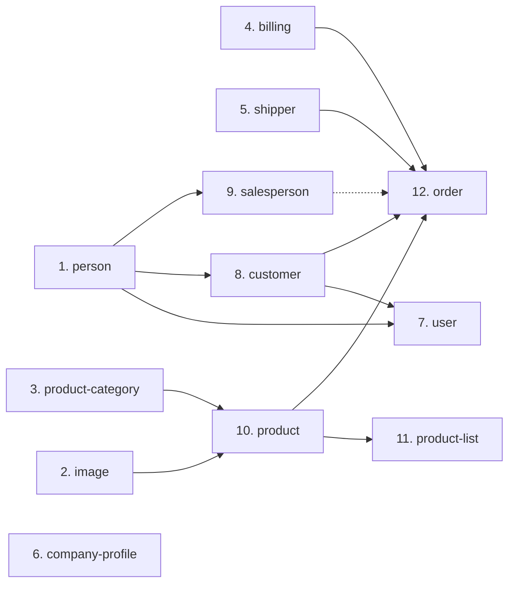

# Execution Order

The recommended order for producing detailed specifications and for extracting
domains. It matches `execution_order` in `domain-manifest.json` exactly.

## The order

| # | Slug | Name | Complexity | Rules | Depends on | Why here |
|---|---|---|---|---|---|---|
| 1 | `person` | Person Registry | small | 13 | — | master data that three later domains write; establishing its contract first unblocks them |
| 2 | `image` | Image Registry | small | 15 | — | leaf reference data; one clean service-level consumer |
| 3 | `product-category` | Product Category Tree | medium | 20 | — | leaf reference data; supplies the descendant-resolution capability `product` consumes |
| 4 | `billing` | Billing | small | 19 | — | leaf reference data; its branch decision must move here before `order` is touched |
| 5 | `shipper` | Shipper | small | 15 | — | leaf reference data |
| 6 | `company-profile` | Company Profile | small | 13 | — | **completely isolated** — no edge in either direction |
| 7 | `user` | Identity & Access | large | 55 | `person`, `customer` | needs the person contract (item 1); its authority vocabulary is consumed by everything, so it must be settled before the consuming domains are finalised |
| 8 | `customer` | Customer | small | 22 | `person` | needs the person contract; must exist before `order` |
| 9 | `salesperson` | Salesperson | small | 23 | `person` | needs the person contract; no live consumer, so position is flexible |
| 10 | `product` | Product Catalog | medium | 32 | `image`, `product-category` | needs items 2 and 3 |
| 11 | `product-list` | Product List | medium | 30 | `product` | needs item 10 |
| 12 | `order` | Order, Checkout & Fulfilment | large | 70 | `customer`, `product`, `billing`, `shipper`, `salesperson` | needs items 4, 5, 8, 9, 10; the only domain depending on five others |

## Dependency graph



`company-profile` has no edge in either direction and could be done at any
point; it is placed at position 6 to close out the dependency-free tier.

The dotted edge is modelled but never executed — no route populates an order's
salesperson reference (`BR-SALESPERSON-015`).

## The ordering rule

**Dependency-free domains first, orchestrators last.** Within each tier, smaller
and more isolated domains precede larger ones so that the contracts the larger
domains need are already settled.

Three tiers emerge from the dependency graph:

| Tier | Domains | Character |
|---|---|---|
| 1 (items 1–6) | `person`, `image`, `product-category`, `billing`, `shipper`, `company-profile` | **no outbound domain dependency**; all leaf data |
| 2 (items 7–10) | `user`, `customer`, `salesperson`, `product` | depend only on tier 1 |
| 3 (items 11–12) | `product-list`, `order` | depend on tier 2 |

`user` sits in tier 2 rather than tier 1 because it depends **outward** on
`person` and `customer` — an inversion worth noting, since a security kernel
would normally be a leaf.

## Why `order` is last, and why that is low-risk

`order` has five outbound dependencies and **zero** inbound ones: no domain
reads orders, order lines, order statuses, addresses or payment types. It is a
pure consumer.

Consequently:

- it **must** come last, because four of its five dependencies need lookup
  contracts that do not exist yet;
- but extracting it carries **no risk to any other domain**, because nothing
  depends on it.

The same is true of `product-list` at position 11: nothing consumes product lists
either.

## Prerequisite refactors, mapped onto the order

These are safe refactors inside the monolith that make the later items
tractable. The numbers refer to the hotspots in
`../reference-documentation/coupling-hotspots.md`.

| Before item | Refactor | Hotspot |
|---|---|---|
| 1 | define the person-management contract (find, create, patch, claimed-check) | HS-02 |
| 4 | move the individual-versus-enterprise branch decision out of the order converter and into `billing` | HS-04 |
| 7 | generate authority-code constants and replace every string literal | HS-03 |
| 7 | split `Constants` by domain | HS-04 |
| 10 | define the product lookup contract (barcode → name, current price) | HS-01 |
| 11 | move the product-list contents lookup behind a service, out of the controller | HS-05 |
| 12 | define the billing-classification, billing-company and carrier lookup contracts | HS-01 |
| 12 | replace the two database cascades with explicit application behaviour | HS-08 |

Steps against items 1, 4, 7 and 10 deliver most of the decoupling benefit before
any physical separation is attempted.

## Alternative groupings worth considering

The twelve boundaries are an extraction plan, not a mandate to deploy twelve
services. Two sensible consolidations:

| Group | Members | Rationale |
|---|---|---|
| people and roles | `person` + `customer` + `salesperson` | 38 files, 2,076 lines combined. Keeps the two cascading writes atomic (`BR-CUSTOMER-003`) and avoids a distributed create. Strongly recommended for a first step. |
| catalogue | `product` + `product-category` + `product-list` | 51 files, 3,309 lines. All three inter-domain edges are already clean service calls, so this grouping is optional rather than necessary — but it also keeps the one schema cascade internal (`BR-PRODLIST-023`). |

`company-profile` should be extracted first regardless of grouping: it is one
table with no consumer and no foreign key, and it is the only domain that does
not inherit the generic framework.

## Verification

```
execution_order length          : 12
domains length                  : 12
set equality                    : true
duplicates in execution_order   : none
```

Confirmed mechanically against `domain-manifest.json`; the stdout is recorded in
`../validation_summary.md` (criterion S2-9).
