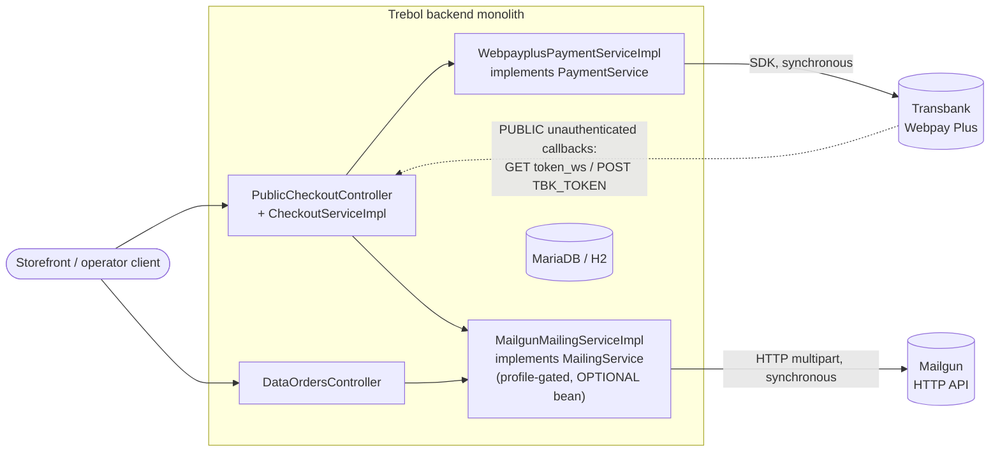

# External Integrations Map

The system has **exactly two** outbound integrations, both owned by the `order`
domain, both synchronous, and both without retry or idempotency. Eleven of the
twelve domains have no external integration at all.

---

## 1. Transbank Webpay Plus — payment

| Aspect | Detail |
|---|---|
| Purpose | hosted payment page and payment confirmation |
| Component | `payment/impl/webpayplus/WebpayplusPaymentServiceImpl.java` |
| Contract | `payment/PaymentService.java` — three operations |
| Transport | the provider's Java SDK (`transbank-sdk-java`), synchronous, blocking |
| Credentials | sandbox commerce code, API key and test mode **by default**; the configured `commerceCode` / `apiKey` and live mode only when `trebol.payment.webpayplus.production` is true |
| Configuration | `trebol.payment.webpayplus.production`, `.commerceCode`, `.apiKey`, `.callbackUrl` (mandatory), `.browserRedirectionUrl` (mandatory) |
| Failure handling | creation failure → `Webpay could not create a new transaction`; **commit failure → swallowed and returned as a non-zero response code**, i.e. treated as a decline; transport failure → `Webpay failed to confirm the transaction` |
| Retry | **none** |
| Idempotency | **none** outbound; inbound protection is incidental only |
| Timeout / circuit breaker | **none configured** |
| Rules | `BR-ORDER-034` … `BR-ORDER-043` |

### Outbound operations

| Operation | Request contents | Response |
|---|---|---|
| create a payment page | the order identifier as the buy order, **the order model's hash code** as the session identifier, the order total as the amount, the configured callback URL | a redirection URL and a 64-character token |
| commit a payment | the token | a response code — **zero means paid** |
| result page URL | — | the configured browser redirection URL |

Two notable details: the session identifier is a Java hash code, which is not
stable across processes (`BR-ORDER-034`); and the amount is the order total,
which **excludes** `transportValue` (`BR-ORDER-016`, `BR-ORDER-035`).

### Inbound callbacks

| Route | Verb | Parameter | Effect |
|---|---|---|---|
| `/public/checkout/validate` | GET | `token_ws` | confirm → `Paid, Unconfirmed` or `Payment Failed` |
| `/public/checkout/validate` | POST | `TBK_TOKEN` | abort → `Payment Cancelled` |

Both are **public and unauthenticated** because the provider calls them. Security
posture:

- **no signature verification**;
- **no provider-origin check**;
- **no idempotency key**;
- the only replay protection is that the order lookup filters on status
  `Payment Started`, so a second callback for an already-confirmed order finds
  nothing (`BR-ORDER-041`);
- the parameter names are dictated by the provider and are asymmetric between the
  two verbs (`BR-ORDER-043`).

Both respond `303` with a `Location` header rather than returning data.

---

## 2. Mailgun — notification

| Aspect | Detail |
|---|---|
| Purpose | order-status notification to the customer and to the shop owner |
| Component | `mailing/impl/mailgun/MailgunMailingServiceImpl.java` |
| Contract | `mailing/MailingService.java` — two operations |
| Transport | plain HTTP via the Unirest client, synchronous, blocking |
| Endpoint | `https://api.mailgun.net/v3/{domain}/messages`, basic authentication with the API key |
| Activation | gated on the `mailgun` profile — when inactive **no mailing bean exists at all** |
| Optionality | injected optionally and null-checked at every call site, so the order flow works with no mail provider (`BR-ORDER-052`) |
| Configuration | `trebol.mailing.*` (sender, owner, date format, seven subjects) and `trebol.mailing.mailgun.*` (API key, domain, seven template names) — **all blank in the shipped files** |
| Request shape | multipart fields `from`, `to`, `subject`, `template`, plus a Mailgun variables header carrying a JSON object with a receipt projection of the order and the customer's person data |
| Success check | the response must contain an identifier; a blank one raises `Status of the sent e-mail is unknown, Mailgun did not provide an ID for this api` |
| Failure handling | the failure is **unmapped**, so it surfaces as a 500-class response — **after** the order transition has already been committed |
| Retry | **none** — a failed notification is lost permanently |
| Transactionality | **none** — see `BR-ORDER-055` |
| Rules | `BR-ORDER-049` … `BR-ORDER-055` |

### Trigger matrix

| Order status | Customer mail | Owner mail |
|---|---|---|
| `Pending`, `Payment Started`, `Payment Cancelled`, `Payment Failed` | — | — |
| `Paid, Unconfirmed` | payment template | — |
| `Paid, Confirmed` | confirmation template | confirmation template |
| `Rejected` | rejection template | — (subject configured, route does not send) |
| `Delivery Complete` | completion template | — (subject configured, route does not send) |

An unmapped status produces no mail and no error (`BR-ORDER-051`). Note the
discrepancy: owner rejection and completion subjects are configured — and marked
"Not used" in the properties file — while only the confirmation route actually
notifies the owner.

### Call sites

| Route | Notifies |
|---|---|
| `GET /public/checkout/validate` (successful payment) | customer |
| `POST /data/orders/confirmation` | customer **and** owner |
| `POST /data/orders/rejection` | customer |
| `POST /data/orders/completion` | customer |

---

## 3. The database

Not an "integration" in the service sense, but the only other external
dependency:

| Aspect | Detail |
|---|---|
| Runtime default | an in-memory H2 database (`jdbc:h2:mem:test`) with credentials in the committed configuration file |
| Production target | MariaDB — a commented-out data-source block exists in the configuration file |
| Schema | `src/main/resources/schema-mariadb.sql` (a MariaDB dump) |
| Seed | `src/main/resources/data.sql`, including identity-generator restart statements required by H2 |
| Note | `src/main/resources/META-INF/persistence.xml` is **stale and unused** — it uses a legacy namespace, lists a non-existent entity and omits seven that do exist |

---

## What is NOT integrated

Material absences, each worth stating because the domain names suggest otherwise:

| Expected integration | Status | Evidence |
|---|---|---|
| carrier / shipping API | **none** — `shipper` is a local name with no rate lookup, label generation or tracking | `../detailed-domain-bre/domain-shipper/integrations.md` |
| tax authority / electronic invoicing | **none** — the `Enterprise Invoice` billing type records an intent and nothing acts on it; no document is generated | `../detailed-domain-bre/domain-billing/integrations.md` |
| inventory / warehouse system | **none** — stock is a local, inert attribute | `BR-PRODUCT-021` |
| object storage / content delivery for images | **none** — only URLs pointing elsewhere are stored; no binary is ever handled | `BR-IMAGE-006` |
| identity provider / single sign-on / directory | **none** — all credentials are local | `../detailed-domain-bre/domain-user/integrations.md` |
| message broker, queue or stream | **none** | `../cross-cutting-documentation/event-publishing-patterns.md` |
| search engine / indexing | **none** — all search is database predicates |
| analytics, telemetry or monitoring export | **none** — only ad-hoc log statements |
| accounting or enterprise-resource-planning export | **none** |
| secret manager | **none** — the signing key, database credentials and bootstrap passwords are all in the committed configuration |

---

## Implications for a rewrite

1. **Both integrations are synchronous with no resilience.** No timeout, retry,
   circuit breaker or bulkhead is configured for either. The payment integration
   is on the critical path of checkout; the mail integration is on the critical
   path of order progression despite being logically optional.
2. **The payment callback surface is the largest security gap.** Public,
   unauthenticated, no signature, no idempotency — and it drives state
   transitions on real orders.
3. **Treat the commit-failure swallow as a defect.** An infrastructure failure
   during confirmation currently marks an order `Payment Failed`, which is
   indistinguishable from a genuine decline.
4. **Notification should move behind an event.** It is already optional in intent
   and coupled in implementation; decoupling it removes the "status committed,
   mail lost" failure mode. No event infrastructure exists to extend.
5. **Everything else is new work.** Shipping, invoicing, inventory and image
   hosting are all modelled-but-unintegrated, so a rewrite that adds them is
   building, not porting.

## Related documentation

- the order domain's integration detail: `../detailed-domain-bre/domain-order/integrations.md`
- the configuration switches that control both adapters: `feature-flag-inventory.md`
- why there is no asynchronous alternative: `cron-daemon-inventory.md`, `../cross-cutting-documentation/event-publishing-patterns.md`
