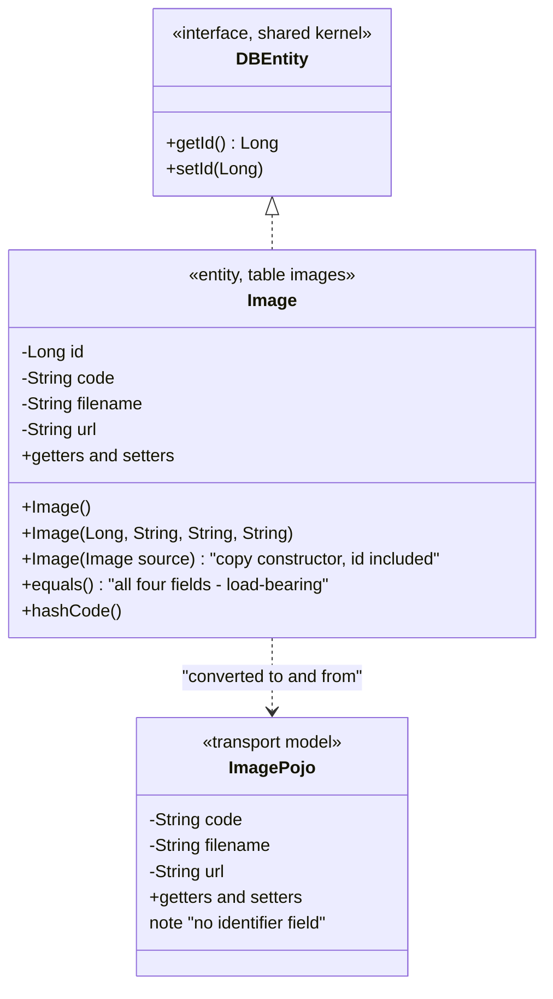
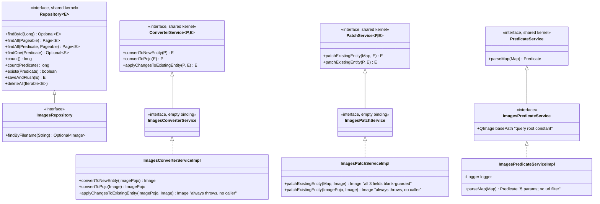
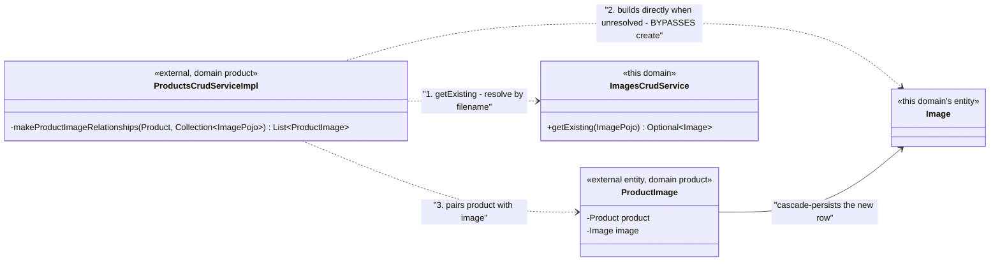

# Image Registry — Class Diagram

A self-contained view of the domain's types and their bindings to the shared-kernel
contracts. Behavioural detail is in documents `01` and `02`; field detail in
`specs/01-data-model.md`.

## Domain types

The domain declares **no exception type of its own** — unlike the sibling `person` domain.
Every error it raises is either the application's shared bad-input type or a framework
exception; see `errors.md`.

## Service layer

## CRUD orchestration and the write-capable controller

```mermaid
classDiagram
    direction TB

    class CrudService~M,E~ {
        <<interface, shared kernel>>
        +create(M) M
        +readMany(int, int, Sort, Predicate) DataPagePojo~M~
        +readOne(Predicate) M
        +getExisting(M) Optional~E~
        +update(M, Long) Optional~M~
        +update(M, Predicate) Optional~M~
        +partialUpdate(Map, Long) Optional~M~
        +partialUpdate(Map, Predicate) Optional~M~
        +delete(Predicate)
    }

    class CrudGenericService~M,E~ {
        <<abstract, shared kernel, transactional>>
        #ITEM_NOT_FOUND "Requested item(s) not found"
        #ITEM_ALREADY_EXISTS "The item already exists"
        -Repository~E~ repository
        -ConverterService~M,E~ converter
        -PatchService~M,E~ patchService
        #flushPartialChanges(Map, E) E "no-write-if-unchanged"
        #validateInputPojoBeforeCreation(M)
    }

    class ImagesCrudService {
        <<interface, empty binding>>
    }

    class ImagesCrudServiceImpl {
        <<transactional>>
        -ImagesRepository imagesRepository
        +getExisting(ImagePojo) Optional~Image~ "the only override - filename only"
    }

    class DataController~M~ {
        <<interface, shared kernel>>
        +readMany(Map) DataPagePojo~M~
    }

    class DataCrudController~M~ {
        <<interface, shared kernel>>
        +create(M)
        +update(M, Map)
        +partialUpdate(Map, Map)
        +delete(Map)
    }

    class DataGenericController~M,E~ {
        <<abstract, shared kernel, read pipeline>>
        #PaginationService paginationService
        #SortSpecParserService sortService
        #CrudService~M,E~ crudService
        #PredicateService predicateService
        #getOrderSpecMap() Map
    }

    class DataCrudGenericController~M,E~ {
        <<abstract, shared kernel, write-capable>>
        +update(M, Map) "guard: Missing request params"
        +partialUpdate(Map, Map) "guard: Missing request params"
        +delete(Map) "INVERTED guard - empty map is a silent no-op"
    }

    class DataImagesController {
        <<REST controller, /data/images>>
        +readMany(Map) "images:read, 200"
        +create(ImagePojo) "images:create, 201 empty body"
        +update(ImagePojo, Map) "images:update, 204"
        +partialUpdate(Map, Map) "images:update, 204"
        +delete(Map) "images:delete, 204"
        #getOrderSpecMap() Map
    }

    class ImagesSortSpec {
        <<helper, non-instantiable>>
        -QImage BASE_PATH
        +Map ORDER_SPEC_MAP "code, filename, url"
    }

    CrudService <|.. CrudGenericService
    CrudService <|-- ImagesCrudService
    CrudGenericService <|-- ImagesCrudServiceImpl
    ImagesCrudService <|.. ImagesCrudServiceImpl
    DataController <|.. DataGenericController
    DataGenericController <|-- DataCrudGenericController
    DataCrudController <|.. DataCrudGenericController
    DataCrudGenericController <|-- DataImagesController
    DataImagesController ..> ImagesSortSpec : "reads allow-list"
    ImagesCrudServiceImpl ..> ImagesRepository : "injected"
    ImagesCrudServiceImpl ..> ImagesConverterService : "injected"
    ImagesCrudServiceImpl ..> ImagesPatchService : "injected"
    DataImagesController ..> ImagesCrudService : "injected"
    DataImagesController ..> ImagesPredicateService : "injected"
```

## Cross-domain structure

**The bypass is the point.** The `product` domain resolves through this domain's service but
**constructs and cascade-persists `Image` rows itself** rather than calling `create`. So the
only internal write path skips the duplicate guard, the 409 path and route-layer validation
(BR-IMAGE-024). A blank filename is additionally swallowed and the image silently dropped —
see `specs/06-integration-points.md` §2.3.

## Reading the structure

1. **Three of four domain contracts are empty type bindings.** `ImagesCrudService`,
   `ImagesConverterService` and `ImagesPatchService` declare no methods; they exist so the
   injection container can resolve the generic shared-kernel contracts for this type pair.
   `ImagesPredicateService` is the exception — it carries the query-root constant.
2. **`ImagesCrudServiceImpl` overrides exactly one method.** Everything else is inherited
   generic behaviour parameterised by `getExisting` — and `getExisting` checks one of the
   three unique fields, which is the root of BR-IMAGE-002.
3. **The controller extends the write-capable base.** That one choice is why this domain has
   five endpoints while the structurally identical `person` domain has one. Capability
   cannot be inferred from the service layer.
4. **`DataCrudGenericController.delete` has an inverted guard.** `update` and
   `partialUpdate` throw on an empty parameter map; `delete` silently does nothing. Combined
   with a predicate that matches everything when no parameter is recognised, a typo deletes
   the registry (BR-IMAGE-013).
