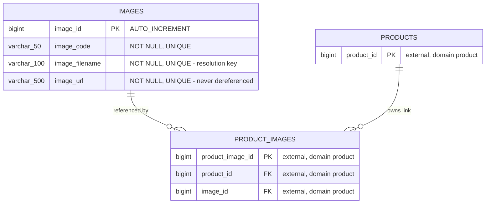
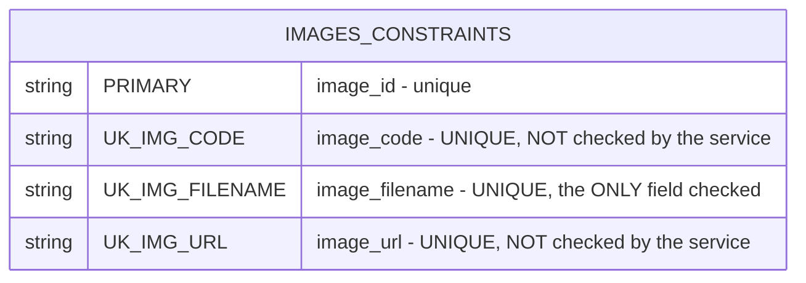

# Image Registry — Entity-Relationship Diagram

The domain owns one table and declares **no** relationships. The only association involving
`images` is held by the `product` domain's join table.

## Owned table in context

`PRODUCT_IMAGES` and `PRODUCTS` are **external reference nodes** — not owned by this domain,
shown only with the columns needed to express the relationship. Their authoritative
definitions are in the `product` domain specification.

## Ownership and cardinality

| Relationship | Cardinality | Owned by | Declared in this domain |
|---|---|---|---|
| `images` → `product_images` | one image to many links | `product` | **no** |
| `products` → `product_images` | one product to many links | `product` | n/a |

An image may be linked to many products; a product may hold many images. The many-to-many
is resolved by the join table, entirely outside this domain.

## The three-way uniqueness problem

All three business columns are independently unique, but
`ImagesCrudServiceImpl.getExisting` resolves by **filename alone**. A collision on `code` or
`url` therefore passes the application guard and fails at the database as a raw constraint
violation — **HTTP 500 instead of 409**. This is BR-IMAGE-002, the defining incoherence of
the domain.

There are **no non-unique indexes**, so the two substring filters (`codeLike`,
`filenameLike`) cannot use an index for a leading-wildcard pattern and will scan.

## Integrity notes

- **No cascade from the product side protects images.** This domain's `delete` is unbounded
  (BR-IMAGE-013); deleting an image still referenced by a product either fails on the
  join-table foreign key or orphans the relationship, depending on that table's constraint
  definition. This domain applies no protection of its own.
- **`url` is unique, sortable, and unfilterable.** No filter parameter addresses it
  (BR-IMAGE-019), so an image cannot be found, updated or deleted by URL.
- **Images are created by the `product` domain's cascade**, bypassing this domain's guard
  entirely (BR-IMAGE-024). The database constraints are the only enforcement on that path.
