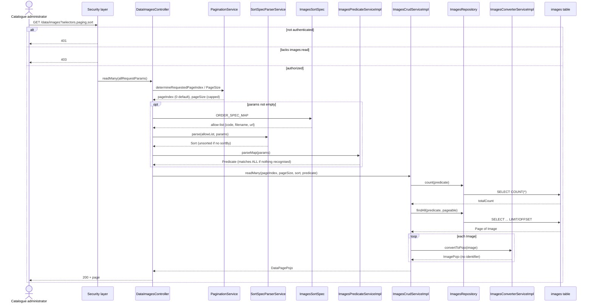
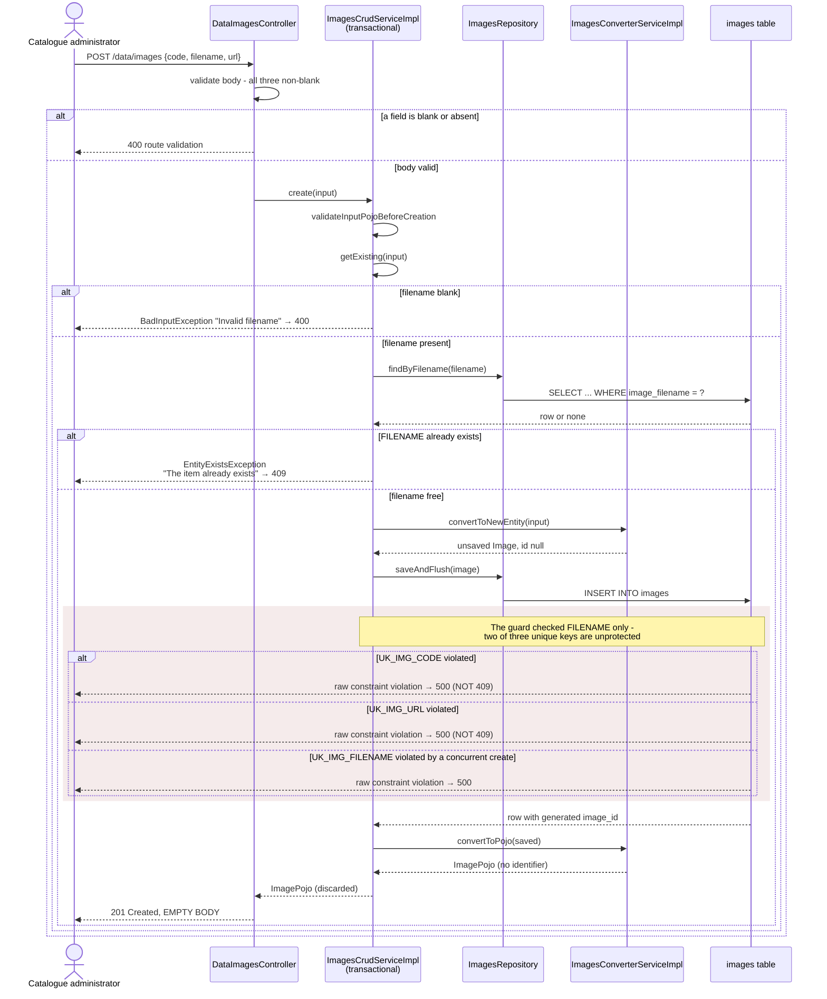
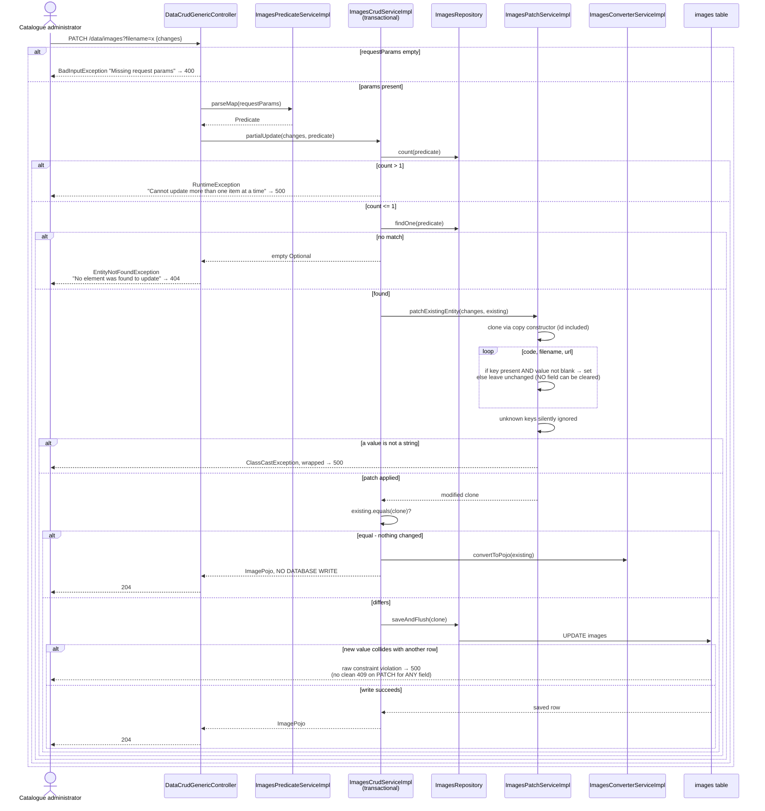
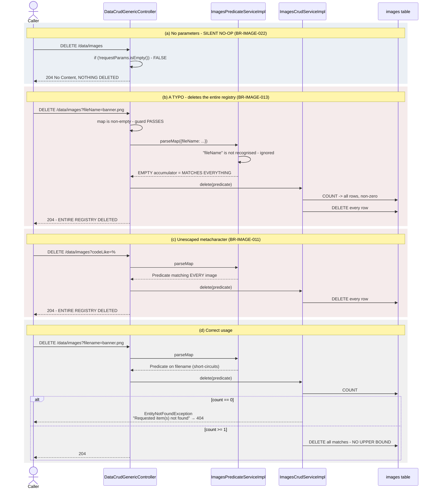
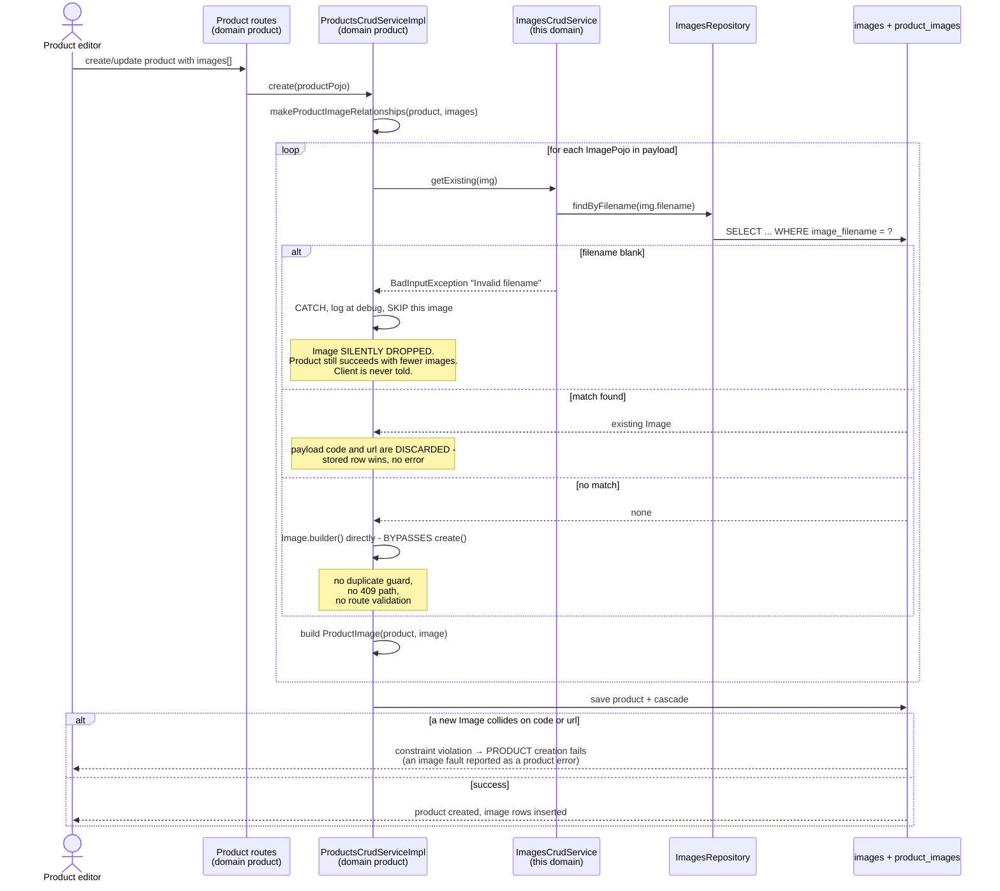

# Image Registry — Sequence Diagrams

Five flows: the list read, creation, patch, the destructive delete paths, and the
cross-domain write from the `product` domain. Step-level behaviour for every participant is
in document `02`.

---

## 1. List images — `GET /data/images`

Two database round trips per request, not atomic with respect to concurrent writes. An
out-of-range page yields an empty list with a non-zero total, not a 404.

---

## 2. Create an image — and the uniqueness defect

**Notes.** BR-IMAGE-002: two of the three duplicate cases report 500 rather than 409. The
guard and the insert are separate statements with no lock between them, so the concurrent
branch is reachable (BR-IMAGE-010). The 201 carries no body and the model has no
identifier, so a creator learns nothing about what it created (BR-IMAGE-012).

---

## 3. Patch an image

**Notes.** The equality comparison covers all four entity fields, which is what makes the
no-write branch reachable (BR-IMAGE-009). All three fields are blank-guarded, so no field
can be cleared and no null can reach a `NOT NULL` column (BR-IMAGE-007). A uniqueness
collision on patch is a 500 for every field, including filename (BR-IMAGE-002).

---

## 4. Delete — the four hazardous paths

**Why these are grouped.** Path (a) is safe but misreported — 204 is indistinguishable from
a real deletion. Paths (b) and (c) are the severe findings: an empty parameter map is safe
while a *typo* destroys the registry, because the controller's guard tests only
non-emptiness while the predicate defaults to matching everything. A rewrite MUST require at
least one **recognised** selector before deleting.

---

## 5. Cross-domain: the `product` domain writes images

**Notes.** This is the domain's entire internal write path and it bypasses the service's
creation operation (BR-IMAGE-024). Three behaviours a rewrite must decide about
deliberately: images created without `images:create`; a blank filename silently dropping an
image; and a payload's `code`/`url` being discarded when the filename already resolves.
Detail in `specs/06-integration-points.md` §2.3.

---

## 6. Flows that do not exist

Their absence is load-bearing:

- **No upload or download flow.** No binary content is ever received or served.
- **No URL dereference.** No HTTP client exists; the URL is never fetched or verified.
- **No image processing.** Nothing resizes, converts, compresses or inspects.
- **No event publication.** Nothing emits a domain event, message or notification.
- **No background job.** No scheduled or asynchronous flow touches this domain.
- **No cache interaction.** No flow reads or writes a cache.
- **No single-image fetch route.** `readOne` exists on the service but no endpoint calls it.
