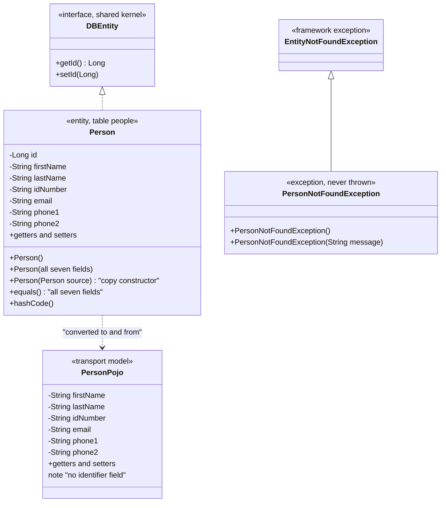
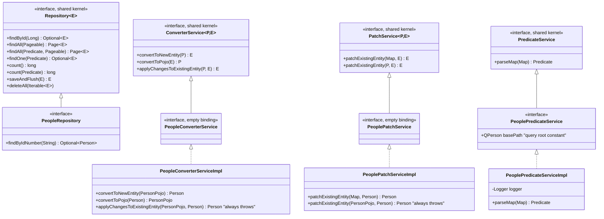
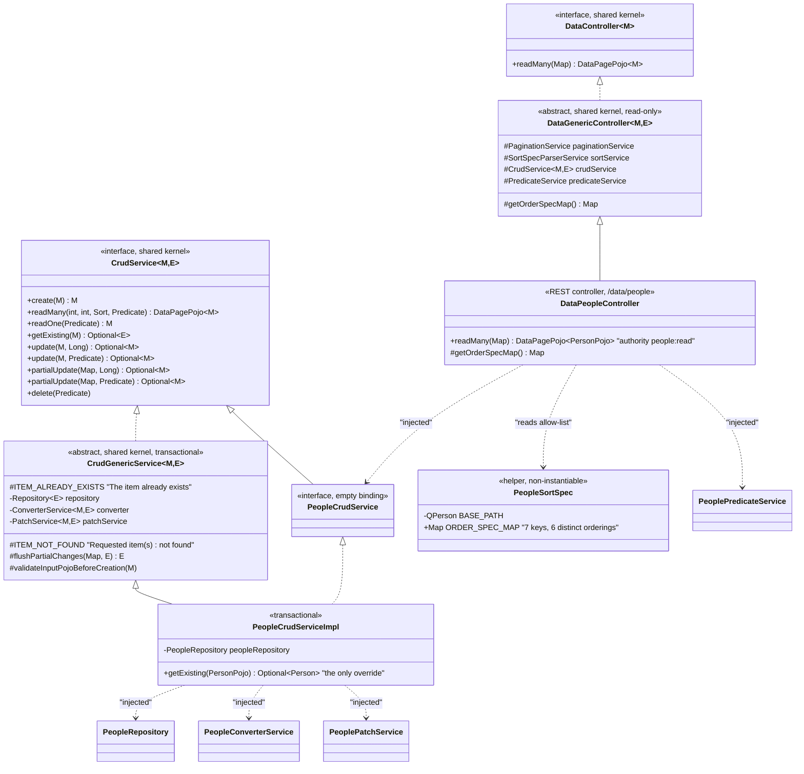

# Person Registry — Class Diagram

A self-contained view of the domain's types and their relationships to the shared-kernel
contracts they bind. Behavioural detail is in documents `01` and `02`; field-level detail
is in `specs/01-data-model.md`.

## Domain types and shared-kernel bindings

## Service layer

## CRUD orchestration and the controller

## Reading the structure

Three observations matter more than the shapes:

1. **The four domain-specific contracts are empty.** `PeopleCrudService`,
   `PeopleConverterService`, `PeoplePatchService` and the repository's own binding declare
   no methods of their own beyond `findByIdNumber` — they bind generic shared-kernel
   contracts to this domain's type pair so the injection container can resolve them. A
   rewrite in a language without that constraint can collapse them away.
   `PeoplePredicateService` is the one exception: it carries the query-root constant.
2. **`PeopleCrudServiceImpl` overrides exactly one method.** Everything else the CRUD
   service does is inherited generic behaviour parameterised by that one definition of
   "what identifies a person" (`getExisting`).
3. **The controller extends the read-only base.** `DataGenericController` contributes only
   a list operation — which is the structural reason the domain has no write route
   (BR-PERSON-013), and the reason an extraction must add one.
