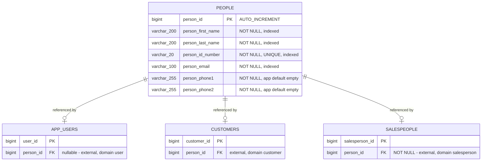
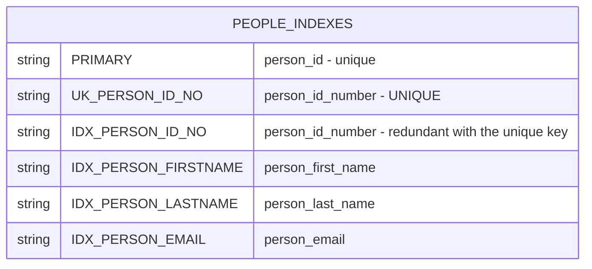

# Person Registry — Entity-Relationship Diagram

The domain owns one table and declares **no** relationships of its own. Every association
shown here is held by the far side, in a consumer domain — which is why `people` is a leaf
with three inbound arrows and no outbound ones.

## Owned table in context

`APP_USERS`, `CUSTOMERS` and `SALESPEOPLE` are **external reference nodes** — they are not
owned by this domain and are shown only with the columns needed to express the
relationship. Their authoritative definitions live in the `user`, `customer` and
`salesperson` domain specifications.

## Ownership and cardinality

| Relationship | Cardinality | Owned by | Constraint |
|---|---|---|---|
| `people` → `app_users` | one person to at most one account | `user` | FK on `app_users.person_id` |
| `people` → `customers` | one person to at most one customer | `customer` | FK on `customers.person_id` |
| `people` → `salespeople` | one person to at most one salesperson | `salesperson` | FK `FK_SPERSON_PERSON_ID`, `NOT NULL` |

## Integrity notes

- **No cascade deletes.** No consumer removes a person when its own record is removed, and
  nothing deletes a person directly (BR-PERSON-013). Orphan accumulation is steady-state.
- **The one-person-one-account rule has no database constraint.** None of the three
  `person_id` columns is declared unique, so the database permits two accounts, two
  customers or two salespeople to point at the same person. That the system behaves
  otherwise is an application-level property only.
- **`person_id_number` uniqueness is the only structural invariant** this domain
  contributes, and three domains depend on it.

## Index layout

The four non-unique indexes exist to support the search filters in
`specs/05-api-contract.md` §1.1. Note that the case-insensitive substring filters
(`*Like`) cannot use these indexes for a leading-wildcard pattern, so partial-match
searches scan — relevant if the registry grows large.
