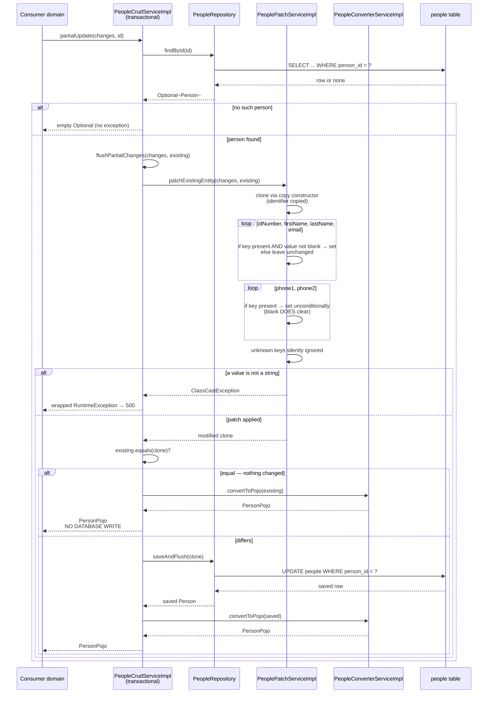
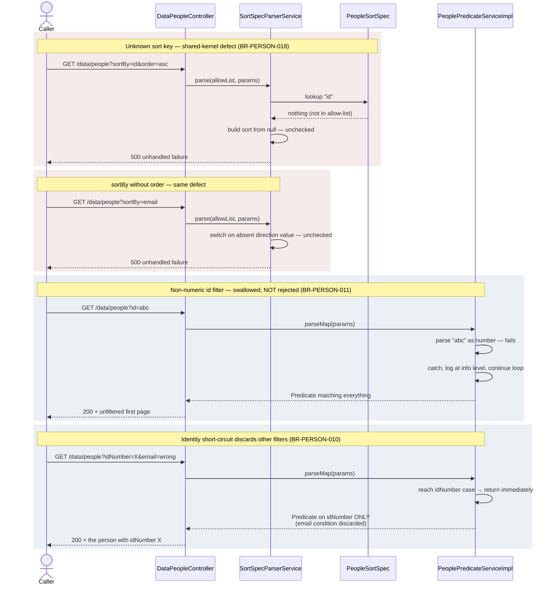

# Person Registry — Sequence Diagrams

Four primary flows: the one HTTP read path, the internal creation path, the internal patch
path, and the failure paths worth calling out. Step-level behaviour for every participant
is specified in document `02`.

---

## 1. List people — `GET /data/people`

The only HTTP flow in the domain.

```mermaid
sequenceDiagram
    actor Caller as Staff user
    participant Sec as Security layer
    participant Ctl as DataPeopleController
    participant Pag as PaginationService
    participant Srt as SortSpecParserService
    participant Spec as PeopleSortSpec
    participant Pred as PeoplePredicateServiceImpl
    participant Crud as PeopleCrudServiceImpl
    participant Repo as PeopleRepository
    participant Conv as PeopleConverterServiceImpl
    participant DB as people table

    Caller->>Sec: GET /data/people?filters,paging,sort
    Sec->>Sec: authenticate
    alt not authenticated
        Sec-->>Caller: 401
    else lacks authority people:read
        Sec-->>Caller: 403
    else authorized
        Sec->>Ctl: readMany(allRequestParams)
        Ctl->>Pag: determineRequestedPageIndex(params)
        Pag-->>Ctl: pageIndex (0 if absent)
        Ctl->>Pag: determineRequestedPageSize(params)
        Pag-->>Ctl: pageSize (default, capped at max)

        opt params not empty
            Ctl->>Spec: ORDER_SPEC_MAP
            Spec-->>Ctl: allow-list of 7 sort keys
            Ctl->>Srt: parse(allowList, params)
            Srt-->>Ctl: Sort (unsorted if no sortBy)
            Ctl->>Pred: parseMap(params)
            Pred->>Pred: accumulate conditions per recognised param
            Pred-->>Ctl: Predicate (matches all if none recognised)
        end

        Ctl->>Crud: readMany(pageIndex, pageSize, sort, predicate)
        Crud->>Repo: count(predicate)
        Repo->>DB: SELECT COUNT(*)
        DB-->>Repo: totalCount
        Repo-->>Crud: totalCount
        Crud->>Repo: findAll(predicate, pageable)
        Repo->>DB: SELECT ... LIMIT/OFFSET
        DB-->>Repo: entity rows
        Repo-->>Crud: Page of Person

        loop for each Person in page
            Crud->>Conv: convertToPojo(person)
            Conv->>Conv: copy 4 fields; set phones only if non-null
            Conv-->>Crud: PersonPojo (no identifier)
        end

        Crud-->>Ctl: DataPagePojo(items, pageIndex, totalCount, pageSize)
        Ctl-->>Caller: 200 + page
    end
```

**Notes.** Two database round trips per request — the count and the fetch — not executed
atomically. The identifier is never emitted (BR-PERSON-020). An out-of-range page yields an
empty list with a non-zero total, not a 404.

---

## 2. Create a person — internal path

No HTTP route reaches this flow. The caller is always another domain: `user` during
self-registration, or `customer` / `salesperson` through their own creation flows.

```mermaid
sequenceDiagram
    participant Cons as Consumer domain<br/>(user / customer / salesperson)
    participant Crud as PeopleCrudServiceImpl<br/>(transactional)
    participant Repo as PeopleRepository
    participant Conv as PeopleConverterServiceImpl
    participant DB as people table

    Cons->>Crud: create(personPojo)
    Crud->>Crud: validateInputPojoBeforeCreation(input)
    Crud->>Crud: getExisting(input)

    alt idNumber blank (null, empty or whitespace)
        Crud-->>Cons: BadInputException<br/>"Customer does not have ID card" → 400
    else idNumber present
        Crud->>Repo: findByIdNumber(idNumber)
        Repo->>DB: SELECT ... WHERE person_id_number = ?
        DB-->>Repo: row or none
        Repo-->>Crud: Optional~Person~

        alt person already exists
            Crud-->>Cons: EntityExistsException<br/>"The item already exists" → 409
        else no match
            Crud->>Conv: convertToNewEntity(personPojo)
            Conv->>Conv: build entity; phones default to ""<br/>identifier left null
            Conv-->>Crud: unsaved Person
            Crud->>Repo: saveAndFlush(person)
            Repo->>DB: INSERT INTO people

            alt unique constraint violated (concurrent create)
                DB-->>Repo: constraint violation
                Repo-->>Cons: raw persistence failure → 500
            else insert succeeds
                DB-->>Repo: row with generated person_id
                Repo-->>Crud: saved Person
                Crud->>Conv: convertToPojo(saved)
                Conv-->>Crud: PersonPojo (identifier NOT included)
                Crud-->>Cons: PersonPojo
            end
        end
    end
```

**Notes.** The duplicate check and the insert are separate statements with no lock between
them, so the concurrent branch is reachable (BR-PERSON-019). The returned model carries no
identifier, so a consumer that needs the key must re-query by identification number
(BR-PERSON-020).

---

## 3. Patch a person — internal path



**Notes.** The equality comparison covers all seven entity fields, which is what makes the
no-write branch reachable (BR-PERSON-009). Redefining equality by identifier alone would
make *every* patch take the no-write branch — see document `01` §1.5. The blank-guard
asymmetry between the four identity fields and the two phone fields is BR-PERSON-007 /
BR-PERSON-008.

---

## 4. Failure paths worth calling out



**Why these are grouped here.** The two red paths are defects that produce a 500 where a
400 or a silent default is intended — a rewrite should fix them, accepting that the
observable status code changes. The two blue paths are *silent* behaviours: the caller
receives a 200 and cannot distinguish "filter applied" from "filter ignored". Preserving
them keeps compatibility; fixing them changes results clients may already depend on. Either
way the choice must be deliberate.

---

## 5. Flows that do not exist

For completeness, and because their absence is load-bearing:

- **No delete flow.** Nothing in the running system deletes a person row (BR-PERSON-013).
- **No event publication.** No flow emits a domain event, message or notification.
- **No external integration.** No flow calls an external system.
- **No background job.** No scheduled or asynchronous flow touches this domain.
- **No cache interaction.** No flow reads or writes a cache.
