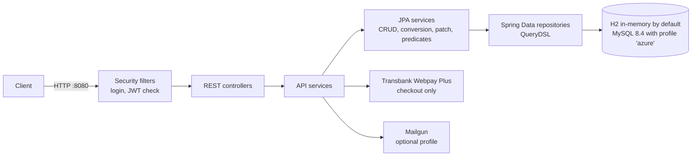

# Trébol backend: application analysis

This document is the analysis deliverable of the POC (Requirement 1). It describes the application as found,
how to build and run it, its dependencies and configuration, the changes made to prepare it for containers and
Azure, and the assumptions and limitations. Everything below was verified on 11 Nov 2026 against commit
`5c8c93f`. A reviewer should be able to build and run the application from this page alone.

## 1. What the application is

Trébol is an open-source e-commerce **REST API backend** (no frontend). It covers:

- catalog: products, product categories (nested), product lists, images (stored as URLs);
- customers, people, salespeople, shippers, billing types and companies;
- orders and their life cycle (confirmation, rejection, completion), receipts;
- checkout through Transbank **Webpay Plus** (integration/test mode);
- users, roles and permissions, login with JWT, self-registration, own profile.

The API has 67 documented operations on 26 paths (OpenAPI), plus the login endpoint, which is implemented as a
security filter and therefore does not appear in the OpenAPI document.

## 2. Technology stack

| Area | Technology | Version |
|---|---|---|
| Language / runtime | Java | 17 (tested with Temurin 17.0.21) |
| Framework | Spring Boot (Web MVC on Tomcat, Data JPA, Security, Validation, Actuator) | 3.2.9 |
| Persistence | Hibernate (via Spring Data JPA), HikariCP connection pool | managed by Spring Boot |
| Query building | QueryDSL (`Q*` classes generated at build time) | from Spring Boot BOM, `jakarta` classifier |
| Databases | H2 (in-memory, default) / MySQL Connector/J | 2.2.220 / 8.3.0 |
| Schema migrations | Flyway (`flyway-core`, `flyway-mysql`), MySQL only | 9.22.3 |
| Security | Spring Security, JJWT (JSON Web Tokens), BCrypt | JJWT 0.11.5 |
| Payments | Transbank SDK Java (Webpay Plus), Unirest HTTP client | 3.0.2 / 3.13.8 |
| API docs | springdoc-openapi (Swagger UI) | 2.6.0 |
| Boilerplate | Lombok (annotation processor) | from Spring Boot BOM |
| Build / quality | Maven, JUnit 5, Mockito, JaCoCo (coverage gate) | JaCoCo 0.8.8 |

## 3. Code structure

Maven project in `trebol-backend-monolith/` (not the repository root). Main class: **`org.trebol.BackendApp`**.
Packaging: **executable WAR** (`java -jar` works; no external servlet container needed). Port **8080**.

| Package (`org.trebol.`) | Files | Role |
|---|---|---|
| `api.controllers` | 21 | REST endpoints (`/public/*`, `/account/*`, `/access`, `/data/*`) |
| `api.services`, `api.models` | 14, 24 | API-level services (registration, profile, checkout, receipts) and JSON models |
| `jpa.entities`, `jpa.repositories` | 22, 22 | 22 JPA entities and their Spring Data repositories |
| `jpa.services` | 127 | Generic CRUD, entity/model conversion, patching, QueryDSL predicates |
| `security` | 13 | Login and JWT filters, user details, permissions |
| `config` | 10 | Security, CORS, JWT key, validation and API properties |
| `payment`, `mailing` | 4, 5 | Webpay Plus integration; optional Mailgun e-mails |
| `common` | 8 | Shared annotations, converters, exceptions |



Size: 294 main and 118 test source files.

## 4. Build from source

Prerequisites: **JDK 17**, **Maven 3.9 or newer** (tested with 3.10.0), Git. Optional: Docker (for MySQL),
bash and curl (for the smoke test; on Windows, Git Bash).

```bash
cd trebol-backend-monolith
mvn -B clean verify
```

What the build does:

1. Generates the QueryDSL `Q*` classes into `target/generated-sources/querydsl/`.
2. Compiles with the Lombok annotation processor.
3. Runs **372 tests** (0 failures expected; 2 tests tagged `external` are skipped, see section 11).
4. Enforces the JaCoCo coverage gate (minimum 20%). Current coverage: **84.7% lines, 72.0% branches**
   (JPA entities and API models are excluded from the measurement).
5. Packages `target/trebol-backend-monolith-java17-0.2.5-SNAPSHOT.war` (about 69 MB).

Duration: about 2 to 2.5 minutes on a laptop with a warm Maven cache.

Troubleshooting:

- IDE shows missing `Q*` classes: run `mvn clean generate-sources` once; the IDE also needs Lombok support.
- Dependency downloads stall on some networks: download one at a time with
  `-Daether.dependencyCollector.bf.threads=1 -Daether.connector.basic.threads=1`.
- Windows: build outside folders synchronised by OneDrive or similar tools (sync can lock files under
  `target/`, and deep paths there can exceed 260 characters). In PowerShell, quote `-D` arguments
  (`"-Dname=value"`).

## 5. Run locally (default profile, H2)

```bash
java -jar target/trebol-backend-monolith-java17-0.2.5-SNAPSHOT.war
```

The application is ready in about 15 to 25 seconds, with an in-memory H2 database created from the JPA entities
and filled from `data.sql` (reference data, demo accounts; no products). Data is lost on every restart.

| URL | Purpose |
|---|---|
| `GET /public/about` | Store information (returns "Trébol Demo") |
| `/swagger-ui/index.html` | Swagger UI |
| `/v3/api-docs` | OpenAPI document |
| `GET /actuator/health/liveness`, `/actuator/health/readiness` | Probes (`{"status":"UP"}`) |
| `POST /public/login` | Login (not in Swagger) |

Login: `POST /public/login` with `{"name":"admin","password":"admin"}`. The token is returned in the
**`Authorization` response header** (value `Bearer <jwt>`), not in the body; send that value back in the
`Authorization` request header. The seeded demo accounts have well-known passwords (for example
`admin`/`admin`): acceptable locally, never in a shared environment.

Smoke test (from the repository root, against any running instance):

```bash
bash test-endpoints.sh                    # default http://localhost:8080
bash test-endpoints.sh https://my-app-url
```

45 checks: public endpoints, login, registration and profile, permissions (403 cases), reference data,
product categories, product CRUD, product lists (read, add, replace, remove) and shippers. It expects the seeded
`admin`/`admin` account and removes most of its own data (one test category and one test customer remain per run).

## 6. Run against MySQL locally (profile `azure`)

The cloud configuration can be exercised on a laptop with a throwaway MySQL 8.4 container:

```bash
docker run -d --name trebol-mysql -e MYSQL_ROOT_PASSWORD=localdev -e MYSQL_DATABASE=trebol \
  -e MYSQL_USER=trebol -e MYSQL_PASSWORD=localdev -p 3306:3306 mysql:8.4
```

bash:

```bash
SPRING_PROFILES_ACTIVE=azure \
SPRING_DATASOURCE_URL='jdbc:mysql://localhost:3306/trebol' \
SPRING_DATASOURCE_USERNAME=trebol SPRING_DATASOURCE_PASSWORD=localdev \
TREBOL_SECURITY_JWTSECRETKEY='local-dev-only-secret-at-least-32-bytes-long!!' \
java -jar target/trebol-backend-monolith-java17-0.2.5-SNAPSHOT.war
```

PowerShell:

```powershell
$env:SPRING_PROFILES_ACTIVE = "azure"
$env:SPRING_DATASOURCE_URL = "jdbc:mysql://localhost:3306/trebol"
$env:SPRING_DATASOURCE_USERNAME = "trebol"
$env:SPRING_DATASOURCE_PASSWORD = "localdev"
$env:TREBOL_SECURITY_JWTSECRETKEY = "local-dev-only-secret-at-least-32-bytes-long!!"
java -jar target\trebol-backend-monolith-java17-0.2.5-SNAPSHOT.war
```

These values are for the local container only. On first start Flyway creates the schema (V1) and the seed data
(V2), Hibernate validates the tables against the entities, and the application is ready in about 25 to 30
seconds. The smoke test passes 45/45 against this setup. Remove the container with `docker rm -f trebol-mysql`.

## 7. Configuration

Settings come from three layers; a higher layer overrides a lower one:

1. **Environment variables** (highest). In Azure they are set by Container Apps, with secrets read from Key Vault.
2. `application-azure.properties`, only when `SPRING_PROFILES_ACTIVE=azure`. Holds no secret values.
3. `application.properties`, the base file with local defaults (H2).

Spring maps environment variables to properties by name: upper case, dots become underscores, dashes are
dropped (`SPRING_DATASOURCE_URL` sets `spring.datasource.url`).

| Environment variable | Default (base file) | Profile `azure` |
|---|---|---|
| `SPRING_PROFILES_ACTIVE` | none (H2) | `azure` |
| `SPRING_DATASOURCE_URL` | `jdbc:h2:mem:test` | **required**, e.g. `jdbc:mysql://host:3306/trebol` |
| `SPRING_DATASOURCE_USERNAME`, `SPRING_DATASOURCE_PASSWORD` | H2 demo values | **required** (password from Key Vault) |
| `TREBOL_SECURITY_JWTSECRETKEY` | public placeholder (local only) | **required**, at least 32 bytes, identical on every replica (Key Vault) |
| `SPRING_DATASOURCE_HIKARI_MAXIMUMPOOLSIZE` | 10 (HikariCP default) | 15 per replica |
| `TREBOL_SECURITY_BCRYPTENCODERSTRENGTH` | 10 | 10 |
| `TREBOL_CORS_ALLOWEDORIGINS` | `localhost:4200` origins | set per environment |
| `TREBOL_PAYMENT_WEBPAYPLUS_CALLBACKURL` | `http://localhost:8080/public/checkout/validate` | public URL of the API |
| `TREBOL_PAYMENT_WEBPAYPLUS_BROWSERREDIRECTIONURL` | `http://localhost:4200/store/receipt` | frontend URL, if any |

Missing configuration stops the application instead of changing its behaviour (both cases verified):

- Profile `azure` without `SPRING_DATASOURCE_URL`: startup fails with
  `Driver com.mysql.cj.jdbc.Driver claims to not accept jdbcUrl, ${SPRING_DATASOURCE_URL}`. The MySQL driver is
  pinned in the profile, so the application can never fall back to the embedded H2 database.
- Profile `azure` without `TREBOL_SECURITY_JWTSECRETKEY`: startup fails with `jwtSecretKey ... must not be blank`.
  The public placeholder key from the base file is never used.

Other behaviour set in the base file (identical locally and in the cloud): `server.shutdown=graceful` with a 30 s
limit, `spring.jpa.open-in-view=false`, `data.sql` read as UTF-8, and only the Actuator `health` endpoint exposed.

## 8. External dependencies

| Dependency | Needed for | Notes |
|---|---|---|
| Database | Everything | H2 in-memory by default; MySQL 8.4 with profile `azure` (Azure Database for MySQL Flexible Server in the cloud) |
| Transbank Webpay Plus | Checkout only | Integration (test) mode with Transbank's public test credentials; no call at startup. Some networks receive HTTP 403 from Transbank's firewall |
| Mailgun | Optional e-mails | Only with Spring profile `mailgun` (template: `application-mailgun.empty.properties`); disabled in this POC |
| Images | Product images | Stored as URLs in the database, never as files (no local storage needed) |

## 9. Database and schema management

| | Default (H2) | Profile `azure` (MySQL 8.4) |
|---|---|---|
| Tables created by | Hibernate (`ddl-auto=create-drop`) from the entities | Flyway `db/migration/V1__schema.sql` (22 tables) |
| Seed data | `data.sql` (Spring SQL init, UTF-8) | Flyway `V2__seed.sql` (the same rows without 7 H2-only statements) |
| Hibernate at startup | creates and drops the schema | `ddl-auto=validate`: refuses to start if entities and tables differ |
| Connection pool | HikariCP default (10) | 15 per replica |

All entity ids use `GenerationType.IDENTITY` (MySQL `AUTO_INCREMENT`). Flyway records a checksum of every applied
migration; an applied migration must never be edited. Schema changes go into a new `V<n>__<description>.sql`.

## 10. Security model

- **Stateless JWT.** No HTTP session (`SessionCreationPolicy.STATELESS`). The token carries the user's
  authorities, so authenticated requests are authorised without a database lookup. Tokens expire after 30 minutes.
- **Login** is a Spring Security filter on `POST /public/login`; passwords are hashed with BCrypt (strength 10).
- **Authorisation** is declared per controller method (`@PreAuthorize`, 61 uses). Endpoints without it are public
  (for example catalog reads, `/public/about`, registration). For the same reason only the Actuator `health`
  endpoint is exposed, with component details hidden.
- **Probes:** liveness does not check the database (a database outage must not restart replicas); readiness
  includes the database (a replica without database access stops receiving traffic).
- **CORS** is limited to the configured origins. The optional guest account is disabled; account id 1 is protected
  from deletion.

## 11. Tests and quality gates

| Check | Scope | Result (11 Nov 2026) |
|---|---|---|
| Unit and integration tests (`mvn verify`) | 372 tests, JUnit 5 + Mockito; 2 test classes start the full Spring context on H2 (`BackendAppTest`, `ActuatorEndpointsTest`) | 372 passed |
| Transbank tests, tag `external` | Call Transbank's public test API | Skipped by default; run with `mvn -B verify -Dtrebol.tests.excludedGroups=` |
| JaCoCo coverage gate | Minimum 20% | 84.7% lines, 72.0% branches |
| Smoke test `test-endpoints.sh` | 45 HTTP checks against a running instance | 45/45 on H2 and on MySQL 8.4 |

Not covered by any automated test: the receipt endpoint end to end (it needs a completed Transbank checkout).

## 12. Changes made in Phase 1

All changes are small, separate commits; the default H2 setup and all tests stay green after each one.

| Commit | Change | Why |
|---|---|---|
| `c7a98f3` | Ignore rules; shell scripts forced to LF | `application-azure.properties` must be tracked; scripts must run in Linux containers |
| `08b060a` | Transbank network tests tagged `external` and skipped by default | They depend on a third-party service that some networks block |
| `239c84b` | Actuator health probes (liveness, readiness with database); only `health` exposed | The container platform needs probes; other Actuator endpoints would be public |
| `8c7b395` | MySQL Connector/J replaces the unused MariaDB driver | The cloud database is MySQL |
| `5ca5f74` | Flyway migrations V1 (schema) and V2 (seed) for MySQL | Versioned, repeatable schema; fixed a foreign key that referenced a non-existent table `sales` (every checkout would have failed on MySQL) |
| `c864030` | `application-azure.properties` (MySQL from environment variables, Flyway on, Hibernate validate, pool 15) | One image for every environment; missing settings stop startup |
| `21dde73` | Registration runs in one transaction | Person, user and customer are created together or not at all |
| `34f047c` | `open-in-view` disabled; transactions added where lazy relations are read | Database connections are released when the work is done, not at the end of the HTTP response |
| `f9726f6` | Graceful shutdown (30 s) | Requests in progress complete during scale-in and deployments |
| `ff233e2` | Smoke test extended to product lists (45 checks) | Covers the code paths changed by `34f047c` |
| `5c8c93f` | `data.sql` read as UTF-8 | Accented text was stored garbled on Windows |

## 13. Findings that shape the cloud design

1. **Statelessness.** An in-memory H2 database per replica would give every replica different data, so the cloud
   uses one managed MySQL database. Everything else is already stateless: JWT instead of sessions, images as URLs,
   no local files.
2. **One JWT signing key for all replicas**, stored in Key Vault; otherwise a token issued by one replica is
   rejected by another.
3. **Login is CPU-bound** (BCrypt, tens of milliseconds per login) and builds a new JSON `ObjectMapper` per request.
   Autoscaling must react to CPU, and load scripts should log in once per virtual user and reuse the token.
4. **Catalog reads** load each product's category separately (N+1 queries) and accept page sizes up to 1000:
   candidates for the performance phase (fetch joins, page-size cap, short-lived cache).
5. **Connection budget:** replicas × 15 connections must stay below the database's connection limit; this drives
   the database tier during the load test.
6. **Startup takes about 15 to 30 seconds**, so the startup probe must allow it and enough replicas must be running
   before load arrives.
7. **Schema changes must run against a real MySQL** before they are trusted: the broken foreign key was invisible
   in the original dump because it disabled foreign key checks.
8. **Dependency age:** Spring Boot 3.2.x is past open-source support, and Flyway 9.22.3 logs that MySQL 8.4 is
   untested (it works). Upgrades will be driven by the container image vulnerability scan.

## 14. Assumptions

- A managed MySQL 8.4 database replaces H2 in the cloud and is shared by all replicas.
- Payments stay in Transbank integration (test) mode; checkout is excluded from load tests so that no load reaches
  Transbank.
- E-mail (Mailgun) stays disabled.
- The default Azure HTTPS URL is sufficient (no custom domain).
- The evaluators' load profile (endpoints, think time, ramp-up) is not yet known; the design is sized for a
  read-heavy mix with logins reused per virtual user.

## 15. Limitations and known gaps

- API only: there is no frontend, so CORS origins and the payment redirect URL have no real frontend to point to.
- The receipt endpoint is verified by code review only (see section 11).
- The seed data has no products; a load-test data set is planned as a separate migration.
- Locally H2 is built by Hibernate while MySQL is built by Flyway; drift between them is caught by
  `ddl-auto=validate` when the application starts on MySQL, and should also be checked in CI.
- The login endpoint rejects unknown JSON fields (its parser does not use the application's JSON settings).
- `README.md` from the upstream project is partly outdated (it mentions Spring Boot 2.6 and MariaDB).
