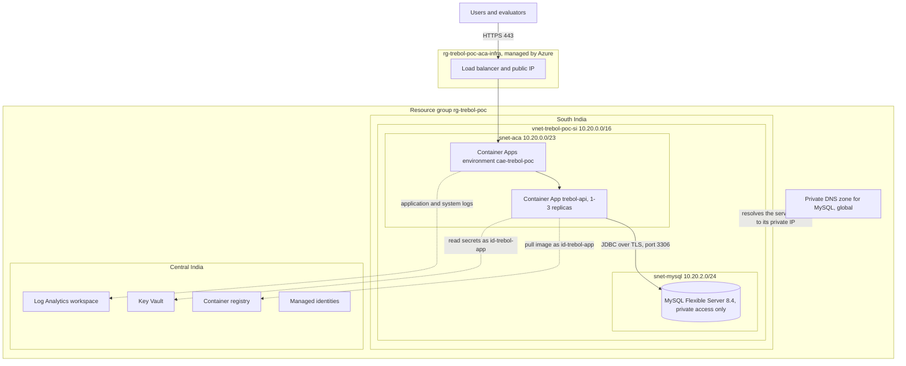

# Trébol backend: Azure infrastructure

This document is the cloud deployment deliverable of the POC (Requirement 4) and covers the infrastructure as code
(bonus). It describes what runs in Azure, why each service was chosen, how the private network, identities and
secrets are set up, how to deploy everything from the Bicep templates, what was verified, what it costs, and the
known limitations. Everything below was verified on 13 Nov 2026 with the templates of commit `3a86198` and the image
`trebol-api:a7ffb87`. The CI/CD pipeline (Requirement 3) will deploy new images to this infrastructure with the same
templates; until it exists, the deployments were run by the engineer, one reviewed change at a time.

## 1. Requirement checklist

| Requirement | How it is met | Evidence |
|---|---|---|
| Managed container platform | Azure Container Apps, serverless Consumption profile | Revision Running and Healthy |
| Live on a public HTTPS URL | External ingress with an Azure-managed certificate; plain HTTP is redirected (301) | Smoke test 45/45 over HTTPS (section 9) |
| Secrets in a vault | Database password, JWT signing key and admin password live only in Key Vault. The app reads them through Key Vault references with its managed identity; the deployment passes the MySQL password to Azure Resource Manager as a Key Vault reference | No secret in the repository, the image, the templates or any command line |
| Least-privilege identities | Two user-assigned managed identities: the pipeline (Contributor on the resource group, cannot assign roles) and the app (image pull and secret read only). Role assignments are made by the subscription administrator | Section 5 |
| Deploy via pipeline | Templates and parameters are ready for it; the GitHub Actions pipeline (OIDC login, no stored Azure secret) is the next phase | In progress |
| Infrastructure as code (bonus) | Every resource is defined in Bicep; deployments are incremental and previewed with what-if first | `infra/` |

## 2. Architecture



**Two regions.** The resource group and the shared services (registry, Key Vault, Log Analytics, identities) are in
Central India. The network, MySQL and Container Apps are in South India: Azure Database for MySQL Flexible Server is
not available to this subscription in Central India (section 11). A virtual network belongs to one region, and both
MySQL (private access) and the Container Apps environment sit inside it, so these three must share a region. The
shared services are reached through their Azure endpoints from any region and stay where they are.

**Path of a request.** Client, public IP of the environment, Azure's load balancer and HTTPS front end (TLS ends
here), a replica of `trebol-api` in `snet-aca` (plain HTTP on port 8080 inside the private network), MySQL at a
private address in `snet-mysql`. Only the front end is reachable from the internet; MySQL has no public endpoint.

## 3. Resources

All resources carry the tags `project`, `owner`, `environment` and `Practice` (the last one is required by an Azure
Policy of the organisation). Names that must be unique across Azure carry the fixed suffix `ttuu`, chosen once so the
names stay stable if the resource group moves to another subscription; `-si` marks South India.

| Resource | Name | Region | Configuration | Why | Alternative considered |
|---|---|---|---|---|---|
| Cost budget | `budget-trebol-poc` | - | 4,000 INR for 1 Nov 2026 - 31 Oct 2027 as one annual period (the project total); e-mail alerts at 50, 80 and 100% of actual cost and at 100% of forecast cost | Cost guardrail; the amount is in the billing currency (INR) and stays below 50 USD | Monthly budget, which would allow the full amount again every month |
| Log Analytics workspace | `log-trebol-poc` | Central India | Pay per GB, 30 days retention, daily ingestion cap 0.1 GB | Central store for container and platform logs; the cap protects the budget (raised temporarily for the evaluation) | Higher cap from the start |
| Virtual network | `vnet-trebol-poc-si` | South India | 10.20.0.0/16; `snet-aca` 10.20.0.0/23 delegated to Container Apps; `snet-mysql` 10.20.2.0/24 delegated to MySQL; subnets declared inside the network resource | Private path from the app to the database. /23 leaves room for 25 replicas with two revisions side by side and cannot be resized once in use | Public MySQL endpoint with a firewall |
| Private DNS zone | `trebol-poc.private.mysql.database.azure.com` | global | Linked to the network, automatic registration off | Resolves the MySQL server name to its private address, only inside linked networks | Zone created implicitly by Azure (less control over its name and lifecycle) |
| Managed identities | `id-trebol-github`, `id-trebol-app` | Central India | User-assigned | No passwords; separate privileges for the pipeline and for the running app | Service principal with a client secret |
| Container registry | `acrtrebolpocttuu` | Central India | Basic, admin user off | Images pulled with the app identity; no shared registry password exists | GitHub Container Registry |
| Key Vault | `kv-trebol-poc-ttuu` | Central India | Standard, role-based access (RBAC), soft delete 7 days, purge protection, enabled for template deployment | Secrets outside code, images and pipeline; access managed like any other Azure permission | Container Apps secrets holding the values themselves |
| MySQL Flexible Server | `mysql-trebol-poc-si-ttuu` | South India | MySQL 8.4 (8.4.11), Burstable B1ms (1 vCore, 2 GiB), 20 GB storage with auto-grow off, backups 7 days (locally redundant), no high availability, public access disabled; database `trebol`, utf8mb4 | Managed MySQL compatible with the existing schema and Flyway migrations; one shared database keeps the replicas stateless. B1ms for development, scaled up for the evaluation | Azure SQL Database (schema rewrite); MySQL in a container (not managed) |
| Container Apps environment | `cae-trebol-poc` | South India | Workload profiles environment with the Consumption profile only, in `snet-aca`, external ingress, logs to Log Analytics | Serverless containers with HTTPS, load balancing, autoscaling and revisions built in; no fixed charge | Azure Kubernetes Service (planned as phase 2) |
| Container App | `trebol-api` | South India | 1 vCPU / 2 GiB, 1-3 replicas (development limits), single revision mode, identity `id-trebol-app` | The API itself (details in sections 6 and 7) | - |

Azure also creates the resource group `rg-trebol-poc-aca-infra` for the environment, holding a load balancer and a
public IP. Azure owns and protects its contents (they are removed with the environment); the platform applied the
environment's tags to them, so the tag policy did not block the deployment.

## 4. Network

- **Private access for MySQL.** The server is injected into the delegated subnet `snet-mysql` and received the
  address 10.20.2.4; it has no public endpoint. Its name `mysql-trebol-poc-si-ttuu.mysql.database.azure.com` points
  into the private DNS zone, which holds the A record for that address and answers only inside linked networks.
  The server can therefore not be reached from a laptop, only from inside the network.
- **Container Apps in the network.** The environment uses `snet-aca` (delegated to `Microsoft.App/environments`).
  Its replicas reach MySQL directly over the private network; inbound traffic arrives only through the environment's
  public front end.
- **Encryption in transit.** HTTPS from clients to the front end (Azure-managed certificate for
  `*.azurecontainerapps.io`, HTTP redirected); TLS between the app and MySQL (`sslMode=REQUIRED`; the server refuses
  unencrypted connections).
- **Outbound to shared services.** Image pulls, secret reads and logs go from South India to the Central India
  services over their Azure endpoints. A Key Vault network restriction and network security groups are planned
  (section 12).

## 5. Identities, roles and secrets

| Identity | Role | Scope | Purpose |
|---|---|---|---|
| `id-trebol-github` (pipeline) | Contributor | `rg-trebol-poc` | Push images and deploy; cannot create role assignments |
| `id-trebol-app` (running app) | AcrPull | `rg-trebol-poc` | Pull the image |
| `id-trebol-app` (running app) | Key Vault Secrets User | `rg-trebol-poc` | Read secrets (read only) |
| Engineer | Key Vault Secrets Officer | `rg-trebol-poc` | Create and rotate secrets |

The resource group holds exactly one registry and one vault, so resource-group scope grants no more than
per-resource scope would. Neither the engineer nor the pipeline may assign roles: `infra/roles.bicep` holds the four
assignments and is run once by the subscription administrator (the role definition ids are the built-in ones).

| Secret (Key Vault name) | Created by | Used by | How it is used |
|---|---|---|---|
| `mysql-admin-password` | Engineer (cryptographic random generator, written from a temporary file that is deleted at once) | MySQL server, app | Deployment: the parameter file references it (`az.getSecret`), Azure Resource Manager reads it from the vault, so it never appears in a shell, file or the deployment history. App: Key Vault reference, exposed as `SPRING_DATASOURCE_PASSWORD` |
| `jwt-secret-key` | Engineer (64 random bytes) | App | Key Vault reference, exposed as `TREBOL_SECURITY_JWTSECRETKEY`; the same key on every replica keeps tokens valid across replicas |
| `app-admin-password` | Engineer, through a script that stores it before applying it | People and the smoke test | The cloud password of the API's `admin` account (see below) |

Key Vault references use versionless secret URLs: Container Apps picks up a new version within about 30 minutes or
at the next restart.

**Seeded demo accounts.** The database seed (`V2__seed.sql`, public in this repository) creates `admin`, `manager`,
`salesperson` and `customer` with known passwords. Right after the first deployment every account in the cloud
database received a new password through the API (`PUT /data/users`): the new admin password was stored in Key Vault
first, the other accounts got random passwords that are not kept (an administrator can reset them). Afterwards all
four seeded logins return 401. The smoke script reads the admin password from the `ADMIN_PASSWORD` environment
variable (default `admin` for local runs).

**Other measures carried over from the image and the application:** non-root container user, Trivy gate of 0
critical vulnerabilities before an image is pushed, only the Actuator `health` endpoints exposed (`env`, `heapdump`
and the rest return 404), stateless JWT authentication with BCrypt password hashing.

## 6. Application configuration in Azure

The container receives exactly the variables tested locally against MySQL (see
[01-analysis.md, section 7](01-analysis.md#7-configuration)):

| Variable | Value or source |
|---|---|
| `SPRING_PROFILES_ACTIVE` | `azure` (MySQL, Flyway, Hibernate `validate`) |
| `SPRING_DATASOURCE_URL` | `jdbc:mysql://mysql-trebol-poc-si-ttuu.mysql.database.azure.com:3306/trebol?sslMode=REQUIRED` |
| `SPRING_DATASOURCE_USERNAME` | `trebol_admin` (the server administrator for now; a restricted user is planned) |
| `SPRING_DATASOURCE_PASSWORD` | Key Vault reference `mysql-admin-password` |
| `TREBOL_SECURITY_JWTSECRETKEY` | Key Vault reference `jwt-secret-key` |

On its first start the app ran the Flyway migrations V1 (schema) and V2 (seed) against the empty `trebol` database
(2.1 s); Hibernate then validated the schema against the entities.

## 7. Health probes, scaling and shutdown (current settings)

| Setting | Value | Why |
|---|---|---|
| Startup probe | `/actuator/health/liveness`, after 30 s, every 10 s, 10 failures allowed (up to 130 s) | The app needs 13-45 s to start depending on the CPU; liveness and readiness start only after it succeeds |
| Liveness probe | `/actuator/health/liveness`, every 10 s, 3 failures | Restarts a stuck container; deliberately without a database check, so a database outage does not restart every replica |
| Readiness probe | `/actuator/health/readiness` (includes the database), every 5 s, 3 failures | A replica that cannot reach MySQL receives no traffic |
| Replicas | min 1, max 3 | Development limits; the scaling phase sets min 2 (high availability) and raises the maximum for the evaluation |
| Scale rule | HTTP, 100 concurrent requests per replica | Adds replicas under load; a CPU rule follows in the scaling phase |
| Termination grace period | 40 s | Longer than the application's graceful shutdown (30 s), so in-flight requests finish before the container stops |
| Revision mode | Single | Each deployment replaces the running revision; multiple revisions (canary and rollback) come with the pipeline |

## 8. Deploying

**Prerequisites.** Azure CLI with Bicep (verified with Azure CLI 2.90.0 and Bicep 0.49.2), Docker, Contributor on
the resource group, Key Vault Secrets Officer for whoever stores the secrets, the four role assignments of
`infra/roles.bicep`, and the resource providers `Microsoft.App`, `Microsoft.ContainerRegistry`,
`Microsoft.KeyVault`, `Microsoft.DBforMySQL`, `Microsoft.OperationalInsights`, `Microsoft.Network` and
`Microsoft.ManagedIdentity` registered.

**Private values** are not in the repository. The parameter file reads them from environment variables of the shell
that runs the deployment (PowerShell shown; the subscription id goes into `$sub`):

```powershell
$sub = 'subscription id'
$env:TREBOL_OWNER_TAG       = 'value of the owner tag'
$env:TREBOL_BUDGET_EMAIL    = 'address that receives the budget alerts'
$env:TREBOL_SUBSCRIPTION_ID = $sub   # used to locate the Key Vault secret
```

**Preview, then deploy** (always incremental: resources not in the template are never removed):

```powershell
az deployment group what-if --subscription $sub --resource-group rg-trebol-poc --parameters infra/main.bicepparam
az deployment group create  --subscription $sub --resource-group rg-trebol-poc --name a-descriptive-name `
  --mode Incremental --parameters infra/main.bicepparam
```

**Order in a new subscription.** The templates grew in five stages in this project (budget and logs; network;
identities, registry and Key Vault; MySQL; Container Apps), and two things must exist before the full template can
run: the MySQL password in Key Vault (the parameter file reads it at deployment time) and the image in the registry
(the first revision pulls it). On a new subscription:

1. Create the resource group with the four tags.
2. Deploy the shared services first (identities, registry, Key Vault); the administrator then runs
   `infra/roles.bicep` with the identities' principal ids.
3. Store `mysql-admin-password` and `jwt-secret-key` in Key Vault, for example from a file in a plain folder:
   `az keyvault secret set --subscription $sub --vault-name kv-trebol-poc-ttuu --name jwt-secret-key --file C:\work\secret-tmp\value.txt --encoding utf-8 --output none`,
   then delete the file.
4. Build, scan and push the image (see [02-container.md](02-container.md)), with the git commit as the tag:
   `az acr login --subscription $sub --name acrtrebolpocttuu`, then
   `docker push acrtrebolpocttuu.azurecr.io/trebol-api:TAG`.
5. Deploy `infra/main.bicepparam` as above (about 6 minutes each for MySQL and for the Container Apps environment).
6. Change the seeded passwords (section 5) and run the smoke test against the `appUrl` output:
   `ADMIN_PASSWORD=... bash test-endpoints.sh https://APP-URL`.

Step 2 currently means deploying the module templates on their own; a parameter to deploy only the shared services
from `main.bicep` is planned (section 12).

## 9. Verification (13 Nov 2026)

| Check | Result |
|---|---|
| Lint, validate, what-if before every deployment | Clean; what-if listed only the intended creations plus known noise (section 11) |
| Deployments | Network and MySQL: Succeeded in 6 min 24 s. Container Apps environment and app: Succeeded in 6 min 22 s |
| MySQL server | Ready, 8.4.11, B1ms, public access disabled, private DNS A record to 10.20.2.4, database utf8mb4 |
| Revision `trebol-api--te8o43o` | Running, Healthy, 1 replica, 100% of the traffic |
| Startup log | Profile `azure`, TLS connection to MySQL, Flyway V1 and V2 applied, **started in 12.7 s** (about 42 s on a laptop limited to 1 CPU) |
| HTTPS endpoints | `/actuator/health`, `/liveness`, `/readiness` and `/public/about`: 200, status UP, data read from MySQL |
| Hardening checks | HTTP answered with 301 to HTTPS; `/actuator/env` and `/actuator/heapdump`: 404 |
| Smoke test (`test-endpoints.sh`, 45 checks: login, registration, permissions, product CRUD, product lists) | **45/45** against the public URL, before and after the password change (the second run with the admin password from Key Vault) |
| Seeded logins after the password change | `admin`, `manager`, `salesperson`, `customer`: 401 |
| Image scan before the push | Trivy: 0 critical (2 accepted findings, see 02-container.md); 2 high, both the disputed QueryDSL CVE-2024-49203 |

## 10. Cost

List prices in USD for the regions used (13 Nov 2026). Stoppable resources run only on weekdays 14:00-22:00 IST
(8 hours); MySQL is stopped and the app scaled to zero outside that window.

| Resource | Billed by | Price | Development estimate |
|---|---|---|---|
| Container App (1 replica, 1 vCPU / 2 GiB) | Second of use | Active: 0.000024 per vCPU-second + 0.000003 per GiB-second (about 0.11 per hour); idle: about 0.03 per hour | 0.26-0.86 per working day |
| Container Apps environment | - | No charge with the Consumption profile only | 0 |
| MySQL B1ms compute | Running hour | 0.0245 per hour | About 0.20 per working day |
| MySQL storage, 20 GB | Month, also when stopped | 0.131 per GB-month | About 2.60 per month |
| Container registry, Basic | Day | About 0.167 per day | About 5 per month |
| Private DNS zone | Month | About 0.50 per month | 0.50 per month |
| Key Vault | Operations | Fractions of a cent per 10,000 operations | Below 0.10 per month |
| Log Analytics | GB ingested | Capped at 0.1 GB per day | Within the monthly free allowance in practice |
| Virtual network | - | Free | 0 |
| Load balancer and public IP of the environment | Managed by Azure | Being confirmed in Cost Management | - |
| Data transfer South India - Central India | GB | Image pulls (about 140 MB each), secret reads, logs | Well below 1 per month |

**Cost controls.** The budget alerts (50%, 80%, 100% actual, 100% forecast); the working-hours schedule (manual for
now, automated by a scheduled workflow later); the development limits (1 vCPU / 2 GiB, at most 3 replicas); the
Log Analytics daily cap; the `project` tag for cost reports. The full-scale evaluation (larger database tier, more
replicas) is planned separately within the 50 USD project total.

## 11. Incidents and decisions during the deployment

1. **MySQL not available in Central India.** The first MySQL deployment failed with
   `ProvisionNotSupportedForRegion`. Validate and what-if cannot detect this: they check templates, permissions and
   policies, not whether the service will provision for this subscription. The early warning was the MySQL
   capability API, which returned an empty list for Central India. A read-only check of other regions showed the
   same restriction in East US, East US 2 and Central US, and availability in South India, Southeast Asia, UAE North
   and West US 2. **South India** was chosen: same list prices as the original plan and closest to the users and
   evaluators (West US 2 has cheaper MySQL but 42% dearer Container Apps compute and about 250 ms more latency from
   India). A network cannot change region, so a new network was created there; the first one (Central India) is no
   longer used and is left for the engineer to remove.
2. **Server name held by the failed attempt.** Azure Resource Manager still tied the name of the failed server to
   Central India although the server did not exist (`InvalidResourceLocation`). The South India server therefore has
   its own name (`-si`).
3. **What-if noise.** Properties that Azure fills in with defaults (registry encryption and data endpoint, Key Vault
   network rules, MySQL backup interval, maintenance window and IOPS, network policies) appear as "Delete" because
   the templates do not mention them; redeploying keeps Azure's defaults. An automation of the organisation adds
   `CreatedDate` and `CreatedMonth` tags, which every deployment removes and the automation adds again.
4. **Module wiring.** Validate and what-if skip a module whose inputs are outputs of other modules. Resource ids and
   host names are therefore computed from names (`resourceId()`, the known DNS suffixes) and the order is kept with
   `dependsOn`.
5. **Budget currency.** Budget amounts are in the currency of the billing account, which is INR here; the first
   deployment created a budget of 50 INR, corrected to 4,000 INR.
6. **Startup time.** The app started in 12.7 s in Container Apps, much faster than on the laptop; the startup probe
   keeps its margin for slower starts.

## 12. Known limitations and planned work

| Item | Today | Planned |
|---|---|---|
| Database user | The app connects as the server administrator | A `trebol_app` user with rights on the `trebol` database only, created by a one-off Container Apps job inside the network (the server is not reachable from outside) |
| Network security groups | None on the subnets | `snet-mysql` accepts port 3306 from `snet-aca` only |
| Key Vault network access | Reachable from the internet (every request still needs an Azure role) | Firewall limited to the network and the engineer, or a private endpoint |
| TLS to MySQL | Encrypted, server certificate not verified | `sslMode=VERIFY_IDENTITY` with the Azure certificate authority |
| High availability | Minimum 1 replica during setup | Minimum 2 replicas, CPU scale rule, alerts (scaling and monitoring phase) |
| Releases | Single revision mode, image tag in the parameter file | Pipeline: new revision per commit, smoke test, traffic shift, automatic rollback |
| Working-hours schedule | Stop and start by approved commands | Scheduled GitHub Actions workflow |
| Swagger UI | Public, kept for the demo | Disable in the `azure` profile after the evaluation |
| New subscription | Shared services need a first deployment of their own (section 8) | A parameter to deploy only the shared services from `main.bicep` |
| Two regions | The app depends on services in two regions; small cross-region traffic | Move the shared services to South India if the project continues there |
| Smoke test data | Each run leaves one test customer account | The script deletes it at the end |
| Old network | `vnet-trebol-poc` (Central India) unused | Removed by the engineer (its DNS link first) |
| Flyway warning | Flyway 11.7 reports MySQL 8.4 as untested (works) | Disappears with a newer Flyway (Spring Boot 4) |

## 13. Files

| File | Purpose |
|---|---|
| `infra/main.bicep` | Entry point: parameters, modules, outputs (`appUrl`, `mysqlServerFqdn`, ...) |
| `infra/main.bicepparam` | Values for this project; private values from environment variables; MySQL password as a Key Vault reference |
| `infra/modules/monitoring.bicep` | Log Analytics workspace |
| `infra/modules/budget.bicep` | Cost budget and alerts |
| `infra/modules/network.bicep` | Virtual network, delegated subnets, private DNS zone and link |
| `infra/modules/identities.bicep` | User-assigned managed identities |
| `infra/modules/registry.bicep` | Container registry |
| `infra/modules/keyvault.bicep` | Key Vault |
| `infra/modules/mysql.bicep` | MySQL Flexible Server and the application database |
| `infra/modules/containerapps-env.bicep` | Container Apps environment |
| `infra/modules/containerapp.bicep` | The API container app |
| `infra/roles.bicep` | The four role assignments, run by the subscription administrator only |
| `test-endpoints.sh` | Smoke test (45 checks); `ADMIN_PASSWORD` for the cloud |
